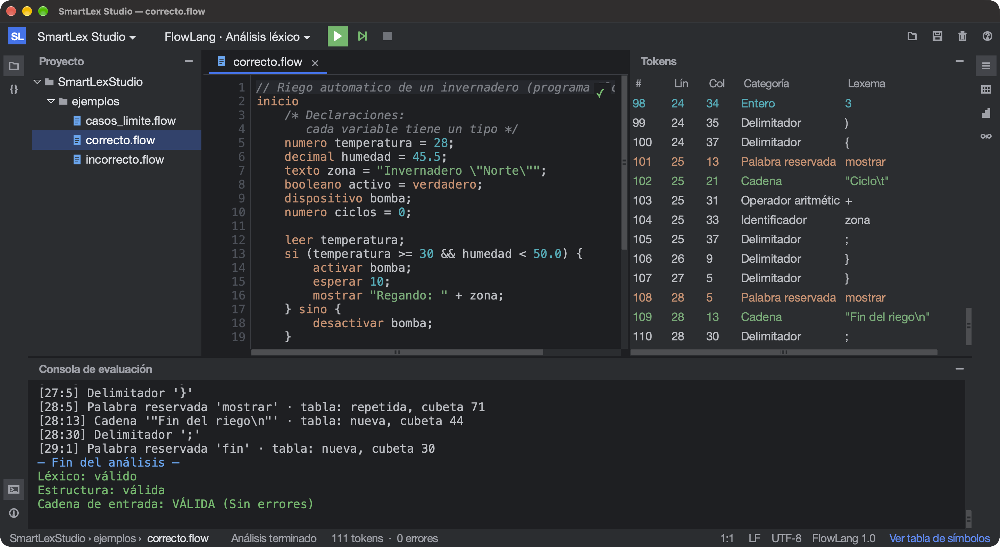

# SmartLex Studio

Analizador léxico educativo con interfaz gráfica tipo IDE para **FlowLang 1.0**, un lenguaje pequeño para describir automatizaciones (riego, luces, alarmas). Reconoce los lexemas con **autómatas finitos deterministas** definidos por tablas de transición, informa los errores léxicos y estructurales, y guarda los símbolos en una **tabla hash propia**.



## Características

- Análisis léxico con cuatro AFD (comentarios, cadenas, números, identificadores) y coincidencia más larga; sin el módulo `re` en producción.
- Reglas del lenguaje como **datos** en `config/reglas.py`: agregar una palabra reservada o un operador es añadir una línea.
- Catálogo de 19 diagnósticos (`LEX-`, `SIN-`, `ARC-`) con mensaje y sugerencia; recuperación en modo pánico (no se detiene en el primer error).
- Comprobación estructural ligera: `inicio`/`fin` y balance de `()` y `{}` con una pila.
- Tabla de símbolos con hash polinomial, encadenamiento, contador de colisiones y redimensionado.
- Interfaz oscura **estilo PyCharm**: barra superior con menús y botones de ejecución, franjas de iconos con *tool windows* que se muestran y ocultan (Proyecto, Lenguaje, Consola, Problemas, Tokens, Tabla de símbolos, Estadísticas, Modo educativo), pestaña de editor con numeración, resaltado y widget de inspección `✗ N ⌃ ⌄`, barra de estado con migas de pan; evaluación **progresiva** (los errores aparecen mientras se analiza), modo **paso a paso**, Modo educativo (regex, recorrido de estados), estadísticas y oferta final de ver la tabla de símbolos.
- Modo consola sin tkinter: `python3 main.py --consola archivo.flow`.

## Requisitos e instalación

- Python 3.10 o superior, solo biblioteca estándar (no hay nada que instalar con `pip`; ver `requirements.txt`).
- tkinter para la interfaz gráfica. Compruébalo con `python3 -c "import tkinter"`. Si falla: macOS `brew install python-tk`; Debian/Ubuntu `sudo apt install python3-tk`; Windows: reinstalar Python con *tcl/tk*. Detalles en [docs/04_manual_usuario.md](docs/04_manual_usuario.md).

## Ejecución

Desde esta carpeta:

```
python3 main.py                                   # interfaz gráfica
python3 main.py --consola ejemplos/correcto.flow  # modo texto
```

(En el equipo de desarrollo se usó `/opt/homebrew/bin/python3.14`, porque el `python3` por defecto no incluye tkinter.)

## Pruebas

```
python3 -m unittest discover -s tests -t . -v
```

Las pruebas de la interfaz se omiten solas si no hay tkinter o pantalla.

## Estructura de carpetas

```
SmartLexStudio/
├── main.py                  Punto de entrada (interfaz o --consola)
├── requirements.txt         Sin dependencias externas
├── config/reglas.py         Reglas de FlowLang como datos
├── core/                    Dominio (sin tkinter)
│   ├── modelos.py  afd.py  errores.py  lexer.py  validador.py  simbolos.py
├── application/             Casos de uso (sin tkinter)
│   ├── archivos.py  analisis_service.py
├── ui/                      Interfaz tkinter
│   ├── estilos.py  iconos.py  editor.py  componentes.py  paneles.py  interfaz.py
├── ejemplos/                correcto.flow, incorrecto.flow, casos_limite.flow
├── tests/                   Pruebas con unittest (test_*.py)
├── docs/                    Documentación y capturas (docs/capturas/)
└── agents/                  tareas.md, decisiones.md, revisiones.md
```

Las dependencias van en un solo sentido: `ui → application → core → config`.

## Mapa de la documentación

| Documento | Contenido |
|---|---|
| `docs/01_investigacion.md` | Investigación previa y comparación de alternativas |
| `docs/02_arquitectura.md` | Capas, diseño de autómatas, tabla hash, UI, puntos de extensión y estado final (§15) |
| `docs/03_especificacion.md` | Definición formal de FlowLang, tablas de los AFD, catálogo de diagnósticos, resultados esperados |
| `docs/04_manual_usuario.md` | Cómo usar la aplicación |
| `docs/05_guia_sustentacion.md` | Cómo explicar cada módulo, preguntas probables y modificaciones ensayadas |
| `docs/06_auditoria.md` | Auditorías de la Fase A y B, hallazgos y evidencia de pruebas |
| `docs/matriz_requisitos.md` | Requisitos del enunciado y dónde se cumple cada uno |
| `agents/tareas.md`, `decisiones.md`, `revisiones.md` | Contrato de tareas, decisiones D-xx y revisiones |

## Créditos

Proyecto desarrollado por un equipo de agentes de IA:

- **architect-fable** (claude-fable-5-2): investigación, especificación, arquitectura, tareas y aprobaciones.
- **developer-sonnet** (claude-sonnet-5-5): implementación de las Fases A y B y documentación de uso.
- **reviewer-opus** (claude-opus-5-5): auditorías y correcciones de las Fases A y B.

## Limitaciones conocidas

- Cuatro mensajes del catálogo repiten un dato de `reglas.py` (máximo de 32 caracteres, extensiones, escapes, 1 MB); si cambias ese dato, actualiza también el texto (D-31).
- El veredicto «válida/inválida» se redacta en tres lugares (`ui/interfaz.py`, `ui/paneles.py`, `main.py`).
- Con Tcl/Tk 8.6, el resaltado posterior a un emoji puede desplazarse; los tokens y posiciones del análisis son correctos (D-34).
- `test_conteos_de_flowlang_1_0` falla a propósito al modificar el lenguaje: hay que actualizar el número esperado (D-32).
- Al editar, el resaltado vuelve a tokenizar todo el texto (≈0,5 s con 5 000 líneas); la animación de archivos muy grandes supera los 3 s previstos por el coste de dibujo de Tk.
- Solo hay una comprobación estructural mínima: no existe analizador sintáctico ni semántico.
