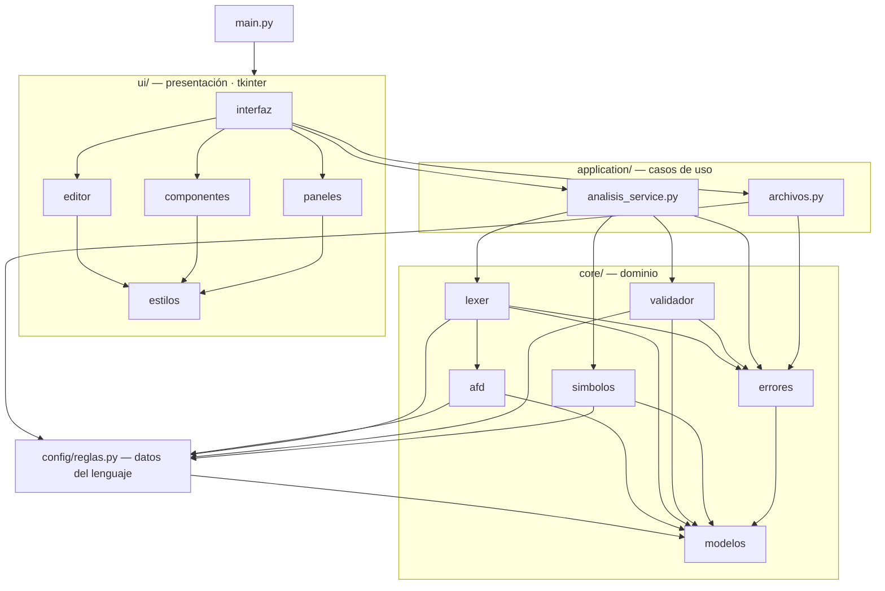
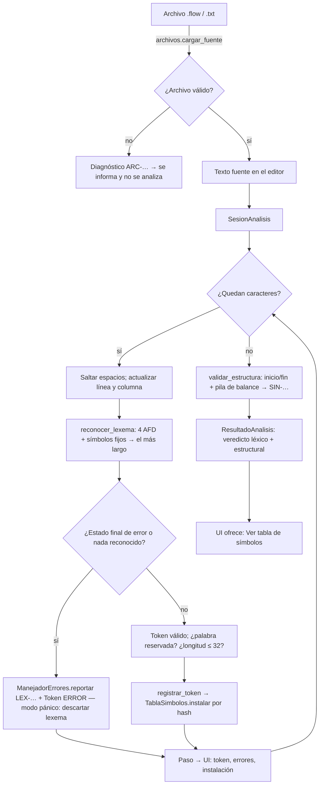

# 02 · Arquitectura — SmartLex Studio

Autor: architect-fable. Lectura previa: `03_especificacion.md` (el lenguaje). Las firmas públicas exactas están en `agents/tareas.md` (contrato de implementación); aquí se explica el **porqué** y el **cómo encajan**.

Principio rector: **complejidad funcional y visual, simplicidad interna.** Cada archivo debe poder explicarse en dos minutos en la sustentación.

---

## 1. Estructura del proyecto

```
SmartLexStudio/
├── main.py                    # Punto de entrada: comprueba tkinter y abre la ventana (o modo consola)
├── requirements.txt           # Solo comentarios: no hay dependencias externas
├── README.md
├── .gitignore
├── config/
│   └── reglas.py              # TODAS las reglas de FlowLang, como DATOS (sin lógica)
├── core/                      # Dominio. Prohibido importar tkinter
│   ├── modelos.py             # TipoToken, Token, Diagnostico, EntradaSimbolo (hoja: no importa nada del proyecto)
│   ├── afd.py                 # Motor genérico de AFD por tabla de transiciones
│   ├── errores.py             # Catálogo de diagnósticos + ManejadorErrores
│   ├── lexer.py               # Analizador léxico (coincidencia más larga sobre los AFD)
│   ├── validador.py           # Comprobaciones estructurales (inicio/fin, balance con pila)
│   └── simbolos.py            # Función hash + TablaSimbolos (hash con encadenamiento)
├── application/               # Casos de uso. Prohibido importar tkinter
│   ├── archivos.py            # Cargar/guardar fuente, validar archivo (ARC-…)
│   └── analisis_service.py    # SesionAnalisis (evaluación progresiva), ResultadoAnalisis, explicar_token
├── ui/                        # Único paquete que importa tkinter
│   ├── estilos.py             # Tema oscuro: colores, fuentes, estilos ttk
│   ├── editor.py              # Editor con números de línea, resaltado y marcas de error
│   ├── componentes.py         # Barra de herramientas, panel lateral, consola, barra de estado
│   ├── paneles.py             # Panel derecho: pestañas Tokens, Tabla, Errores, Estadísticas, Educativo
│   └── interfaz.py            # VentanaPrincipal: arma la ventana y coordina las acciones
├── ejemplos/                  # correcto.flow, incorrecto.flow, casos_limite.flow (ya creados)
├── tests/                     # unittest (biblioteca estándar)
│   ├── test_afd.py  test_lexer.py  test_validador.py  test_simbolos.py
│   ├── test_errores.py  test_archivos.py  test_integracion.py  test_auditoria_fase_a.py  test_ui_humo.py
├── docs/                      # 01_investigacion, 02_arquitectura, 03_especificacion, 04_manual_usuario, 05_guia_sustentacion, 06_auditoria, matriz_requisitos
└── agents/                    # tareas.md, decisiones.md, revisiones.md
```

Cambios respecto a la estructura propuesta inicialmente, y por qué:

| Cambio | Motivo |
|---|---|
| **+ `core/afd.py`** | El motor de autómatas es el concepto central del curso: merece un archivo propio de ~60 líneas que se pueda mostrar solo. |
| **+ `ui/paneles.py`** | Las cinco pestañas en `componentes.py` darían un archivo de más de 500 líneas. Dos archivos de tamaño medio se explican mejor. |
| **+ `tests/test_afd.py`, `test_archivos.py`, `test_ui_humo.py`** | Una prueba por módulo con lógica. |
| `config/reglas.py` **sin mensajes de error** | El catálogo de diagnósticos vive en `core/errores.py`: así «el manejador de errores» (25 pts) es un módulo completo y autocontenido. |
| Cada paquete lleva un `__init__.py` vacío | Necesario para `python -m unittest discover`. |

Total: 14 archivos de código + pruebas. No hay carpetas ni archivos vacíos «por si acaso».

---

## 2. Capas y regla de dependencias



Versión ASCII:

```
main.py ─▶ ui/ ─────────▶ application/ ─────────▶ core/ ─────▶ config/reglas.py ─▶ core/modelos.py
          (tkinter)       (sin tkinter)           (sin tkinter)   (solo datos)        (hoja)
```

**Reglas (verificables con una búsqueda de `import`):**

1. Las dependencias van solo hacia la derecha: `ui → application → core → config`. Nunca al revés.
2. `tkinter` solo se importa dentro de `ui/` y en `main.py`. Lo comprueba la prueba `test_dominio_sin_tkinter`.
3. `ui/` no importa `core.lexer`, `core.validador` ni `core.simbolos` directamente: pide todo a `application/`. Sí puede importar los **tipos** de `core.modelos` (Token, Diagnostico…) y leer **constantes** de `config.reglas` (para mostrar la información del lenguaje).
4. `core/modelos.py` no importa nada del proyecto. `config/reglas.py` solo importa `TipoToken` de `core.modelos` (necesita nombrar las categorías); es la única flecha «hacia arriba» y no crea ciclos.
5. `config/reglas.py` contiene **solo datos** (constantes, diccionarios, tuplas): ni funciones ni clases.

---

## 3. Modelo de datos (`core/modelos.py`)

| Tipo | Clase | Campos | Notas |
|---|---|---|---|
| Categoría de token | `TipoToken(Enum)` | 12 miembros (§2 de la especificación) | El `value` es el nombre para mostrar («Palabra reservada») |
| Tipo de diagnóstico | `TipoDiagnostico(Enum)` | `LEXICO`, `ESTRUCTURAL`, `ARCHIVO` | |
| Token | `Token` — `dataclass(frozen=True)` | `tipo`, `lexema`, `linea`, `columna` | Inmutable. Propiedades `longitud` y `es_significativo` |
| Diagnóstico | `Diagnostico` — `dataclass(frozen=True)` | `codigo`, `tipo`, `titulo`, `mensaje`, `sugerencia`, `linea`, `columna`, `lexema` | Inmutable |
| Entrada de la tabla | `EntradaSimbolo` — `dataclass` | `lexema`, `categoria`, `valor_hash`, `tipo_dato`, `valor`, `linea_declaracion`, `apariciones` | Mutable: acumula apariciones |

Tipos de resultado, definidos junto al módulo que los produce:

| Clase | Módulo | Campos |
|---|---|---|
| `ResultadoAFD` (frozen) | `core/afd.py` | `longitud`, `tipo`, `codigo_error`, `recorrido` |
| `Coincidencia` (frozen) | `core/lexer.py` | `longitud`, `tipo`, `codigo_error`, `reconocedor`, `recorrido` |
| `ResultadoInstalacion` (frozen) | `core/simbolos.py` | `entrada`, `es_nueva`, `hubo_colision`, `indice`, `redimensiono` |
| `EstadisticasTabla` (frozen) | `core/simbolos.py` | `capacidad`, `cantidad`, `factor_carga`, `colisiones`, `cubetas_ocupadas`, `cadena_mas_larga`, `redimensionados` |
| `Paso` (frozen) | `application/analisis_service.py` | `numero`, `fase`, `token`, `diagnosticos`, `instalacion`, `descripcion` |
| `ResultadoAnalisis` | `application/analisis_service.py` | `fuente`, `tokens`, `manejador`, `tabla`, `terminado` + veredictos |
| `ExplicacionToken` (frozen) | `application/analisis_service.py` | `token`, `categoria`, `descripcion`, `regex`, `reconocedor`, `recorrido`, `detalle` |

Los objetos que viajan hacia la UI (Token, Diagnostico, Paso) son inmutables: la interfaz no puede corromper el resultado del análisis.

---

## 4. Relación entre la implementación y la teoría de autómatas

### 4.1 Decisión: AFD explícitos, no `re`
El reconocimiento léxico **no usa el módulo `re`**. Se implementa con:

- un **motor genérico** (`core/afd.py`, clase `AFD`) que ejecuta cualquier autómata descrito como tabla de transiciones, y
- **cuatro tablas** escritas como diccionarios en `config/reglas.py`: `AFD_COMENTARIO`, `AFD_CADENA`, `AFD_NUMERO`, `AFD_IDENTIFICADOR`.

Por qué no `re`: el motor de Python es de **backtracking** (no construye un AFD) y su alternancia `|` elige la **primera** alternativa que coincide, no la más larga. Un lexer basado en `re` funciona, pero no permitiría afirmar con honestidad «esto es un autómata finito determinista». Con el motor propio, cada afirmación se puede **mostrar en el código y en pantalla**.

### 4.2 Qué se puede afirmar (y demostrar)
| Afirmación | Dónde se demuestra |
|---|---|
| Identificadores, números, cadenas y comentarios se reconocen con un AFD por tabla de transiciones | `config/reglas.py` (las tablas) + `AFD.reconocer` (bucle `estado = δ(estado, carácter)`) |
| Es determinista | Para cada (estado, carácter) la búsqueda devuelve a lo sumo **un** estado siguiente (§4 de la especificación) |
| Se aplica la coincidencia más larga | `AFD.reconocer` recuerda el último estado final alcanzado; `reconocer_lexema` elige el candidato más largo |
| Cada AFD equivale a su expresión regular | `tests/test_afd.py` compara, para todas las cadenas de hasta 5 símbolos sobre un alfabeto de prueba, `re.fullmatch(regex)` contra el AFD. (En el diseño se verificó con 16 millones de comparaciones sin diferencias.) Es **verificación por pruebas**, no una demostración formal |
| El recorrido de estados de cada token es visible | Modo educativo: `q0 → q1 → q2 → q3` |

### 4.3 Qué **no** se debe afirmar
- Que *todo* el lexer es un único AFD: los operadores y delimitadores se resuelven con un diccionario (equivale a un autómata trivial, pero no está escrito como tabla de estados); las palabras reservadas, con una consulta posterior; el límite de 32 caracteres, con `len()`.
- Que los AFD implementados son mínimos: los de número y cadena incluyen **estados de error** añadidos a propósito (la especificación muestra el AFD mínimo y el extendido).
- Que el balance de paréntesis lo hace un autómata finito: usa una pila, precisamente porque ese lenguaje no es regular.
- `re` se usa **solo en las pruebas**, como oráculo de la especificación.

### 4.4 El motor (`AFD.reconocer`), en pseudocódigo

```
estado ← inicial ; mejor ← (longitud 0, nada)
para cada carácter c desde la posición de inicio:
    siguiente ← δ(estado, c)            # exacto → clase → OTRO (si c no es salto)
    si no hay siguiente: terminar
    estado ← siguiente ; avanzar
    si estado es final (de token o de error): mejor ← (longitud leída, etiqueta del estado)
devolver mejor                           # el prefijo más largo que terminó en estado final
```

---

## 5. Flujo del analizador



Versión ASCII resumida:

```
fuente ─▶ [saltar espacios] ─▶ [4 AFD + símbolos: coincidencia más larga] ─▶ ¿error?
                                                                             ├─ sí ─▶ ManejadorErrores + Token ERROR ─┐
                                                                             └─ no ─▶ Token ─▶ TablaSimbolos (hash) ──┤
            ◀──────────────────────────── siguiente posición ◀── Paso (a la UI) ◀──────────────────────────────────────┘
fin del texto ─▶ validador (inicio/fin, balance) ─▶ ResultadoAnalisis ─▶ «¿Ver tabla de símbolos?»
```

---

## 6. Tabla de símbolos: tabla hash propia (`core/simbolos.py`)

No se usa `dict` ni `hash()` de Python: la estructura se implementa a mano para poder explicarla.

### 6.1 Función hash
Hash **polinomial** evaluado con el método de Horner:

```
h ← 0
para cada carácter c del lexema:  h ← (h · BASE_HASH + código(c)) mod MODULO_HASH
índice de cubeta ← h mod capacidad
```

`BASE_HASH = 31`, `MODULO_HASH = 2³²`, capacidad siempre **prima** (inicial 17). Se eligió frente a djb2 porque se calcula a mano en el tablero (`"si"` → 115·31 + 105 = 3670 → 3670 mod 17 = 15) y es el mismo esquema que usa `String.hashCode` de Java. La capacidad prima reparte mejor los restos.

### 6.2 Estructura y operaciones
- `cubetas`: lista de `capacidad` listas. Cada cubeta es una lista de `EntradaSimbolo` → **encadenamiento separado**.
- **Buscar**: calcular índice; recorrer la cubeta comparando lexemas.
- **Instalar** un token:
  1. Buscar el lexema. **Si existe (duplicado)**: no se crea entrada; se agrega (línea, columna) a `apariciones`.
  2. Si no existe: si la cubeta ya tenía entradas → **colisión** (`colisiones += 1`); se añade la entrada al final de la cubeta.
  3. Si `cantidad / capacidad > FACTOR_CARGA_MAXIMO` (0.75) → **redimensionar**: nueva capacidad = primer primo ≥ 2·capacidad (17 → 37 → 79 → 163…); se reubican todas las entradas con su `valor_hash` guardado.
  4. Devuelve `ResultadoInstalacion` (entrada, si es nueva, si hubo colisión, índice, si redimensionó) para que la UI lo narre.
- `colisiones` es un **contador histórico** de inserciones en cubeta ocupada; no cambia al redimensionar. `estadisticas()` da además el estado actual (cubetas ocupadas, cadena más larga, factor de carga). Las **colisiones visibles en la tabla actual** se calculan como `cantidad − cubetas_ocupadas`; suelen ser menos que las históricas porque redimensionar deshace colisiones (en `correcto.flow`: 14 al insertar, 7 en la tabla final).
- La función hash se **inyecta** por el constructor (`funcion_hash=hash_polinomial`): las pruebas pasan `lambda s: 0` para forzar que todo colisione.

### 6.3 Qué se instala
Definido en la especificación §9. La regla contextual de declaración y el cálculo de `tipo_dato`/`valor` están en la función `registrar_token(tabla, token, anterior)`; la clase `TablaSimbolos` no sabe nada de FlowLang (es una tabla hash genérica de lexemas).

### 6.4 Visibilidad en la UI
Pestaña «Tabla de símbolos»: filas ordenadas por cubeta; las entradas que comparten cubeta se muestran contiguas y con fondo distinto (colisión). Encabezado: `Capacidad 79 · Entradas 36 · Factor de carga 0.46 · Colisiones al insertar 14 · En la tabla actual 7 · Cadena más larga 3 · Redimensionados 2`.

---

## 7. Manejador de errores (`core/errores.py`)

- `CATALOGO`: diccionario `código → {tipo, titulo, mensaje, sugerencia}` con los 19 diagnósticos de la especificación §10. **Único lugar** donde están los textos.
- `crear_diagnostico(codigo, linea, columna, lexema, sugerencia=None)`: construye un `Diagnostico` rellenando la plantilla.
- `ManejadorErrores`: acumula los diagnósticos de un análisis y responde consultas (ordenados, por tipo, por línea, cantidad, resumen). El lexer recibe el manejador por el constructor y llama a `reportar(...)`; el servicio le añade los estructurales.
- Los errores de archivo se transportan con la excepción `ErrorArchivo`, que lleva dentro su `Diagnostico`: la UI muestra todos los errores con el mismo formato.

Administración de errores = catálogo único + recolección + recuperación (modo pánico) + consulta + presentación uniforme.

---

## 8. Evaluación progresiva (requisito 5)

**Problema:** la interfaz debe mostrar el manejo de errores *durante* la evaluación, pero el dominio no puede conocer tkinter.

**Solución:** el lexer es un **generador** (`Lexer.tokens()` produce un token cada vez) y el servicio envuelve cada avance en un objeto `Paso`. La UI decide el ritmo.

```
sesion = SesionAnalisis(fuente)
paso = sesion.siguiente_paso()     # Paso | None
```

| Campo de `Paso` | Contenido |
|---|---|
| `numero` | 1, 2, 3… |
| `fase` | `"Léxico"` o `"Estructura"` |
| `token` | El token recién reconocido (`None` en la fase de estructura) |
| `diagnosticos` | Los errores detectados **en este paso** |
| `instalacion` | `ResultadoInstalacion` si el token entró a la tabla |
| `descripcion` | Línea lista para la consola |

Secuencia: un paso por token (fase léxica) → al agotarse el texto se ejecuta el validador y se emite un paso por cada diagnóstico estructural → `siguiente_paso()` devuelve `None` y `sesion.resultado.terminado` es `True`.

Cómo la consume la UI (sin hilos, con el temporizador de Tk):

| Modo | Mecanismo |
|---|---|
| **Analizar** (F5) | `root.after(RETARDO_ANIMACION_MS, tick)`; cada *tick* consume `n` pasos y actualiza paneles. `n` se calcula para que la animación completa dure como máximo ~3 s aunque el archivo sea grande |
| **Paso a paso** (F10) | Cada pulsación consume **un** paso; resalta el lexema actual en el editor y muestra su explicación |
| **Detener** (Esc) | Cancela el temporizador; la sesión queda donde está y puede continuarse |
| Sin interfaz | `analizar_texto(fuente)` consume todos los pasos y devuelve el `ResultadoAnalisis` (lo usan las pruebas y el modo consola) |

En cada paso la UI: añade el token a la pestaña Tokens, escribe la descripción en la consola, y **si hay diagnósticos** los añade a la pestaña Errores, los subraya en el editor y actualiza el contador de la barra de estado. La pestaña «Tabla de símbolos» permanece deshabilitada hasta el final.

**Al terminar** (cumplimiento literal del requisito 5):
1. La consola muestra el veredicto (léxico, estructura, global, líneas inválidas).
2. Se abre el diálogo: «Análisis terminado: cadena VÁLIDA / INVÁLIDA (n errores). **¿Desea ver la tabla de símbolos?**» [Sí] [No].
3. Se habilita la pestaña y el botón permanente **«Ver tabla de símbolos»** de la barra de estado; «Sí» selecciona la pestaña.

---

## 9. Modo educativo

Al seleccionar un token (clic en la tabla de Tokens, o automáticamente en cada paso del modo paso a paso) la pestaña «Modo educativo» muestra:

| Dato | Origen (sin duplicar información) |
|---|---|
| Lexema, categoría, línea y columna | `Token` |
| Descripción de la categoría, expresión regular, ejemplos | `reglas.INFO_CATEGORIAS[tipo]` |
| Reconocedor usado y **recorrido de estados** | `reconocer_lexema(token.lexema)` vuelve a ejecutar el AFD sobre el lexema |
| Tabla de transiciones del AFD | `reglas.AFD_…["transiciones"]` (la misma que usa el lexer) |
| Significado de una palabra reservada | `reglas.PALABRAS_RESERVADAS[lexema]` |
| Código y sugerencia, si es un token `ERROR` | `core.errores.CATALOGO[codigo]` |
| Hash y cubeta, si está en la tabla | `resultado.tabla.buscar(lexema)` |

Todo lo arma `explicar_token(token, tabla=None)` en `application/analisis_service.py`; la UI solo lo pinta. Ejemplo de salida para `45.5`:

```
Lexema: 45.5        Categoría: Decimal        Posición: línea 6, columna 23
Regla:  [0-9]+\.[0-9]+
Reconocedor: AFD de números
Recorrido:  q0 ─4→ q1 ─5→ q1 ─.→ q2 ─5→ q3   (q3: estado final de DECIMAL)
Tabla de símbolos: hash 1601544 · cubeta 56 (capacidad 79) · tipo decimal · valor 45.5
```

---

## 10. Interfaz de usuario

### 10.1 Disposición (inspirada en VS Code; `ttk.Panedwindow` anidados, todo redimensionable)

```
┌─────────────────────────────────────────────────────────────────────────────────────────────┐
│ SmartLex Studio — correcto.flow                                                             │
├─────────────────────────────────────────────────────────────────────────────────────────────┤
│ [Abrir] [Guardar] │ [▶ Analizar] [⏭ Paso a paso] [■ Detener] │ [Limpiar] │ [Ayuda]          │
├──────────────┬───────────────────────────────────────┬──────────────────────────────────────┤
│ EJEMPLOS     │  1 │ // Riego automatico              │ Tokens│Tabla│Errores│Estad.│Educativo│
│  correcto    │  2 │ inicio                           │ ┌──┬────┬───┬───────────┬─────────┐  │
│  incorrecto  │  3 │     numero temperatura = 28;     │ │# │Lín.│Col│Categoría  │Lexema   │  │
│  casos_limite│  4 │     decimal humedad = 45.5;      │ │1 │ 2  │ 1 │Reservada  │inicio   │  │
│──────────────│✗ 5 │     texto zona = "Norte;         │ │2 │ 3  │ 5 │Reservada  │numero   │  │
│ FLOWLANG     │  6 │ fin                              │ │… │    │   │           │         │  │
│  Reservadas  │    │                                  │ └──┴────┴───┴───────────┴─────────┘  │
│  Operadores  │    │                                  │                                      │
│  Delimitad.  ├────┴──────────────────────────────────┴──────────────────────────────────────┤
│  Escapes     │ CONSOLA DE EVALUACIÓN                                                        │
│              │ [2:1]  Palabra reservada 'inicio' → tabla: nueva, cubeta 15                  │
│              │ [5:18] ✗ LEX-002 Cadena sin cerrar …                                         │
├──────────────┴──────────────────────────────────────────────────────────────────────────────┤
│ Analizando… 42 tokens · 1 error │ Lín 5, Col 18 │ UTF-8 │ FlowLang 1.0 │ [Ver tabla símbolos]│
└─────────────────────────────────────────────────────────────────────────────────────────────┘
```

### 10.2 Componentes y archivo

| Zona | Clase | Archivo | Contenido |
|---|---|---|---|
| Ventana | `VentanaPrincipal` | `ui/interfaz.py` | Arma los paneles, atajos de teclado, estados de la aplicación, temporizador de animación |
| Barra superior | `BarraHerramientas` | `ui/componentes.py` | Abrir (Ctrl+O), Guardar (Ctrl+S), Analizar (F5), Paso a paso (F10), Detener (Esc), Limpiar, Ayuda (F1) |
| Panel izquierdo | `PanelLateral` | `ui/componentes.py` | Lista de `ejemplos/*.flow` (doble clic carga) + árbol «FlowLang» generado desde `config/reglas.py` |
| Editor | `EditorCodigo` | `ui/editor.py` | `tk.Text` + margen de números (otro `Text` de solo lectura sincronizado, como IDLE); resaltado por *tags* a partir de los tokens; subrayado rojo de errores; ✗ en el margen de las líneas inválidas; resaltado del token actual |
| Panel inferior | `PanelConsola` | `ui/componentes.py` | Registro de la evaluación con colores (normal / error / éxito) |
| Barra de estado | `BarraEstado` | `ui/componentes.py` | Estado, contadores, posición del cursor, botón «Ver tabla de símbolos» |
| Panel derecho | `PanelResultados` | `ui/paneles.py` | `ttk.Notebook` con 5 pestañas |
| Tema | `TEMA`, `COLORES_TOKEN`, `aplicar_tema` | `ui/estilos.py` | Paleta oscura, fuentes, estilos `ttk` sobre el tema `clam` |

Pestañas del panel derecho:

| Pestaña | Columnas / contenido |
|---|---|
| **Tokens** | `# · Línea · Col · Categoría · Lexema`; fila con el color de su categoría; clic → selecciona el lexema en el editor y actualiza el Modo educativo |
| **Tabla de símbolos** | Resumen (capacidad, entradas, factor de carga, colisiones, cadena más larga, redimensionados) + `Cubeta · Hash · Lexema · Categoría · Tipo · Valor · Declaración · Apariciones`. Deshabilitada hasta que termina el análisis |
| **Errores** | `Código · Tipo · Lín:Col · Mensaje · Sugerencia`; doble clic → lleva el cursor al error. Se llena **durante** la evaluación |
| **Estadísticas** | Veredictos (léxico, estructura, global), tokens por categoría con barra proporcional, líneas, caracteres, errores por tipo |
| **Modo educativo** | §9 |

### 10.3 Patrón de presentación
**Vista pasiva + coordinador** (una forma ligera de MVP):

- Los paneles son **vistas pasivas**: exponen métodos `mostrar_…(datos)` / `limpiar()` y avisan de acciones del usuario mediante *callbacks* recibidos en el constructor. No conocen el servicio.
- `VentanaPrincipal` es el **coordinador**: recibe los *callbacks*, llama a `application/` y reparte los resultados a las vistas.
- No se crea una clase «Presenter» ni un bus de eventos aparte: sería una capa más sin simplificar nada.

### 10.4 Estados de la aplicación

| Estado | Entra cuando | Botones activos |
|---|---|---|
| `SIN_FUENTE` | Arranque sin archivo, o tras Limpiar | Abrir, Ayuda |
| `LISTO` | Hay texto en el editor | Abrir, Guardar, Analizar, Paso a paso, Limpiar |
| `ANALIZANDO` | Analizar / Paso a paso en curso (editor en solo lectura) | Paso a paso, Analizar (= continuar), Detener |
| `TERMINADO` | La sesión devolvió `None` | Todos + «Ver tabla de símbolos» |

Editar el texto en `TERMINADO` vuelve a `LISTO` y marca los resultados como desactualizados.

### 10.5 Solicitud del archivo (requisito 6)
- Al **arrancar**, la aplicación abre el selector: «Seleccione el archivo con las cadenas de entrada». Si se cancela, queda en `SIN_FUENTE` con los ejemplos a la vista.
- **Analizar** en `SIN_FUENTE` vuelve a solicitar el archivo.
- Cualquier `ErrorArchivo` se muestra en la consola, en la pestaña Errores y en un `messagebox`.

### 10.6 Resaltado mientras se escribe
`EditorCodigo` pide `tokenizar(texto)` al servicio 300 ms después de la última tecla (*debounce* con `after`) y aplica los *tags*. Es el mismo lexer: lo que se ve coloreado es exactamente lo que el analizador reconoce.

---

## 11. Puntos de extensión (modificaciones típicas de sustentación)

| Modificación pedida | Archivo | Qué se toca exactamente | ¿Algo más? |
|---|---|---|---|
| Agregar palabra reservada `repetir` | `config/reglas.py` | Añadir `"repetir": "Repite un bloque…"` al diccionario `PALABRAS_RESERVADAS` | No. El lexer, el resaltado, el panel lateral y el modo educativo la toman solos |
| Agregar un tipo de dato (p. ej. `fecha`) | `config/reglas.py` | `PALABRAS_RESERVADAS` + la tupla `TIPOS_DE_DATO` | No |
| Agregar un operador (p. ej. `**` o `<>`) | `config/reglas.py` | Una entrada en `OPERADORES`: `"**": TipoToken.OPERADOR_ARITMETICO` | No (la coincidencia más larga usa la longitud máxima de las claves) |
| Agregar un delimitador (p. ej. `[` `]`) | `config/reglas.py` | `DELIMITADORES`; si debe balancearse, también `PARES_AGRUPACION`; quitarlo de `SUGERENCIAS_CARACTER` | No |
| Cambiar la regla de identificadores (p. ej. permitir `ñ` o `$`) | `config/reglas.py` | Letras: constante `LETRAS`. Otro símbolo: añadir la columna en `AFD_IDENTIFICADOR["transiciones"]`. Actualizar `INFO_CATEGORIAS[TipoToken.IDENTIFICADOR]["regex"]` | La prueba de equivalencia de `test_afd.py` avisa si regex y AFD dejan de coincidir |
| Cambiar la longitud máxima de identificador | `config/reglas.py` | `LONGITUD_MAXIMA_IDENTIFICADOR` | Texto de `LEX-005` en `CATALOGO` |
| Cambiar la regla de decimales (p. ej. aceptar `.5` o `5.`) | `config/reglas.py` | `AFD_NUMERO`: mover el estado de `"errores"` a `"aceptacion"` (para `5.`: `q2`) o cambiar la transición (para `.5`: `q6 → q3`) y la regex de `INFO_CATEGORIAS` | No |
| Agregar un escape (p. ej. `\r`) | `config/reglas.py` | `ESCAPES_VALIDOS["r"] = "\r"` y la transición `"r": "q1"` en `AFD_CADENA["transiciones"]["q2"]` | Texto de `LEX-006` |
| Nuevo patrón léxico (p. ej. carácter `'a'` o hexadecimal `0x1F`) | `core/modelos.py`, `config/reglas.py`, `ui/estilos.py` | (1) miembro nuevo en `TipoToken`; (2) diccionario `AFD_…` nuevo y añadirlo a la tupla `AUTOMATAS`; (3) entrada en `INFO_CATEGORIAS`; (4) color en `COLORES_TOKEN` | Si debe ir a la tabla: `CATEGORIAS_EN_TABLA` |
| Nuevo diagnóstico | `core/errores.py` | Entrada en `CATALOGO` | Emitirlo: estado en `"errores"` de un AFD (léxico) o una regla en `validar_estructura` (estructural) |
| Cambiar el texto de un mensaje o sugerencia | `core/errores.py` | `CATALOGO[codigo]` | No |
| Instalar también operadores y delimitadores en la tabla | `config/reglas.py` | Añadir sus categorías a `CATEGORIAS_EN_TABLA` | No |
| Nueva columna en la tabla de símbolos (p. ej. «Longitud») | `core/modelos.py`, `core/simbolos.py`, `ui/paneles.py` | Campo en `EntradaSimbolo`; asignarlo en `registrar_token`; añadir a `COLUMNAS_SIMBOLOS` | No |
| Cambiar la función hash | `core/simbolos.py` / `config/reglas.py` | Cuerpo de `hash_polinomial`, o `BASE_HASH`, `MODULO_HASH` | Las pruebas con valores hash fijos |
| Cambiar capacidad o factor de carga | `config/reglas.py` | `CAPACIDAD_INICIAL_TABLA`, `FACTOR_CARGA_MAXIMO` | Ídem |
| Cambiar la extensión de archivo | `config/reglas.py` | `EXTENSIONES_PERMITIDAS` | Texto de `ARC-002` |
| Cambiar el tema o un color | `ui/estilos.py` | Diccionarios `TEMA` y `COLORES_TOKEN` | No |
| Cambiar la velocidad de la animación | `ui/interfaz.py` | `RETARDO_ANIMACION_MS`, `DURACION_MAXIMA_ANIMACION_MS` | No |
| Quitar la exigencia de `inicio`/`fin` | `core/validador.py` | Reglas E2/E3 de `validar_estructura` | Pruebas de `test_validador.py` |
| Cambiar el tamaño máximo de archivo | `config/reglas.py` | `TAMANO_MAXIMO_BYTES` | Texto de `ARC-006` |
| Renombrar el tipo `booleano` | `config/reglas.py` | `PALABRAS_RESERVADAS`, `TIPOS_DE_DATO`, `TIPO_DATO_BOOLEANO` | No |

**Limitación aceptada (D-31):** los textos de cuatro diagnósticos repiten un dato de `reglas.py` — `LEX-005` (32), `LEX-006` (los escapes), `ARC-002` (`.flow`/`.txt`) y `ARC-006` (1 MB). Al cambiar ese dato hay que actualizar también el texto en `CATALOGO`. Se prefiere esto a plantillas con más parámetros, que harían depender `errores.py` de `reglas.py`.

**Pruebas que fijan la versión del lenguaje (D-32):** `test_conteos_de_flowlang_1_0` fija 17 reservadas, 15 operadores, etc. Tras una modificación intencional del lenguaje esa prueba falla **a propósito**: se actualiza el número y vuelve a verde. Es la demostración de que las pruebas vigilan la especificación.

---

## 12. SOLID aplicado de forma pragmática

| Principio | Cómo se aplica | Cómo se demuestra |
|---|---|---|
| **S** — Responsabilidad única | Un motivo de cambio por módulo: reglas (`reglas.py`), autómatas (`afd.py`), reconocer (`lexer.py`), estructura (`validador.py`), tabla (`simbolos.py`), errores (`errores.py`), archivos (`archivos.py`), orquestación (`analisis_service.py`) | Cambiar el tema no toca `core/`; agregar una palabra no toca ningún algoritmo |
| **O** — Abierto/cerrado | El lenguaje se extiende **agregando datos** en `reglas.py` sin modificar el motor | Demo en vivo: añadir `repetir` u otro AFD a `AUTOMATAS` sin abrir `lexer.py` |
| **L** — Sustitución de Liskov | Casi no hay herencia (solo de widgets de Tk y de `Exception`). Cualquier función `str → int` sirve como función hash de `TablaSimbolos` | La prueba de colisiones forzadas sustituye la función hash y la tabla sigue cumpliendo su contrato |
| **I** — Segregación de interfaces | Las vistas reciben solo los datos que pintan (`mostrar_tokens(tokens)`), no el servicio completo; el lexer solo conoce `reportar` del manejador | Firmas de `ui/paneles.py` |
| **D** — Inversión de dependencias | El dominio no depende de la UI: la UI depende de `application`. El lexer recibe su `ManejadorErrores` y la tabla su función hash por parámetro, con valores por defecto | `test_dominio_sin_tkinter`; pruebas que inyectan manejador y hash |

No se usan contenedores de inyección, interfaces abstractas ni fábricas: los parámetros con valor por defecto bastan.

## 13. Patrones: usados y descartados

| Patrón | ¿Se usa? | Dónde / por qué |
|---|---|---|
| **Autómata dirigido por tabla** (*table-driven*) | Sí | `AFD` + tablas de `reglas.py`. Es el patrón central: separa el algoritmo (fijo) de los datos (el lenguaje) |
| **Iterador / generador** | Sí | `Lexer.tokens()` y `SesionAnalisis.pasos()`: permiten la evaluación progresiva sin hilos ni *callbacks* en el dominio |
| **Strategy** (versión mínima) | Sí | La función hash es un parámetro de `TablaSimbolos`. Uso real: forzar colisiones en pruebas y poder cambiarla en la sustentación |
| **Vista pasiva + coordinador** (MVP ligero) | Sí | §10.3 |
| **Objeto valor inmutable** | Sí | `Token`, `Diagnostico`, `Paso` (`frozen=True`) |
| **Fachada** | Sí, implícita | `analisis_service.py` es la única puerta de la UI al dominio |
| MVC completo / Presenter separado | No | Añade una capa y un archivo sin simplificar nada a este tamaño |
| Factory / Abstract Factory | No | `crear_diagnostico` es una función; no hay familias de objetos |
| Observer / bus de eventos | No | El `Paso` devuelto por `siguiente_paso()` ya entrega todo lo que la UI necesita |
| Singleton | No | El estado vive en la sesión; así las pruebas son independientes |
| Hilos (`threading`) | No | El análisis es rápido y `after` basta; evita condiciones de carrera con Tk |

---

## 14. Decisiones técnicas transversales

- **Python ≥ 3.10**, solo biblioteca estándar. Cada módulo empieza con `from __future__ import annotations`.
- **Pruebas** con `unittest`. Desde `SmartLexStudio/`: `python -m unittest discover -s tests -t . -v`. En este equipo usar `/opt/homebrew/bin/python3.14` (el `python3` por defecto no tiene tkinter).
- `tests/test_ui_humo.py` se **omite solo** (`skipUnless`) si no hay tkinter o pantalla.
- **Idioma**: identificadores, comentarios y mensajes en español; sin tildes ni `ñ` en nombres de código.
- **Tamaño orientativo**: ningún archivo de `core/` o `application/` supera ~200 líneas; ninguno de `ui/` supera ~350.
- **Rendimiento**: lineal en la longitud del texto (cada AFD se detiene en el primer carácter que no le corresponde). Objetivo verificable: 5 000 líneas (~150 000 caracteres) en menos de 3 s.
- **Modo consola** (opcional, tarea B7): `python main.py --consola archivo.flow` imprime tokens, errores y tabla. Sirve de respaldo si el laboratorio no tiene Tk y de prueba de extremo a extremo sin pantalla.
