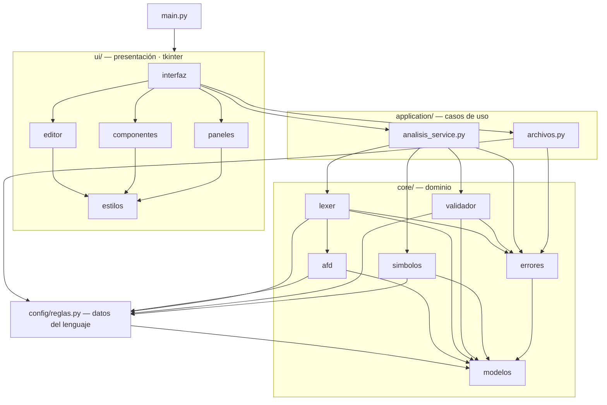
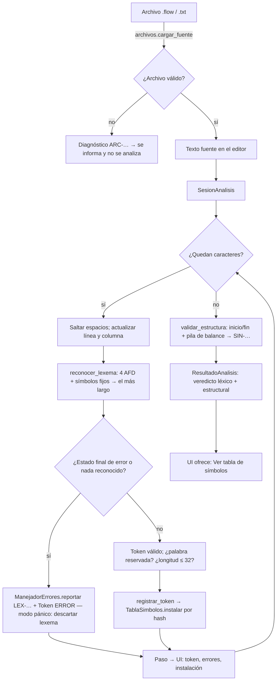

# 02 · Arquitectura — SmartLex Studio

Autor: architect-fable. Lectura previa: `03_especificacion.md` (el lenguaje). Las firmas públicas exactas están en `agents/tareas.md` (contrato de implementación); aquí se explica el **porqué** y el **cómo encajan**.

Principio rector: **complejidad funcional y visual, simplicidad interna.** Cada archivo debe poder explicarse en dos minutos en la sustentación.

---

## 1. Estructura del proyecto

```
SmartLexStudio/
├── main.py                    # Punto de entrada: comprueba tkinter y abre la ventana (o modo consola)
├── requirements.txt           # Solo comentarios: no hay dependencias externas
├── README.md
├── .gitignore
├── config/
│   └── reglas.py              # TODAS las reglas de FlowLang, como DATOS (sin lógica)
├── core/                      # Dominio. Prohibido importar tkinter
│   ├── modelos.py             # TipoToken, Token, Diagnostico, EntradaSimbolo (hoja: no importa nada del proyecto)
│   ├── afd.py                 # Motor genérico de AFD por tabla de transiciones
│   ├── errores.py             # Catálogo de diagnósticos + ManejadorErrores
│   ├── lexer.py               # Analizador léxico (coincidencia más larga sobre los AFD)
│   ├── validador.py           # Comprobaciones estructurales (inicio/fin, balance con pila)
│   └── simbolos.py            # Función hash + TablaSimbolos (hash con encadenamiento)
├── application/               # Casos de uso. Prohibido importar tkinter
│   ├── archivos.py            # Cargar/guardar fuente, validar archivo (ARC-…)
│   └── analisis_service.py    # SesionAnalisis (evaluación progresiva), ResultadoAnalisis, explicar_token
├── ui/                        # Único paquete que importa tkinter
│   ├── estilos.py             # Tema oscuro: colores, fuentes, estilos ttk
│   ├── editor.py              # Editor con números de línea, resaltado y marcas de error
│   ├── componentes.py         # Barra de herramientas, panel lateral, consola, barra de estado
│   ├── paneles.py             # Panel derecho: pestañas Tokens, Tabla, Errores, Estadísticas, Educativo
│   └── interfaz.py            # VentanaPrincipal: arma la ventana y coordina las acciones
├── ejemplos/                  # correcto.flow, incorrecto.flow, casos_limite.flow (ya creados)
├── tests/                     # unittest (biblioteca estándar)
│   ├── test_afd.py  test_lexer.py  test_validador.py  test_simbolos.py
│   ├── test_errores.py  test_archivos.py  test_integracion.py  test_ui_humo.py
│   ├── test_auditoria_fase_a.py  test_auditoria_fase_b.py   # regresiones de las dos auditorías
├── docs/                      # 01_investigacion, 02_arquitectura, 03_especificacion, 04_manual_usuario, 05_guia_sustentacion, 06_auditoria, matriz_requisitos
└── agents/                    # tareas.md, decisiones.md, revisiones.md
```

Cambios respecto a la estructura propuesta inicialmente, y por qué:

| Cambio | Motivo |
|---|---|
| **+ `core/afd.py`** | El motor de autómatas es el concepto central del curso: merece un archivo propio de ~60 líneas que se pueda mostrar solo. |
| **+ `ui/paneles.py`** | Las cinco pestañas en `componentes.py` darían un archivo de más de 500 líneas. Dos archivos de tamaño medio se explican mejor. |
| **+ `tests/test_afd.py`, `test_archivos.py`, `test_ui_humo.py`** | Una prueba por módulo con lógica. |
| `config/reglas.py` **sin mensajes de error** | El catálogo de diagnósticos vive en `core/errores.py`: así «el manejador de errores» (25 pts) es un módulo completo y autocontenido. |
| Cada paquete lleva un `__init__.py` vacío | Necesario para `python -m unittest discover`. |

Total: 15 archivos de código (`main.py`, 1 de configuración, 6 de dominio, 2 de aplicación y 5 de interfaz) + 10 de pruebas. `docs/capturas/` contiene 5 capturas reales de la aplicación y el script que las tomó. No hay carpetas ni archivos vacíos «por si acaso».

---

## 2. Capas y regla de dependencias



Versión ASCII:

```
main.py ─▶ ui/ ─────────▶ application/ ─────────▶ core/ ─────▶ config/reglas.py ─▶ core/modelos.py
          (tkinter)       (sin tkinter)           (sin tkinter)   (solo datos)        (hoja)
```

**Reglas (verificables con una búsqueda de `import`):**

1. Las dependencias van solo hacia la derecha: `ui → application → core → config`. Nunca al revés.
2. `tkinter` solo se importa dentro de `ui/` y en `main.py`. Lo comprueba la prueba `test_dominio_sin_tkinter`.
3. `ui/` no importa `core.lexer`, `core.validador` ni `core.simbolos` directamente: pide todo a `application/`. Sí puede importar los **tipos** de `core.modelos` (Token, Diagnostico…) y leer **constantes** de `config.reglas` (para mostrar la información del lenguaje).
4. `core/modelos.py` no importa nada del proyecto. `config/reglas.py` solo importa `TipoToken` de `core.modelos` (necesita nombrar las categorías); es la única flecha «hacia arriba» y no crea ciclos.
5. `config/reglas.py` contiene **solo datos** (constantes, diccionarios, tuplas): ni funciones ni clases.

---

## 3. Modelo de datos (`core/modelos.py`)

| Tipo | Clase | Campos | Notas |
|---|---|---|---|
| Categoría de token | `TipoToken(Enum)` | 12 miembros (§2 de la especificación) | El `value` es el nombre para mostrar («Palabra reservada») |
| Tipo de diagnóstico | `TipoDiagnostico(Enum)` | `LEXICO`, `ESTRUCTURAL`, `ARCHIVO` | |
| Token | `Token` — `dataclass(frozen=True)` | `tipo`, `lexema`, `linea`, `columna` | Inmutable. Propiedades `longitud` y `es_significativo` |
| Diagnóstico | `Diagnostico` — `dataclass(frozen=True)` | `codigo`, `tipo`, `titulo`, `mensaje`, `sugerencia`, `linea`, `columna`, `lexema` | Inmutable |
| Entrada de la tabla | `EntradaSimbolo` — `dataclass` | `lexema`, `categoria`, `valor_hash`, `tipo_dato`, `valor`, `linea_declaracion`, `apariciones` | Mutable: acumula apariciones |

Tipos de resultado, definidos junto al módulo que los produce:

| Clase | Módulo | Campos |
|---|---|---|
| `ResultadoAFD` (frozen) | `core/afd.py` | `longitud`, `tipo`, `codigo_error`, `recorrido` |
| `Coincidencia` (frozen) | `core/lexer.py` | `longitud`, `tipo`, `codigo_error`, `reconocedor`, `recorrido` |
| `ResultadoInstalacion` (frozen) | `core/simbolos.py` | `entrada`, `es_nueva`, `hubo_colision`, `indice`, `redimensiono` |
| `EstadisticasTabla` (frozen) | `core/simbolos.py` | `capacidad`, `cantidad`, `factor_carga`, `colisiones`, `cubetas_ocupadas`, `cadena_mas_larga`, `redimensionados` |
| `Paso` (frozen) | `application/analisis_service.py` | `numero`, `fase`, `token`, `diagnosticos`, `instalacion`, `descripcion` |
| `ResultadoAnalisis` | `application/analisis_service.py` | `fuente`, `tokens`, `manejador`, `tabla`, `terminado` + veredictos |
| `ExplicacionToken` (frozen) | `application/analisis_service.py` | `token`, `categoria`, `descripcion`, `regex`, `reconocedor`, `recorrido`, `detalle` |

Los objetos que viajan hacia la UI (Token, Diagnostico, Paso) son inmutables: la interfaz no puede corromper el resultado del análisis.

---

## 4. Relación entre la implementación y la teoría de autómatas

### 4.1 Decisión: AFD explícitos, no `re`
El reconocimiento léxico **no usa el módulo `re`**. Se implementa con:

- un **motor genérico** (`core/afd.py`, clase `AFD`) que ejecuta cualquier autómata descrito como tabla de transiciones, y
- **cuatro tablas** escritas como diccionarios en `config/reglas.py`: `AFD_COMENTARIO`, `AFD_CADENA`, `AFD_NUMERO`, `AFD_IDENTIFICADOR`.

Por qué no `re`: el motor de Python es de **backtracking** (no construye un AFD) y su alternancia `|` elige la **primera** alternativa que coincide, no la más larga. Un lexer basado en `re` funciona, pero no permitiría afirmar con honestidad «esto es un autómata finito determinista». Con el motor propio, cada afirmación se puede **mostrar en el código y en pantalla**.

### 4.2 Qué se puede afirmar (y demostrar)
| Afirmación | Dónde se demuestra |
|---|---|
| Identificadores, números, cadenas y comentarios se reconocen con un AFD por tabla de transiciones | `config/reglas.py` (las tablas) + `AFD.reconocer` (bucle `estado = δ(estado, carácter)`) |
| Es determinista | Para cada (estado, carácter) la búsqueda devuelve a lo sumo **un** estado siguiente (§4 de la especificación) |
| Se aplica la coincidencia más larga | `AFD.reconocer` recuerda el último estado final alcanzado; `reconocer_lexema` elige el candidato más largo |
| Cada AFD equivale a su expresión regular | `tests/test_afd.py` compara, para todas las cadenas de hasta 5 símbolos sobre un alfabeto de prueba, `re.fullmatch(regex)` contra el AFD. (En el diseño se verificó con 16 millones de comparaciones sin diferencias.) Es **verificación por pruebas**, no una demostración formal |
| El recorrido de estados de cada token es visible | Modo educativo: `q0 → q1 → q2 → q3` |

### 4.3 Qué **no** se debe afirmar
- Que *todo* el lexer es un único AFD: los operadores y delimitadores se resuelven con un diccionario (equivale a un autómata trivial, pero no está escrito como tabla de estados); las palabras reservadas, con una consulta posterior; el límite de 32 caracteres, con `len()`.
- Que los AFD implementados son mínimos: los de número y cadena incluyen **estados de error** añadidos a propósito (la especificación muestra el AFD mínimo y el extendido).
- Que el balance de paréntesis lo hace un autómata finito: usa una pila, precisamente porque ese lenguaje no es regular.
- `re` se usa **solo en las pruebas**, como oráculo de la especificación.

### 4.4 El motor (`AFD.reconocer`), en pseudocódigo

```
estado ← inicial ; mejor ← (longitud 0, nada)
para cada carácter c desde la posición de inicio:
    siguiente ← δ(estado, c)            # exacto → clase → OTRO (si c no es salto)
    si no hay siguiente: terminar
    estado ← siguiente ; avanzar
    si estado es final (de token o de error): mejor ← (longitud leída, etiqueta del estado)
devolver mejor                           # el prefijo más largo que terminó en estado final
```

---

## 5. Flujo del analizador



Versión ASCII resumida:

```
fuente ─▶ [saltar espacios] ─▶ [4 AFD + símbolos: coincidencia más larga] ─▶ ¿error?
                                                                             ├─ sí ─▶ ManejadorErrores + Token ERROR ─┐
                                                                             └─ no ─▶ Token ─▶ TablaSimbolos (hash) ──┤
            ◀──────────────────────────── siguiente posición ◀── Paso (a la UI) ◀──────────────────────────────────────┘
fin del texto ─▶ validador (inicio/fin, balance) ─▶ ResultadoAnalisis ─▶ «¿Ver tabla de símbolos?»
```

---

## 6. Tabla de símbolos: tabla hash propia (`core/simbolos.py`)

No se usa `dict` ni `hash()` de Python: la estructura se implementa a mano para poder explicarla.

### 6.1 Función hash
Hash **polinomial** evaluado con el método de Horner:

```
h ← 0
para cada carácter c del lexema:  h ← (h · BASE_HASH + código(c)) mod MODULO_HASH
índice de cubeta ← h mod capacidad
```

`BASE_HASH = 31`, `MODULO_HASH = 2³²`, capacidad siempre **prima** (inicial 17). Se eligió frente a djb2 porque se calcula a mano en el tablero (`"si"` → 115·31 + 105 = 3670 → 3670 mod 17 = 15) y es el mismo esquema que usa `String.hashCode` de Java. La capacidad prima reparte mejor los restos.

### 6.2 Estructura y operaciones
- `cubetas`: lista de `capacidad` listas. Cada cubeta es una lista de `EntradaSimbolo` → **encadenamiento separado**.
- **Buscar**: calcular índice; recorrer la cubeta comparando lexemas.
- **Instalar** un token:
  1. Buscar el lexema. **Si existe (duplicado)**: no se crea entrada; se agrega (línea, columna) a `apariciones`.
  2. Si no existe: si la cubeta ya tenía entradas → **colisión** (`colisiones += 1`); se añade la entrada al final de la cubeta.
  3. Si `cantidad / capacidad > FACTOR_CARGA_MAXIMO` (0.75) → **redimensionar**: nueva capacidad = primer primo ≥ 2·capacidad (17 → 37 → 79 → 163…); se reubican todas las entradas con su `valor_hash` guardado.
  4. Devuelve `ResultadoInstalacion` (entrada, si es nueva, si hubo colisión, índice, si redimensionó) para que la UI lo narre.
- `colisiones` es un **contador histórico** de inserciones en cubeta ocupada; no cambia al redimensionar. `estadisticas()` da además el estado actual (cubetas ocupadas, cadena más larga, factor de carga). Las **colisiones visibles en la tabla actual** se calculan como `cantidad − cubetas_ocupadas`; suelen ser menos que las históricas porque redimensionar deshace colisiones (en `correcto.flow`: 14 al insertar, 7 en la tabla final).
- La función hash se **inyecta** por el constructor (`funcion_hash=hash_polinomial`): las pruebas pasan `lambda s: 0` para forzar que todo colisione.

### 6.3 Qué se instala
> **FlowLang 2.0:** `registrar_token` se sustituye por `RegistradorSimbolos` y la identidad de una entrada es su clave normalizada (§18.7).

Definido en la especificación §9. La regla contextual de declaración y el cálculo de `tipo_dato`/`valor` están en la función `registrar_token(tabla, token, anterior)`; la clase `TablaSimbolos` no sabe nada de FlowLang (es una tabla hash genérica de lexemas).

### 6.4 Visibilidad en la UI
Pestaña «Tabla de símbolos»: filas ordenadas por cubeta; las entradas que comparten cubeta se muestran contiguas y con fondo distinto (colisión). Encabezado: `Capacidad 79 · Entradas 36 · Factor de carga 0.46 · Colisiones al insertar 14 · En la tabla actual 7 · Cadena más larga 3 · Redimensionados 2`.

---

## 7. Manejador de errores (`core/errores.py`)

- `CATALOGO`: diccionario `código → {tipo, titulo, mensaje, sugerencia}` con los 19 diagnósticos de la especificación §10. **Único lugar** donde están los textos.
- `crear_diagnostico(codigo, linea, columna, lexema, sugerencia=None)`: construye un `Diagnostico` rellenando la plantilla.
- `ManejadorErrores`: acumula los diagnósticos de un análisis y responde consultas (ordenados, por tipo, por línea, cantidad, resumen). El lexer recibe el manejador por el constructor y llama a `reportar(...)`; el servicio le añade los estructurales.
- Los errores de archivo se transportan con la excepción `ErrorArchivo`, que lleva dentro su `Diagnostico`: la UI muestra todos los errores con el mismo formato.

Administración de errores = catálogo único + recolección + recuperación (modo pánico) + consulta + presentación uniforme.

---

## 8. Evaluación progresiva (requisito 5)

**Problema:** la interfaz debe mostrar el manejo de errores *durante* la evaluación, pero el dominio no puede conocer tkinter.

**Solución:** el lexer es un **generador** (`Lexer.tokens()` produce un token cada vez) y el servicio envuelve cada avance en un objeto `Paso`. La UI decide el ritmo.

```
sesion = SesionAnalisis(fuente)
paso = sesion.siguiente_paso()     # Paso | None
```

| Campo de `Paso` | Contenido |
|---|---|
| `numero` | 1, 2, 3… |
| `fase` | `"Léxico"` o `"Estructura"` |
| `token` | El token recién reconocido (`None` en la fase de estructura) |
| `diagnosticos` | Los errores detectados **en este paso** |
| `instalacion` | `ResultadoInstalacion` si el token entró a la tabla |
| `descripcion` | Línea lista para la consola |

Secuencia: un paso por token (fase léxica) → al agotarse el texto se ejecuta el validador y se emite un paso por cada diagnóstico estructural → `siguiente_paso()` devuelve `None` y `sesion.resultado.terminado` es `True`.

Cómo la consume la UI (sin hilos, con el temporizador de Tk):

| Modo | Mecanismo |
|---|---|
| **Analizar** (F5) | `root.after(RETARDO_ANIMACION_MS, tick)`; cada *tick* consume `n` pasos y actualiza paneles. `n` = `max(1, ceil((len(fuente) // 4) / (DURACION_MAXIMA_ANIMACION_MS / RETARDO_ANIMACION_MS)))`: apunta a ~3 s de animación. Es una estimación: el dibujo de Tk añade tiempo (medido en la auditoría: 5 000 líneas ≈ 5,7 s, con la ventana respondiendo entre *ticks*) |
| **Paso a paso** (F10) | Cada pulsación consume **un** paso; resalta el lexema actual en el editor y muestra su explicación |
| **Detener** (Esc) | Cancela el temporizador; la sesión queda donde está y puede continuarse |
| Sin interfaz | `analizar_texto(fuente)` consume todos los pasos y devuelve el `ResultadoAnalisis` (lo usan las pruebas y el modo consola) |

En cada paso la UI: añade el token a la pestaña Tokens, escribe la descripción en la consola, y **si hay diagnósticos** los añade a la pestaña Errores, los subraya en el editor y actualiza el contador de la barra de estado. La pestaña «Tabla de símbolos» permanece deshabilitada hasta el final.

**Al terminar** (cumplimiento literal del requisito 5):
1. La consola muestra el veredicto (léxico, estructura, global, líneas inválidas).
2. Se abre el diálogo: «Análisis terminado: cadena VÁLIDA / INVÁLIDA (n errores). **¿Desea ver la tabla de símbolos?**» [Sí] [No].
3. Se habilita la pestaña y el botón permanente **«Ver tabla de símbolos»** de la barra de estado; «Sí» selecciona la pestaña.

---

## 9. Modo educativo

Al seleccionar un token (clic en la tabla de Tokens, o automáticamente en cada paso del modo paso a paso) la pestaña «Modo educativo» muestra:

| Dato | Origen (sin duplicar información) |
|---|---|
| Lexema, categoría, línea y columna | `Token` |
| Descripción de la categoría, expresión regular, ejemplos | `reglas.INFO_CATEGORIAS[tipo]` |
| Reconocedor usado y **recorrido de estados** | `reconocer_lexema(token.lexema)` vuelve a ejecutar el AFD sobre el lexema |
| Tabla de transiciones del AFD | `reglas.AFD_…["transiciones"]` (la misma que usa el lexer) |
| Significado de una palabra reservada | `reglas.PALABRAS_RESERVADAS[lexema]` |
| Código y sugerencia, si es un token `ERROR` | `core.errores.CATALOGO[codigo]` |
| Hash y cubeta, si está en la tabla | `resultado.tabla.buscar(lexema)` |

`explicar_token(token, tabla=None)` en `application/analisis_service.py` arma el texto `detalle` (una línea por dato, con la forma `Campo: valor`). La **tabla de transiciones** la añade `PanelResultados.mostrar_explicacion` leyéndola de `reglas.AUTOMATAS` por el nombre del reconocedor (D-39), sin pasar por el servicio. Ejemplo del contenido para `45.5` (formato ilustrativo; el recorrido real se muestra como `q0 → q1 → q1 → q2 → q3`):

```
Lexema: 45.5
Categoría: Decimal
Posición: línea 6, columna 23
Regla:  [0-9]+\.[0-9]+
Reconocedor: AFD de números
Recorrido:  q0 ─4→ q1 ─5→ q1 ─.→ q2 ─5→ q3   (q3: estado final de DECIMAL)
Tabla de símbolos: hash 1601544 · cubeta 56 (capacidad 79) · tipo decimal · valor 45.5
```

---

## 10. Interfaz de usuario

### 10.1 Disposición (inspirada en VS Code; `ttk.Panedwindow` anidados, todo redimensionable)

> **Esta disposición (inspirada en VS Code) quedó sustituida por el rediseño claro de §17** (que a su vez reemplazó al de §16), ya implementado. Texto histórico: zonas, paleta, iconos y *tool windows* están en §16.2–§16.7, que reemplazan este diagrama y la tabla de §10.2. Se conservan como referencia histórica.

```
┌─────────────────────────────────────────────────────────────────────────────────────────────┐
│ SmartLex Studio — correcto.flow                                                             │
├─────────────────────────────────────────────────────────────────────────────────────────────┤
│ [Abrir] [Guardar] │ [▶ Analizar] [⏭ Paso a paso] [■ Detener] │ [Limpiar] │ [Ayuda]          │
├──────────────┬───────────────────────────────────────┬──────────────────────────────────────┤
│ EJEMPLOS     │  1 │ // Riego automatico              │ Tokens│Tabla│Errores│Estad.│Educativo│
│  correcto    │  2 │ inicio                           │ ┌──┬────┬───┬───────────┬─────────┐  │
│  incorrecto  │  3 │     numero temperatura = 28;     │ │# │Lín.│Col│Categoría  │Lexema   │  │
│  casos_limite│  4 │     decimal humedad = 45.5;      │ │1 │ 2  │ 1 │Reservada  │inicio   │  │
│──────────────│✗ 5 │     texto zona = "Norte;         │ │2 │ 3  │ 5 │Reservada  │numero   │  │
│ FLOWLANG     │  6 │ fin                              │ │… │    │   │           │         │  │
│  Reservadas  │    │                                  │ └──┴────┴───┴───────────┴─────────┘  │
│  Operadores  │    │                                  │                                      │
│  Delimitad.  ├────┴──────────────────────────────────┴──────────────────────────────────────┤
│  Escapes     │ CONSOLA DE EVALUACIÓN                                                        │
│              │ [2:1]  Palabra reservada 'inicio' → tabla: nueva, cubeta 15                  │
│              │ [5:18] ✗ LEX-002 Cadena sin cerrar …                                         │
├──────────────┴──────────────────────────────────────────────────────────────────────────────┤
│ Analizando… 42 tokens · 1 error │ Lín 5, Col 18 │ UTF-8 │ FlowLang 1.0 │ [Ver tabla símbolos]│
└─────────────────────────────────────────────────────────────────────────────────────────────┘
```

### 10.2 Componentes y archivo

> Vigente: la tabla de componentes y archivos de §17.9 (`Cabecera`, `BarraEstado`, `PanelConsola`, `VistaLenguaje`, `EditorCodigo`, `PanelErrores`, `PanelResultados`, `VentanaPrincipal`). La tabla siguiente es histórica.

| Zona | Clase | Archivo | Contenido |
|---|---|---|---|
| Ventana | `VentanaPrincipal` | `ui/interfaz.py` | Arma los paneles, atajos de teclado, estados de la aplicación, temporizador de animación |
| Barra superior | `BarraHerramientas` | `ui/componentes.py` | Abrir (Ctrl+O), Guardar (Ctrl+S), Analizar (F5), Paso a paso (F10), Detener (Esc), Limpiar, Ayuda (F1) |
| Panel izquierdo | `PanelLateral` | `ui/componentes.py` | Lista de `ejemplos/*.flow` (doble clic carga) + árbol «FlowLang» generado desde `config/reglas.py` |
| Editor | `EditorCodigo` | `ui/editor.py` | `tk.Text` + margen de números (otro `Text` de solo lectura sincronizado, como IDLE); resaltado por *tags* a partir de los tokens; subrayado rojo de errores; ✗ en el margen de las líneas inválidas; resaltado del token actual |
| Panel inferior | `PanelConsola` | `ui/componentes.py` | Registro de la evaluación con colores (normal / error / éxito) |
| Barra de estado | `BarraEstado` | `ui/componentes.py` | Estado, contadores, posición del cursor, botón «Ver tabla de símbolos» |
| Panel derecho | `PanelResultados` | `ui/paneles.py` | `ttk.Notebook` con 5 pestañas |
| Tema | `TEMA`, `COLORES_TOKEN`, `aplicar_tema` | `ui/estilos.py` | Paleta oscura, fuentes, estilos `ttk` sobre el tema `clam` |

Pestañas del panel derecho:

| Pestaña | Columnas / contenido |
|---|---|
| **Tokens** | `# · Línea · Col · Categoría · Lexema`; fila con el color de su categoría; clic → selecciona el lexema en el editor y actualiza el Modo educativo |
| **Tabla de símbolos** | Resumen (capacidad, entradas, factor de carga, colisiones, cadena más larga, redimensionados) + `Cubeta · Hash · Lexema · Categoría · Tipo · Valor · Declaración · Apariciones`. Deshabilitada hasta que termina el análisis |
| **Errores** | `Código · Tipo · Lín:Col · Mensaje · Sugerencia`; doble clic → lleva el cursor al error. Se llena **durante** la evaluación |
| **Estadísticas** | Veredictos (léxico, estructura, global), tokens por categoría con barra proporcional, líneas, caracteres, errores por tipo |
| **Modo educativo** | §9 |

### 10.3 Patrón de presentación
**Vista pasiva + coordinador** (una forma ligera de MVP):

- Los paneles son **vistas pasivas**: exponen métodos `mostrar_…(datos)` / `limpiar()` y avisan de acciones del usuario mediante *callbacks* recibidos en el constructor. No conocen el servicio.
- `VentanaPrincipal` es el **coordinador**: recibe los *callbacks*, llama a `application/` y reparte los resultados a las vistas.
- No se crea una clase «Presenter» ni un bus de eventos aparte: sería una capa más sin simplificar nada.

### 10.4 Estados de la aplicación

| Estado | Entra cuando | Botones activos |
|---|---|---|
| `SIN_FUENTE` | Arranque sin archivo, o tras Limpiar | Abrir, **Analizar** (vuelve a pedir el archivo, D-36), Ayuda |
| `LISTO` | Hay texto en el editor | Abrir, Guardar, Analizar, Paso a paso, Limpiar |
| `ANALIZANDO` | Analizar / Paso a paso en curso (editor en solo lectura) | Paso a paso, Analizar (= continuar), Detener, y también Abrir y Limpiar (cancelan el análisis en curso, D-36) |
| `TERMINADO` | La sesión devolvió `None` | Todos menos Detener + «Ver tabla de símbolos» |

Editar el texto en `TERMINADO` vuelve a `LISTO` y marca los resultados como desactualizados.

### 10.5 Solicitud del archivo (requisito 6)
- Al **arrancar**, la aplicación abre el selector: «Seleccione el archivo con las cadenas de entrada». Si se cancela, queda en `SIN_FUENTE` con los ejemplos a la vista.
- **Analizar** en `SIN_FUENTE` vuelve a solicitar el archivo.
- Cualquier `ErrorArchivo` se muestra en la consola, en la pestaña Errores y en un `messagebox`.

### 10.6 Resaltado mientras se escribe
`EditorCodigo` pide `tokenizar(texto)` al servicio 300 ms después de la última tecla (*debounce* con `after`) y aplica los *tags*. Es el mismo lexer: lo que se ve coloreado es exactamente lo que el analizador reconoce.

---

## 11. Puntos de extensión (modificaciones típicas de sustentación)

> **FlowLang 2.0:** los nombres de ejemplo de esta tabla (`repetir`, `numero`, `inicio`/`fin`, llaves) son de la versión 1.0. La tabla vigente es **§18.10**; el mecanismo de cada fila no cambia.

| Modificación pedida | Archivo | Qué se toca exactamente | ¿Algo más? |
|---|---|---|---|
| Agregar palabra reservada `repetir` | `config/reglas.py` | Añadir `"repetir": "Repite un bloque…"` al diccionario `PALABRAS_RESERVADAS` | No. El lexer, el resaltado, el panel lateral y el modo educativo la toman solos |
| Agregar un tipo de dato (p. ej. `fecha`) | `config/reglas.py` | `PALABRAS_RESERVADAS` + la tupla `TIPOS_DE_DATO` | No |
| Agregar un operador (p. ej. `**` o `<>`) | `config/reglas.py` | Una entrada en `OPERADORES`: `"**": TipoToken.OPERADOR_ARITMETICO` | No (la coincidencia más larga usa la longitud máxima de las claves) |
| Agregar un delimitador (p. ej. `[` `]`) | `config/reglas.py` | `DELIMITADORES`; si debe balancearse, también `PARES_AGRUPACION`; quitarlo de `SUGERENCIAS_CARACTER` | No |
| Cambiar la regla de identificadores (p. ej. permitir `ñ` o `$`) | `config/reglas.py` | Letras: constante `LETRAS`. Otro símbolo: añadir la columna en `AFD_IDENTIFICADOR["transiciones"]`. Actualizar `INFO_CATEGORIAS[TipoToken.IDENTIFICADOR]["regex"]` | La prueba de equivalencia de `test_afd.py` avisa si regex y AFD dejan de coincidir |
| Cambiar la longitud máxima de identificador | `config/reglas.py` | `LONGITUD_MAXIMA_IDENTIFICADOR` | Texto de `LEX-005` en `CATALOGO` |
| Cambiar la regla de decimales (p. ej. aceptar `.5` o `5.`) | `config/reglas.py` | `AFD_NUMERO`: mover el estado de `"errores"` a `"aceptacion"` (para `5.`: `q2`) o cambiar la transición (para `.5`: `q6 → q3`) y la regex de `INFO_CATEGORIAS` | No |
| Agregar un escape (p. ej. `\r`) | `config/reglas.py` | `ESCAPES_VALIDOS["r"] = "\r"` y la transición `"r": "q1"` en `AFD_CADENA["transiciones"]["q2"]` | Texto de `LEX-006` |
| Nuevo patrón léxico (p. ej. carácter `'a'` o hexadecimal `0x1F`) | `core/modelos.py`, `config/reglas.py`, `ui/estilos.py` | (1) miembro nuevo en `TipoToken`; (2) diccionario `AFD_…` nuevo y añadirlo a la tupla `AUTOMATAS`; (3) entrada en `INFO_CATEGORIAS`; (4) color en `COLORES_TOKEN` | Si debe ir a la tabla: `CATEGORIAS_EN_TABLA` |
| Nuevo diagnóstico | `core/errores.py` | Entrada en `CATALOGO` | Emitirlo: estado en `"errores"` de un AFD (léxico) o una regla en `validar_estructura` (estructural) |
| Cambiar el texto de un mensaje o sugerencia | `core/errores.py` | `CATALOGO[codigo]` | No |
| Instalar también operadores y delimitadores en la tabla | `config/reglas.py` | Añadir sus categorías a `CATEGORIAS_EN_TABLA` | No |
| Nueva columna en la tabla de símbolos (p. ej. «Longitud») | `core/modelos.py`, `core/simbolos.py`, `ui/paneles.py` | Campo en `EntradaSimbolo`; asignarlo en `registrar_token`; añadir a `COLUMNAS_SIMBOLOS` | No |
| Cambiar la función hash | `core/simbolos.py` / `config/reglas.py` | Cuerpo de `hash_polinomial`, o `BASE_HASH`, `MODULO_HASH` | Las pruebas con valores hash fijos |
| Cambiar capacidad o factor de carga | `config/reglas.py` | `CAPACIDAD_INICIAL_TABLA`, `FACTOR_CARGA_MAXIMO` | Ídem |
| Cambiar la extensión de archivo | `config/reglas.py` | `EXTENSIONES_PERMITIDAS` | Texto de `ARC-002` |
| Cambiar el tema o un color | `ui/estilos.py` | Diccionarios `TEMA` y `COLORES_TOKEN` | No |
| Cambiar la velocidad de la animación | `ui/interfaz.py` | `RETARDO_ANIMACION_MS`, `DURACION_MAXIMA_ANIMACION_MS` | No |
| Quitar la exigencia de `inicio`/`fin` | `core/validador.py` | Reglas E2/E3 de `validar_estructura` | Pruebas de `test_validador.py` |
| Cambiar el tamaño máximo de archivo | `config/reglas.py` | `TAMANO_MAXIMO_BYTES` | Texto de `ARC-006` |
| Renombrar el tipo `booleano` | `config/reglas.py` | `PALABRAS_RESERVADAS`, `TIPOS_DE_DATO`, `TIPO_DATO_BOOLEANO` | No |

**Limitación aceptada (D-31):** los textos de cuatro diagnósticos repiten un dato de `reglas.py` — `LEX-005` (32), `LEX-006` (los escapes), `ARC-002` (`.flow`/`.txt`) y `ARC-006` (1 MB). Al cambiar ese dato hay que actualizar también el texto en `CATALOGO`. Se prefiere esto a plantillas con más parámetros, que harían depender `errores.py` de `reglas.py`.

**Pruebas que fijan la versión del lenguaje (D-32):** `test_conteos_de_flowlang_1_0` fija 17 reservadas, 15 operadores, etc. Tras una modificación intencional del lenguaje esa prueba falla **a propósito**: se actualiza el número y vuelve a verde. Es la demostración de que las pruebas vigilan la especificación.

---

## 12. SOLID aplicado de forma pragmática

| Principio | Cómo se aplica | Cómo se demuestra |
|---|---|---|
| **S** — Responsabilidad única | Un motivo de cambio por módulo: reglas (`reglas.py`), autómatas (`afd.py`), reconocer (`lexer.py`), estructura (`validador.py`), tabla (`simbolos.py`), errores (`errores.py`), archivos (`archivos.py`), orquestación (`analisis_service.py`) | Cambiar el tema no toca `core/`; agregar una palabra no toca ningún algoritmo |
| **O** — Abierto/cerrado | El lenguaje se extiende **agregando datos** en `reglas.py` sin modificar el motor | Demo en vivo: añadir `repetir` u otro AFD a `AUTOMATAS` sin abrir `lexer.py` |
| **L** — Sustitución de Liskov | Casi no hay herencia (solo de widgets de Tk y de `Exception`). Cualquier función `str → int` sirve como función hash de `TablaSimbolos` | La prueba de colisiones forzadas sustituye la función hash y la tabla sigue cumpliendo su contrato |
| **I** — Segregación de interfaces | Las vistas reciben solo los datos que pintan (`mostrar_tokens(tokens)`), no el servicio completo; el lexer solo conoce `reportar` del manejador | Firmas de `ui/paneles.py` |
| **D** — Inversión de dependencias | El dominio no depende de la UI: la UI depende de `application`. El lexer recibe su `ManejadorErrores` y la tabla su función hash por parámetro, con valores por defecto | `test_dominio_sin_tkinter`; pruebas que inyectan manejador y hash |

No se usan contenedores de inyección, interfaces abstractas ni fábricas: los parámetros con valor por defecto bastan.

## 13. Patrones: usados y descartados

| Patrón | ¿Se usa? | Dónde / por qué |
|---|---|---|
| **Autómata dirigido por tabla** (*table-driven*) | Sí | `AFD` + tablas de `reglas.py`. Es el patrón central: separa el algoritmo (fijo) de los datos (el lenguaje) |
| **Iterador / generador** | Sí | `Lexer.tokens()` y `SesionAnalisis.pasos()`: permiten la evaluación progresiva sin hilos ni *callbacks* en el dominio |
| **Strategy** (versión mínima) | Sí | La función hash es un parámetro de `TablaSimbolos`. Uso real: forzar colisiones en pruebas y poder cambiarla en la sustentación |
| **Vista pasiva + coordinador** (MVP ligero) | Sí | §10.3 |
| **Objeto valor inmutable** | Sí | `Token`, `Diagnostico`, `Paso` (`frozen=True`) |
| **Fachada** | Sí, implícita | `analisis_service.py` es la única puerta de la UI al dominio |
| MVC completo / Presenter separado | No | Añade una capa y un archivo sin simplificar nada a este tamaño |
| Factory / Abstract Factory | No | `crear_diagnostico` es una función; no hay familias de objetos |
| Observer / bus de eventos | No | El `Paso` devuelto por `siguiente_paso()` ya entrega todo lo que la UI necesita |
| Singleton | No | El estado vive en la sesión; así las pruebas son independientes |
| Hilos (`threading`) | No | El análisis es rápido y `after` basta; evita condiciones de carrera con Tk |

---

## 14. Decisiones técnicas transversales

- **Python ≥ 3.10**, solo biblioteca estándar. Cada módulo empieza con `from __future__ import annotations`.
- **Pruebas** con `unittest`. Desde `SmartLexStudio/`: `python -m unittest discover -s tests -t . -v`. En este equipo usar `/opt/homebrew/bin/python3.14` (el `python3` por defecto no tiene tkinter).
- `tests/test_ui_humo.py` se **omite solo** (`skipUnless`) si no hay tkinter o pantalla.
- **Idioma**: identificadores, comentarios y mensajes en español; sin tildes ni `ñ` en nombres de código.
- **Tamaño real**: en `core/` el mayor es `simbolos.py` (193 líneas); `application/analisis_service.py` tiene 239 (aceptado en D-26/D-29); en `ui/` el mayor es `interfaz.py` (335). Total del proyecto sin pruebas: ~2 400 líneas.
- **Rendimiento**: lineal en la longitud del texto (cada AFD se detiene en el primer carácter que no le corresponde). Verificado por prueba: 5 000 líneas (40 000 tokens) en menos de 5 s para el lexer solo (`tests/test_lexer.py`), y sesión lineal en el número de diagnósticos (`test_aud01…`). Limitación conocida: al editar, el resaltado vuelve a tokenizar todo el texto (≈0,5 s con 5 000 líneas).
- **Modo consola** (opcional, tarea B7): `python main.py --consola archivo.flow` imprime tokens, errores y tabla. Sirve de respaldo si el laboratorio no tiene Tk y de prueba de extremo a extremo sin pantalla.

---

## 15. Estado final: diferencias entre el diseño y lo implementado

Revisión final del arquitecto sobre el commit `3a8f372` (115 pruebas en verde). El código cumple las capas y reglas de este documento; estas son las diferencias y añadidos respecto al diseño inicial, todos registrados en `agents/decisiones.md`:

| Tema | Lo implementado | Decisión |
|---|---|---|
| Constante del tipo booleano | `reglas.TIPO_DATO_BOOLEANO`; `core/` no contiene ningún nombre de tipo literal | D-30 |
| Colisiones | Resumen con «Colisiones al insertar» y «En la tabla actual» (`cantidad − cubetas_ocupadas`, calculado en `ui/paneles.py`) | D-33 |
| Regex de palabras reservadas | `"\|".join(PALABRAS_RESERVADAS)`: se deriva del diccionario, sigue siendo un dato | AUD-03 |
| Declaración tardía | La declaración se anota en la primera aparición declarada del identificador, aunque no sea la primera aparición | D-27 |
| Sesión y manejador | `SesionAnalisis` da al lexer un `ManejadorErrores` propio por paso y vuelca sus diagnósticos al del resultado (coste lineal) | AUD-01 |
| Editor | Normaliza `\r\n`/`\r`; `marcar_errores` acumula; método añadido `descartar_cambio_pendiente()`; cursor en 1:1 al cargar | D-34, D-37, AUD-16, AUD-19 |
| Pestaña Errores | Bajo la tabla, detalle completo (código, título, mensaje, sugerencia) del error seleccionado; doble clic navega | AUD-20 |
| Desplazamiento | Tokens, consola y editor se desplazan una vez por ciclo de eventos (`after_idle`), no una vez por token | AUD-17 |
| Estados y botones | Tabla de §10.4 actualizada | D-36 |
| Modo educativo | Tabla de transiciones añadida por la UI desde `reglas.AUTOMATAS` | D-39 |
| Modo consola | `python main.py --consola [ruta]`, en `main.py`, sin tkinter; tolera entrada cerrada | B7, AUD-21 |
| Fuentes | `ui/estilos.py` añade `fuente_interfaz()` además de `fuente_codigo()` | — |
| Pruebas de UI | Detectan Tk en un subproceso; se omiten (17) si no hay Tk | D-38 |
| Rediseño §16 | Implementado: `ui/iconos.py` nuevo; `PanelProblemas`; `RAIZ_PROYECTO` vive en `componentes.py`; zona inferior inicial de 250 px (no 210); `F2`/`Shift+F2` solo en `bind_all`; sin rombo `◆` en el menú de ejecución; las técnicas «por validar» (`Panedwindow.forget/insert`, barras sin flechas, globos) funcionaron sin alternativa | D-54…D-57 |
| Capturas | `docs/capturas/capturar.py` fotografía la ventana por su identificador (`id_ventana.swift`) | D-58 |

Rediseño §17 (Fase D): implementado. Diferencias con la especificación: el menú «Ejemplos» no lleva «▾» en su texto (el tema `clam` ya dibuja su flecha; D-73); `PAUSA_POR_DEFECTO_MS` y `PAUSA_MAXIMA_MS` viven en `ui/componentes.py` y `ui/interfaz.py` los importa; el deslizador mide 80 px y los botones usan fuente 11 y relleno (7, 4) para que la cabecera quepa en 1100 px; el cuadro de detalle del manejador mide 178 px fijos; se añadió el estilo `PanelError.TLabel`; la pestaña Resumen responde a la rueda del ratón; `ui/iconos.py` y las zonas ocultables desaparecen.

Pendiente menor tras esta revisión (tareas B9 y B10): un único error de archivo visible a la vez en la pestaña Errores, y una línea por dato en el `detalle` del Modo educativo.

Limitaciones conocidas y aceptadas: textos de cuatro diagnósticos que repiten un dato de `reglas.py` (D-31); el veredicto «válida/inválida» se redacta en tres lugares (`ui/interfaz.py`, `ui/paneles.py`, `main.py`); con Tcl/Tk 8.6 el resaltado posterior a un emoji puede desplazarse (D-34); `test_conteos_de_flowlang_1_0` falla a propósito cuando se modifica el lenguaje (D-32).

---

## 16. Rediseño visual estilo PyCharm (New UI, tema oscuro)

> **Sustituido por §17 (Fase D, D-61).** El aspecto PyCharm (franjas de iconos, *tool windows*, `ui/iconos.py`, paleta Darcula) deja de ser el diseño vigente; esta sección queda como historial. Siguen vigentes las técnicas validadas aquí que §17 reutiliza (`_puntos`, D-51; barras de desplazamiento sin flechas; capturas por identificador de ventana, D-58).

> **Estado: implementado (tareas B11–B16 de `agents/tareas.md`, decisiones D-44…D-59); las diferencias con el diseño están en §15.** Este rediseño cambia **solo `ui/`**: `core/`, `application/`, `config/` y `main.py` no se tocan, y §10.3 (vista pasiva + coordinador), §10.4 (estados), §10.5 (requisito 6) y §10.6 siguen vigentes sin cambios.

### 16.1 Objetivo y límites

Que la ventana se lea como PyCharm New UI oscuro —barra superior con *widgets*, franjas de iconos, *tool windows* que se muestran y ocultan, pestaña de editor subrayada, *widget* de inspección, barra de estado con migas de pan— sin añadir lógica: es **piel y disposición**. Regla de diseño: complejidad visual, simplicidad interna; todo lo nuevo son tablas de datos (colores, iconos, acciones, herramientas) recorridas por bucles cortos.

Lo que **no** se imita, y por qué:

| Elemento de PyCharm | Decisión | Motivo |
|---|---|---|
| Barra superior fundida con la barra de título del sistema | No. Se conserva la barra de título nativa y debajo va la barra de la aplicación | Quitar la decoración (`overrideredirect`) rompe mover, redimensionar y minimizar, distinto en cada sistema |
| Varias pestañas de editor | **Una sola pestaña** (D-46) | Varias exigirían una sesión, resultados y marcas por pestaña: reescribir el coordinador |
| Widget de rama de Git, usuario, buscar, ajustes | No hay equivalente; su lugar lo ocupan acciones reales (Abrir, Guardar, Limpiar, Ayuda) | No se dibujan controles que no hacen nada |
| Guías de sangría | No | `tk.Text` no permite dibujarlas sin un lienzo superpuesto y sincronizado |
| Fila seleccionada con esquinas redondeadas | Selección rectangular con el color de PyCharm | `ttk.Treeview` no redondea |
| Menús emergentes oscuros en macOS | En macOS los pinta el sistema | `tk.Menu` es nativo en Aqua; en Windows y Linux sí se colorean |

### 16.2 Mapa de zonas

```
┌──────────────────────────────────────────────────────────────────────────────────────────────┐
│ ● ● ●                    SmartLex Studio — correcto.flow            (barra de título nativa) │
├──────────────────────────────────────────────────────────────────────────────────────────────┤
│ [SL] SmartLex Studio ▾              ◆ FlowLang · Análisis léxico ▾ [▶][▷|][■]  │ ⌂ ▣ ⌫ ?     │ A
├───┬──────────────────┬───────────────────────────────────────┬──────────────────────────┬────┤
│ ▣ │ Proyecto       — │ ▤ correcto.flow ×                     │ Tokens                 — │ ≡  │
│ {}│ ▾ SmartLexStudio │ ═══════════════            ✗ 3  ⌃ ⌄   │  #  Lín Col Categoría …  │ ▦  │
│   │   ▾ ejemplos     │  1  // Riego automatico               │  1   2   1  Reservada …  │ ▥  │
│   │     ▤ correcto   │  2  inicio                            │  2   3   5  Reservada …  │ ○→◎│
│ B │     ▤ incorrecto │✗ 3      texto zona = "Norte;          │                          │ E  │
│   │        C         │              D                        │            F             │    │
│   ├──────────────────┴───────────────────────────────────────┴──────────────────────────┤    │
│ ▷_│ Problemas  (15)                                                                   — │    │
│ ⓘ │ LEX-002  Léxico  4:20  La cadena "Hola mundo; no tiene comilla de cierre …   G      │    │
├───┴─────────────────────────────────────────────────────────────────────────────────────┴────┤
│ SmartLexStudio › ejemplos › correcto.flow   Análisis terminado · 57 tokens · 15 errores      │ H
│                                         12:22   LF   UTF-8   FlowLang 1.0   Ver tabla de símbolos │
└──────────────────────────────────────────────────────────────────────────────────────────────┘
```

| Zona | PyCharm | SmartLex Studio | Clase (archivo) |
|---|---|---|---|
| A | Barra principal: proyecto ▾, configuración de ejecución ▾, Run, Debug, Stop, iconos | Logo «SL»; **«SmartLex Studio ▾»** (menú Abrir, Guardar, Limpiar, Ayuda, Salir); **«FlowLang · Análisis léxico ▾»** (menú Analizar, Paso a paso, Detener); **▶ Analizar** (relleno verde), **Paso a paso** (icono verde sin relleno, hace de «Debug»), **■ Detener** (relleno rojo); a la derecha, en gris, Abrir, Guardar, Limpiar, Ayuda | `BarraHerramientas` (`ui/componentes.py`) |
| B | Franja izquierda de *tool windows* | Arriba: **Proyecto**, **Lenguaje FlowLang**. Abajo: **Consola de evaluación**, **Problemas** (con contador de errores) | `FranjaHerramientas` (`ui/componentes.py`) |
| C | *Tool window* «Project» | Vista **Proyecto**: árbol `SmartLexStudio › ejemplos › *.flow` (+ el archivo abierto si está fuera de `ejemplos/`), el archivo abierto queda seleccionado, doble clic abre. Vista **Lenguaje**: el árbol de referencia actual, generado desde `config/reglas.py`, con su descripción al pie | `PanelLateral` (`ui/componentes.py`) |
| D | Editor con pestañas y *widget* de inspección | Una pestaña (icono + nombre + `×`, subrayado azul), margen con números grises y `✗` roja, resaltado Darcula, subrayado rojo, **`✗ N ⌃ ⌄`** arriba a la derecha | `EditorCodigo` (`ui/editor.py`) |
| E | Franja derecha | **Tokens**, **Tabla de símbolos** (desactivado hasta terminar), **Estadísticas**, **Modo educativo** | `FranjaHerramientas` |
| F | *Tool window* derecha | Las cuatro vistas anteriores, una visible a la vez | `PanelResultados` (`ui/paneles.py`) |
| G | *Tool windows* inferiores (Run, Problems) | **Consola de evaluación** y **Problemas** (tabla de errores + detalle), a todo el ancho | `PanelHerramientas` + `PanelConsola` (`ui/componentes.py`) + `PanelProblemas` (`ui/paneles.py`) |
| H | Barra de estado: migas de pan · `32:1 LF UTF-8 4 spaces Python 3.11` | Migas `SmartLexStudio › ejemplos › correcto.flow` · estado y contadores · `Lín:Col  LF  UTF-8  FlowLang 1.0` · enlace **Ver tabla de símbolos** | `BarraEstado` (`ui/componentes.py`) |

Decisiones del mapeo:

- **Los errores bajan a «Problemas» (zona G)** y dejan de ser una pestaña a la derecha (D-45). En PyCharm «Problems» está abajo, y a todo el ancho se leen completos el mensaje y la sugerencia, que en un panel de ~480 px quedaban cortados (AUD-20). El detalle del error seleccionado se conserva.
- **Derecha = cuatro vistas con franja de iconos**, no un `ttk.Notebook` (D-45): es como PyCharm muestra sus *tool windows* y elimina las pestañas, que eran lo más «VS Code» de la ventana.
- **`LF` y `UTF-8` no son adorno**: el editor normaliza los saltos a `\n` (D-34) y `application/archivos.py` lee y escribe UTF-8.
- **`FlowLang 1.0`** se sigue leyendo de `reglas.NOMBRE_LENGUAJE` y `reglas.VERSION_LENGUAJE`.

Disposición con `ttk.Panedwindow` (uno menos que hoy):

```
VentanaPrincipal
├── BarraHerramientas                     (arriba, alto fijo 40)
├── BarraEstado                           (abajo, alto fijo 26)
├── FranjaHerramientas izquierda          (ancho fijo 40)
├── FranjaHerramientas derecha            (ancho fijo 40)
└── cuerpo: Panedwindow vertical
    ├── superior: Panedwindow horizontal → PanelLateral | EditorCodigo | PanelResultados
    └── inferior: PanelHerramientas (Consola, Problemas)
```

Tamaños iniciales: ventana 1280×800 (mínimo 1000×650, como ahora); izquierda 250 px; derecha ≈ 36 % del ancho; inferior ≈ 210 px. Al arrancar se ven Proyecto, Tokens y Consola.

### 16.3 Paleta (`TEMA`, único lugar con colores: `ui/estilos.py`)

Se **conservan las 16 claves actuales** (cambia el valor) y se añaden 8. Ningún otro archivo escribe un literal `#rrggbb` (criterio verificable con `grep`).

| Clave | Hex | Uso | |
|---|---|---|---|
| `fondo` | `#1E1F22` | Editor, vistas de solo lectura, lienzo de estadísticas, separación entre paneles | cambia |
| `panel` | `#2B2D30` | Barra superior, franjas, *tool windows*, tablas, barra de estado | cambia |
| `barra` | `#2B2D30` | Barra superior (se mantiene la clave; mismo valor que `panel`) | cambia |
| `borde` | `#393B40` | Líneas divisorias de 1 px, fondo al pasar el ratón sobre un icono | cambia |
| `texto` | `#DFE1E5` | Texto de la interfaz | cambia |
| `texto_codigo` | `#BCBEC4` | Texto del editor, consola y Modo educativo | **nueva** |
| `texto_secundario` | `#9DA0A8` | Cabeceras de tabla, títulos de *tool window*, barra de estado, iconos en reposo | **nueva** |
| `texto_tenue` | `#6F737A` | Deshabilitado, textos de ayuda | cambia |
| `numero_linea` | `#4B5059` | Números del margen | **nueva** |
| `blanco` | `#FFFFFF` | Cursor del editor, icono sobre botón relleno, texto seleccionado | igual |
| `acento` | `#3574F0` | Subrayado de la pestaña activa, foco, logo | cambia |
| `acento_claro` | `#548AF7` | Enlace «Ver tabla de símbolos» | cambia |
| `seleccion` | `#214283` | Selección de texto y token actual en el editor | cambia |
| `seleccion_fila` | `#2E436E` | Fila seleccionada en árboles y tablas | **nueva** |
| `activo` | `#43454A` | Icono de la *tool window* que se está mostrando | **nueva** |
| `deslizador` | `#4D4E51` | Pulgar de las barras de desplazamiento | **nueva** |
| `linea_actual` | `#26282E` | Línea del cursor | cambia |
| `error` | `#F75464` | Errores: texto, `✗`, subrayado, contador | cambia |
| `exito` | `#5FB865` | Veredicto válido, botón Analizar, icono de Paso a paso | cambia |
| `detener` | `#DB5C5C` | Botón Detener | **nueva** |
| `advertencia` | `#F2C55C` | Reservado (avisos) | cambia |
| `info` | `#56A8F5` | Líneas informativas de la consola | cambia |
| `colision` | `#3D3223` | Fila con colisión en la tabla de símbolos | cambia |
| `ayuda_fondo` | `#393B40` | Fondo del globo de ayuda de los iconos | **nueva** |

`COLORES_TOKEN` (sigue indexado por `TipoToken`; el editor, la tabla de Tokens y las barras de Estadísticas lo recorren, ninguno nombra una categoría):

| `TipoToken` | Hex | Referencia Darcula |
|---|---|---|
| `PALABRA_RESERVADA` | `#CF8E6D` | palabra clave (naranja) |
| `IDENTIFICADOR` | `#BCBEC4` | texto |
| `ENTERO`, `DECIMAL` | `#2AACB8` | número (cian) |
| `CADENA` | `#6AAB73` | cadena (verde) |
| `OPERADOR_ARITMETICO`, `OPERADOR_RELACIONAL`, `OPERADOR_LOGICO`, `ASIGNACION`, `DELIMITADOR` | `#BCBEC4` | texto |
| `COMENTARIO` | `#7A7E85` | comentario (gris, **cursiva**) |
| `ERROR` | `#F75464` | error |

La cursiva no es un color: se declara junto a la paleta como `TIPOS_EN_CURSIVA = (TipoToken.COMENTARIO,)` y el editor la aplica al configurar las etiquetas. Un tipo nuevo de token sigue necesitando solo su entrada en `COLORES_TOKEN` (§11 no cambia).

### 16.4 Tipografías

| Uso | Familias, en orden | Tamaño de diseño |
|---|---|---|
| Código (editor, consola, Modo educativo) | JetBrains Mono → Menlo → Consolas → DejaVu Sans Mono → Courier New | 13 |
| Interfaz | Inter → SF Pro Text → Segoe UI → Helvetica Neue → DejaVu Sans → Arial | 13; 12 en cabeceras y barra de estado |

Se mantienen `fuente_codigo(tamano)` y `fuente_interfaz(tamano)` con `_primera_disponible`. Los tamaños se piensan **en píxeles de PyCharm**: en macOS Tk dibuja 1 punto = 1 píxel; en Windows y Linux, 1 punto ≈ 1,33 píxeles. Una sola función privada `_puntos(tamano)` devuelve `tamano` en macOS y `round(tamano * 0.75)` en el resto, para que 13 se vea como 13 px en los tres sistemas (D-51). Si en el laboratorio el texto se ve pequeño, se corrige cambiando ese factor.

Medidas: barra superior 40 px; franjas 40 px; botón de icono 30×30 con dibujo de 16×16; cabecera de *tool window* 32 px; fila de pestaña 36 px con subrayado de 3 px; filas de árbol 26 px y de tabla 28 px; barra de estado 26 px.

### 16.5 Iconos (`ui/iconos.py`, archivo nuevo, solo datos y dos funciones)

Sin archivos de imagen y sin depender de qué fuente tenga cada sistema para un glifo (D-44):

1. **Iconos de botones y franjas: trazos sobre `tk.Canvas`.** `TRAZOS` es un diccionario `nombre → lista de primitivas` en una rejilla de 16×16, por ejemplo `("linea", x1, y1, x2, y2, …)`, `("rectangulo", x1, y1, x2, y2)`, `("ovalo", …)`, `("poligono", …)`, con un indicador de relleno. `dibujar(lienzo, nombre, x, y, color)` las recorre y llama a `create_line` / `create_rectangle` / `create_oval` / `create_polygon`. Cambiar de color (reposo, activo, deshabilitado) es volver a dibujar con otro `color`.
2. **Iconos dentro de los árboles: `tk.PhotoImage` de 16×16 pintada con rectángulos.** `ttk.Treeview` solo acepta imágenes. `imagen(nombre)` crea la imagen vacía y la rellena con `put(color, to=(x1, y1, x2, y2))` según `RECTANGULOS[nombre]` (carpeta: pestaña + cuerpo; archivo `.flow`: hoja con dos renglones de color). Son 2 o 3 imágenes; quien las pide **guarda la referencia** en un atributo (si no, Tk las pierde al recolectar basura).
3. **Glifos de texto** solo donde son seguros en cualquier fuente: `▾` (desplegables), `›` (migas), `×` (cerrar), `✗` y `✓` (inspección y margen, ya en uso), `⌃ ⌄` (anterior / siguiente; si no se ven bien, `▴ ▾`).

Los colores de los iconos salen de `TEMA`; `iconos.py` no contiene colores salvo nombres de claves de `TEMA`.

| Icono | Dibujo | Dónde |
|---|---|---|
| `analizar` | triángulo relleno | barra (blanco sobre `exito`) |
| `paso` | triángulo hueco + barra vertical | barra (`exito`) |
| `detener` | cuadrado | barra (blanco sobre `detener`) |
| `abrir`, `guardar`, `limpiar`, `ayuda` | carpeta abierta, disquete, papelera, signo `?` en círculo | barra, derecha |
| `proyecto`, `lenguaje` | carpeta, llaves `{ }` | franja izquierda, arriba |
| `consola`, `problemas` | rectángulo con `>_`, círculo con `!` | franja izquierda, abajo |
| `tokens`, `simbolos`, `estadisticas` | lista de renglones, rejilla, barras | franja derecha |
| `educativo` | dos estados unidos por una flecha (un autómata) | franja derecha |
| `ocultar` | raya horizontal | cabecera de *tool window* |

### 16.6 Componentes nuevos (`ui/componentes.py`)

| Clase | Qué es | Interfaz |
|---|---|---|
| `BotonIcono(tk.Canvas)` | Botón de 30×30 con un icono de `TRAZOS`; fondo al pasar el ratón; variantes `relleno=` (Analizar, Detener) y `activo` (franjas); contador opcional | `habilitar(bool)`, `habilitado`, `marcar_activo(bool)`, `poner_contador(n)`; `command` como un botón normal |
| `Globo` | Texto de ayuda al detenerse sobre un icono (un `Toplevel` sin decoración, como hace IDLE) | `Globo(widget, texto)` |
| `PanelHerramientas(ttk.Frame)` | Una *tool window*: cabecera (título de la vista + botón ocultar) y varias vistas apiladas, una visible | `agregar_vista(nombre, titulo, vista)`, `mostrar(nombre)`, `vista_actual`, `cuerpo` |
| `FranjaHerramientas(ttk.Frame)` | Columna de `BotonIcono`; unos arriba y otros abajo | `agregar(nombre, descripcion, abajo=False)`, `marcar(nombres)`, `habilitar(nombre, bool)`, `poner_contador(nombre, n)` |

`PanelLateral` y `PanelResultados` **heredan** de `PanelHerramientas` (son *tool windows* con vistas propias); la zona inferior es un `PanelHerramientas` al que la ventana añade la consola y los problemas.

Una sola tabla describe las acciones de la barra, y de ella salen botones, menús y globos:

```
_ACCIONES = (nombre, texto, atajo, grupo)      # grupo: "ejecucion" | "archivo"
    ("analizar", "Analizar", "F5", "ejecucion"), ("paso", "Paso a paso", "F10", "ejecucion"), …
```

`BarraHerramientas.botones` sigue siendo `dict[str, BotonIcono]` con las **mismas siete claves** (`abrir`, `guardar`, `analizar`, `paso`, `detener`, `limpiar`, `ayuda`) y `habilitar(nombres)` conserva su firma, de modo que `_BOTONES_POR_ESTADO` y §10.4 no cambian. Los dos menús se construyen al abrirse (`postcommand`) y copian el estado habilitado de los botones.

### 16.7 Comportamiento de las *tool windows*

La ventana tiene una tabla y dos métodos; no hay más lógica:

```
_HERRAMIENTAS = {            # nombre → zona
    "proyecto": "izquierda", "lenguaje": "izquierda",
    "consola": "inferior",   "problemas": "inferior",
    "tokens": "derecha", "simbolos": "derecha", "estadisticas": "derecha", "educativo": "derecha",
}

mostrar_herramienta(nombre)     # uso interno y pruebas: deja la zona visible con esa vista
alternar_herramienta(nombre)    # clic en un icono de franja
```

- **Clic en un icono**: si esa vista ya se ve, **oculta la zona**; si no, muestra la zona con esa vista (igual que PyCharm). El icono de la vista visible de cada zona queda con fondo `activo`.
- **Ocultar** = `Panedwindow.forget(panel)`; **mostrar** = `Panedwindow.insert(posicion, panel)`. Antes de ocultar se guarda el tamaño de la zona y al volver se restaura con `sashpos` en `after_idle`. El editor nunca se oculta.
- El botón `—` de la cabecera oculta la zona (mismo método).
- **La aplicación abre sola una vista** en estos casos, todos ya existentes: primer error de un análisis → `problemas`; paso a paso → `educativo`; error de archivo → `problemas`; «Ver tabla de símbolos» y el «Sí» del diálogo final → `simbolos`; al iniciar un análisis → `consola` si la zona inferior estaba oculta.
- El icono `simbolos` está **deshabilitado hasta que termina el análisis** (sustituye a la pestaña deshabilitada); `PanelResultados.tabla_simbolos_habilitada()` y `habilitar_tabla_simbolos()` se conservan.
- El icono `problemas` muestra el **número de errores** mientras avanza la evaluación.

**Requisito 5 con el diseño nuevo.** Durante la evaluación progresiva un error es visible a la vez en cinco sitios: línea roja en la Consola, fila nueva en Problemas (que se abre sola con el primero), subrayado rojo y `✗` en el margen del editor, contador `✗ N` del *widget* de inspección y contador de la barra de estado. Al final, el diálogo «¿Desea ver la tabla de símbolos?» no cambia, y quedan el enlace de la barra de estado y el icono de la franja derecha.

### 16.8 Editor (`ui/editor.py`)

- **Pestaña única**: fila de 36 px sobre el texto con icono de archivo, nombre (`sin título` si no hay archivo) y `×`; subrayado `acento`. `establecer_nombre(nombre)` la actualiza; `×` llama al *callback* `al_cerrar` (la ventana lo conecta con `limpiar`).
- **Margen**: fondo `fondo`, números en `numero_linea`, línea vertical de 1 px `borde` a su derecha; la `✗` de las líneas inválidas en `error` (D-37 sin cambios).
- ***Widget* de inspección**: un marco pequeño colocado con `place(relx=1.0, anchor="ne")` sobre el texto. Oculto si no hay análisis; **`✗ N ⌃ ⌄`** en `error` cuando hay marcas; **`✓`** en `exito` si el análisis terminó sin errores. `⌃` y `⌄` llaman a `ir_a_error(-1)` / `ir_a_error(+1)`: el editor guarda las posiciones `(línea, columna)` de las marcas que ya recibe en `marcar_errores`, las ordena y salta a la anterior o siguiente respecto al cursor, dando la vuelta al llegar al final. También con `F2` / `Shift+F2`, como en PyCharm.
- Métodos públicos nuevos: `establecer_nombre(nombre)`, `ir_a_error(direccion)`, `indicar_sin_errores()`. `limpiar_marcas()` además vacía las posiciones y oculta el *widget*. Lo demás (normalización, *debounce*, `descartar_cambio_pendiente`, cursor en 1:1, desplazamiento diferido) **no se toca**: AUD-16, AUD-17 y AUD-19 dependen de ello.

### 16.9 Qué cambia y qué se mantiene

| Archivo | Cambio |
|---|---|
| `ui/estilos.py` | Valores de `TEMA` y `COLORES_TOKEN`, 8 claves nuevas, `TIPOS_EN_CURSIVA`, `_puntos`; estilos `ttk`: `Treeview` (filas altas, selección `seleccion_fila`, cabecera plana `texto_secundario`), barras de desplazamiento finas sin flechas, `Estado.*` sobre `panel`, `Enlace.TLabel`; desaparecen `Accion.TButton`, `Estado.TButton` y `TNotebook` |
| `ui/iconos.py` | **Nuevo**: `TRAZOS`, `RECTANGULOS`, `dibujar`, `imagen` |
| `ui/componentes.py` | Nuevos `BotonIcono`, `Globo`, `PanelHerramientas`, `FranjaHerramientas`; `BarraHerramientas` rehecha sobre `_ACCIONES`; `PanelLateral` pasa a dos vistas (Proyecto, Lenguaje) y gana `marcar_abierto(ruta)`; `PanelConsola` pierde su título (lo pone la cabecera); `BarraEstado` gana `establecer_ruta(partes)` y el formato `Lín:Col` |
| `ui/paneles.py` | `PanelResultados` cambia el `ttk.Notebook` por `PanelHerramientas` (4 vistas); lo relativo a errores se **mueve** a la clase nueva `PanelProblemas` (`arbol_errores`, `detalle_error`, `agregar_error`, `quitar_errores_de_archivo`, `limpiar`); `seleccionar_pestana` desaparece (lo sustituye `VentanaPrincipal.mostrar_herramienta`) |
| `ui/editor.py` | §16.8; etiquetas con la paleta nueva y cursiva |
| `ui/interfaz.py` | `_construir` con la disposición de §16.2; `_HERRAMIENTAS`, `mostrar_herramienta`, `alternar_herramienta`; `self.problemas`; migas de pan y nombre de pestaña al abrir, guardar y limpiar; atajos `F2` / `Shift+F2` |
| `docs/capturas/capturar.py` | Usa `mostrar_herramienta` y `v.problemas` |
| `tests/test_ui_humo.py`, `tests/test_auditoria_fase_b.py` | Solo renombres (`v.panel_resultados.arbol_errores` → `v.problemas.arbol_errores`, etc.) y la comprobación de AUD-18 (ver B16); nada de lo que verifican se pierde |

**No cambia**: `core/`, `application/`, `config/`, `main.py` (modo consola incluido), `ejemplos/`; los métodos públicos de `VentanaPrincipal` (`abrir_archivo`, `guardar_archivo`, `analizar`, `paso_a_paso`, `detener`, `limpiar`, `ver_tabla_simbolos`, `mostrar_ayuda`, `destroy`); los cuatro estados y sus botones; el temporizador y `_consumir_paso`; el diálogo inicial (requisito 6) y el final (requisito 5); el contenido de Tokens, Tabla de símbolos, Estadísticas y Modo educativo; los atajos actuales.

Regla de dependencias de `ui/` (igual que §2): `estilos` ← `iconos` ← `componentes` ← `paneles`, `editor` ← `interfaz`. `iconos.py` solo importa `tkinter` y `ui.estilos`.

### 16.10 Riesgos y cómo se acotan

| Riesgo | Medida |
|---|---|
| **Tk 8.6 frente a 9.0**: `underlinefg` (ya resuelto con `_admite_underlinefg`), aspecto del indicador de los árboles, disposición de las barras de desplazamiento | Solo se usan opciones presentes en ambas; cualquier `estilo.layout`/opción dudosa va dentro de `try/except tk.TclError` con el aspecto actual como respaldo. La batería se corre con 3.11/3.12 (Tk 8.6) además de 3.14 (Tk 9.0) |
| **Windows / Linux**: fuentes ausentes, 1 pt ≠ 1 px, `tk.Canvas` sin suavizado (diagonales con dientes) | Lista de fuentes con respaldo; `_puntos`; iconos hechos con horizontales, verticales y pocas diagonales, grosor 1,5; verificación manual **M5** en el equipo del laboratorio |
| **`Globo` en macOS** puede robar el foco o no mostrarse | Mismo recurso que `idlelib.tooltip`; si falla (`tk.TclError`) no se muestra y la acción sigue disponible con su texto en los menús `▾` |
| **`PhotoImage` recolectada** → iconos del árbol en blanco | Referencias guardadas en un atributo del panel; lo comprueba una prueba |
| **Ocultar y mostrar zonas** descoloca los divisores | Guardar y restaurar el tamaño; prueba que alterna cada herramienta dos veces y comprueba tamaños ≥ 150 px |
| **`place` del *widget* de inspección** tapa el final de la primera línea | Aceptado (PyCharm hace lo mismo); mide < 110 px |
| **Rendimiento** (AUD-17, AUD-26) | Nada nuevo se ejecuta por token salvo dos `configure` de texto (contadores); los iconos se redibujan solo al cambiar de estado; las vistas ocultas no se desplazan. `test_aud17` sigue siendo el límite |
| **`after` nuevos** (globos, restaurar divisores) al cerrar | `VentanaPrincipal.destroy` ya cancela todos los pendientes (AUD-28); su prueba no cambia |
| **Se pierde un requisito al mover paneles** | Las pruebas de humo de los requisitos 5 y 6 no se relajan; B16 añade las del diseño nuevo |

Lista de comprobación visual contra la referencia (la usa B16 con capturas reales): (1) barra superior del color de los paneles, con dos *widgets* `▾`, botón verde, botón rojo e iconos grises a la derecha; (2) franjas de iconos a ambos lados, con el icono activo resaltado; (3) cabecera «Proyecto» y árbol con iconos de carpeta y archivo, fila seleccionada azul grisáceo; (4) pestaña con icono, `×` y subrayado azul; (5) números de línea gris oscuro sobre el fondo del editor; (6) palabras reservadas naranja, cadenas verde, números cian, comentarios gris en cursiva; (7) `✗ N ⌃ ⌄` arriba a la derecha del editor; (8) barra de estado gris con migas `›` a la izquierda y `Lín:Col  LF  UTF-8  FlowLang 1.0` a la derecha; (9) tablas sin rejilla, filas altas, cabeceras discretas; (10) ningún resto del azul `#007acc` ni de las pestañas de `ttk.Notebook`.

---

## 17. Rediseño claro estilo académico (Fase D)

> **Estado: implementado (tareas C1–C8 de `agents/tareas.md`, decisiones D-61…D-73).** Sustituye a §16. Cambia **solo `ui/`**, las pruebas de UI, `docs/capturas/` y la documentación: `core/`, `application/`, `config/` y `main.py` no se tocan. Siguen vigentes §10.3 (vista pasiva + coordinador), §10.4 (cuatro estados y `_BOTONES_POR_ESTADO`), §10.5 (requisito 6), §8 (requisito 5) y las correcciones AUD-16…AUD-28.

### 17.1 Objetivo y límites

La referencia del usuario es la captura de otra aplicación académica («DronLang»): cabecera azul marino, cuerpo claro, editor con columna ✓/✗ a la izquierda, «Manejador de errores» a la derecha, pestañas de resultados abajo a todo el ancho y barra de estado con el veredicto. Se toma **el estilo y la disposición**, no el contenido: nombre «SmartLex Studio», lenguaje FlowLang, códigos `LEX-`/`SIN-`/`ARC-`, columnas de nuestra `EntradaSimbolo` y fórmula de nuestro hash.

Diferencias deliberadas con la referencia (todas por conservar funciones que ya existen):

| Referencia | SmartLex Studio | Motivo |
|---|---|---|
| Cabecera de una fila con 2 botones | Cabecera de **dos filas** (marca arriba, acciones abajo) | Hay 8 acciones + menú de ejemplos + deslizador; en una fila no caben a 1100 px (D-62) |
| 4 pestañas | 6: las cuatro de la referencia y en el mismo orden, más **Lenguaje** y **Consola** | Conservan la referencia de FlowLang y la bitácora paso a paso (instalaciones en la tabla hash) (D-66) |
| Códigos E01…E08, columnas Tipo/Subtipo/Veces/Líneas | Códigos y columnas reales del proyecto | No se inventan datos que el modelo no tiene |
| Tabla de símbolos siempre visible | Pestaña deshabilitada hasta terminar | Requisito 5b: se ofrece **al final** (§8) |

### 17.2 Mapa de zonas

```
┌──────────────────────────────────────────────────────────────────────────────────────────────┐
│ SmartLex Studio  Analizador léxico de FlowLang · Tabla de símbolos · Manejador de errores     │ fila 1
│                                                             [Ayuda] [Ver tabla de símbolos]  │ (azul marino)
│ [Nuevo archivo][Abrir archivo…][Ejemplos ▾][Guardar][Limpiar] │ [Analizar][Paso a paso][Detener] │ fila 2
│                                                  │ Pausa por línea: ──●────── 120 ms         │ (misma fila 2)
├───────────────────────────────────────────────┬──────────────────────────────────────────────┤
│ Archivo de entrada: incorrecto.flow           │ Manejador de errores (15 errores)   (rojo)   │
│ ┌───────────────────────────────────────────┐ │ ┌──────────────────────────────────────────┐ │
│ │  1 ✓ │ inicio                             │ │ │ Código │ Línea │ Col │ Lexema │ Error     │ │
│ │  2 ✗ │ numero 3x = 5;      (fondo rosado) │ │ │ LEX-002│   2   │ 12  │ 3x     │ Número…   │ │
│ │  3 ✓ │ ...                                │ │ └──────────────────────────────────────────┘ │
│ │      │                                    │ │ LEX-002 · Número mal formado — línea 2, col… │
│ └───────────────────────────────────────────┘ │ Lexema: '3x' / mensaje / sugerencia          │
├───────────────────────────────────────────────┴──────────────────────────────────────────────┤
│ [Tokens][Tabla de símbolos][Resumen][Autómatas][Lenguaje][Consola]                            │
│  (contenido de la pestaña, a todo el ancho)                                                  │
├──────────────────────────────────────────────────────────────────────────────────────────────┤
│ Líneas válidas: 7 · Líneas con errores: 8 · Tokens: 57 · Símbolos: 18 · Errores: 15          │
│                    Análisis terminado   Lín 1, Col 1   ✗ El archivo NO es válido para FlowLang │
└──────────────────────────────────────────────────────────────────────────────────────────────┘
```

Contenedores: `ttk.Panedwindow` vertical (`cuerpo`) con dos paneles: arriba un `ttk.Panedwindow` horizontal (`superior`: editor peso 3, errores peso 2) y abajo `PanelResultados` (peso 2). Tamaños iniciales: errores 38 % del ancho; zona inferior 40 % del alto. Los divisores se pueden arrastrar; **ninguna zona se oculta** (desaparecen `alternar_herramienta`, `_ocultar_zona`, `_mostrar_zona`, `_restaurar_tamano`, `_tamanos` y con ellos AUD-30). Ventana 1280×800, mínimo 1100×650 (o el tamaño de la pantalla si es menor).

**Cabecera** (`Cabecera`, en `ui/componentes.py`, sustituye a `BarraHerramientas`): un `tk.Frame` con fondo `cabecera`.
- Fila 1: «SmartLex Studio» (blanco, negrita, 17) y el subtítulo `f"Analizador léxico de {reglas.NOMBRE_LENGUAJE} · Tabla de símbolos · Manejador de errores"` (`cabecera_tenue`, 12). A la derecha «Ayuda» y «Ver tabla de símbolos» (deshabilitado hasta `TERMINADO`).
- Fila 2: botones con texto generados desde la tabla `_ACCIONES` (clave, texto, estilo): `nuevo` «Nuevo archivo», `abrir` «Abrir archivo…» (**único** primario), `guardar` «Guardar», `limpiar` «Limpiar», `analizar` «Analizar», `paso` «Paso a paso», `detener` «Detener»; separadores verticales entre el grupo de archivo, el de ejecución y el deslizador. `ayuda` va en la fila 1. Entre *Abrir* y *Guardar*, un `ttk.Menubutton` «Ejemplos ▾» cuyo menú se rellena **cada vez que se abre** (`postcommand`) con `application.archivos.listar_ejemplos()` y llama a `abrir_archivo(ruta)`; no está en `botones` (siempre habilitado, como `abrir`).
- `Cabecera.botones` conserva las **ocho claves** (`nuevo, abrir, guardar, analizar, paso, detener, limpiar, ayuda`) con `ttk.Button`; `habilitar(nombres)` no cambia de contrato. `_BOTONES_POR_ESTADO` no se toca.
- Deslizador: etiqueta «Pausa por línea:», `ttk.Scale` de `0` a `PAUSA_MAXIMA_MS` y etiqueta «120 ms». `Cabecera.pausa_ms() -> int` devuelve el valor redondeado a múltiplos de 10; `Cabecera.establecer_pausa(ms)` lo fija (pruebas y capturas).
- Todos son `ttk` con el tema `clam` (en macOS `tk.Button` ignora el color de fondo): estilos `Primario.TButton`, `Secundario.TButton`, `Cabecera.TMenubutton`, `Cabecera.Horizontal.TScale`, con `width=0` para que no hereden el ancho mínimo de `clam` (AUD-18).

**Barra de estado** (`BarraEstado`): a la izquierda los cinco contadores en una sola etiqueta; a la derecha, de izquierda a derecha, el mensaje de estado (§10.4), `Lín N, Col M` y el **veredicto**. API: `establecer_contadores(validas, con_errores, tokens, simbolos, errores)`, `establecer_estado(texto)`, `establecer_posicion(linea, columna)`, `establecer_veredicto(valido: bool | None)` (`None` lo borra; `True` → «✓ El archivo es válido para FlowLang» en `exito`; `False` → «✗ El archivo NO es válido para FlowLang» en `error`, negrita; el nombre sale de `reglas.NOMBRE_LENGUAJE`). Desaparecen las migas de pan, `LF`, `UTF-8` y el enlace «Ver tabla» (ahora es un botón de la cabecera).

### 17.3 Paleta (`TEMA`, único lugar con colores: `ui/estilos.py`)

Se conservan las claves que siguen en uso (cambia el valor), se eliminan las que quedan sin uso (`activo`, `detener`, `ayuda_fondo`) y se añaden cuatro (`cabecera`, `cabecera_tenue`, `error_fondo`, `error_lexema`). Regla de siempre: ningún `#rrggbb` fuera de `ui/estilos.py`.

| Clave | Valor | Uso |
|---|---|---|
| `fondo` | `#F4F6F9` | fondo de la ventana y de los marcos |
| `panel` | `#FFFFFF` | editor, tablas, detalle, pestaña activa |
| `barra` | `#E8ECF2` | barra de estado, cabeceras de tabla, pestañas inactivas |
| `borde` | `#C5CDD8` | bordes de tablas, editor y separadores |
| `texto` | `#1B2430` | texto de la interfaz |
| `texto_codigo` | `#1F2937` | texto base del editor |
| `texto_secundario` | `#4B5563` | títulos de sección, cabeceras de tabla |
| `texto_tenue` | `#8791A0` | textos de ayuda, deshabilitados |
| `numero_linea` | `#8791A0` | números del margen |
| `blanco` | `#FFFFFF` | texto sobre cabecera y botón primario |
| `acento` | `#1D5FD1` | botón primario, pestaña activa, foco |
| `acento_claro` | `#3B7DE9` | botón primario con el ratón encima |
| `seleccion` | `#CFE0FB` | selección de texto y token actual |
| `seleccion_fila` | `#DCE8FB` | fila seleccionada (texto `texto`, no blanco) |
| `linea_actual` | `#F1F5FB` | línea del cursor |
| `deslizador` | `#B5BFCC` | barras de desplazamiento y canal del deslizador |
| `error` | `#C62828` | ✗, título del manejador, veredicto inválido |
| `error_fondo` | `#FDECEC` | fondo de la línea con error |
| `error_lexema` | `#F8C8C8` | fondo del lexema erróneo (además del subrayado) |
| `exito` | `#1E8E3E` | ✓, veredicto válido |
| `advertencia` | `#B26A00` | avisos de la consola |
| `info` | `#1D5FD1` | mensajes informativos de la consola |
| `colision` | `#FFF4CC` | filas de cubetas con colisión |
| `cabecera` | `#14213D` | fondo de la cabecera |
| `cabecera_tenue` | `#A9B6CC` | subtítulo y etiquetas sobre la cabecera |

`COLORES_TOKEN` (sigue por `TipoToken`, todas las categorías; el Ejercicio 7 de la guía no cambia de mecanismo): `PALABRA_RESERVADA #0B3FA8`, `IDENTIFICADOR #1F2937`, `ENTERO #1565C0`, `DECIMAL #1565C0`, `CADENA #A14A00`, `OPERADOR_ARITMETICO`/`RELACIONAL`/`LOGICO`/`ASIGNACION #37474F`, `DELIMITADOR #5F6B7A`, `COMENTARIO #7A8594`, `ERROR #C62828`. Junto a `TIPOS_EN_CURSIVA = (COMENTARIO,)` se añade `TIPOS_EN_NEGRITA = (PALABRA_RESERVADA,)`; el editor aplica ambas con `font=` en la etiqueta. Tipografías y `_puntos()` (D-51) no cambian.

Estilos `ttk` nuevos o cambiados en `aplicar_tema`: `Treeview` blanco con filas de 24 px y cabecera `barra` con borde; `TNotebook`/`TNotebook.Tab` (activa `panel` + texto `acento`, inactiva `barra`, deshabilitada `texto_tenue`); los cuatro estilos de la cabecera; `Titulo.TLabel` (negrita) y `TituloError.TLabel` (negrita, `error`); `Estado.TFrame`/`Estado.TLabel` sobre `barra`; `Veredicto.TLabel`; `TCombobox` de solo lectura.

### 17.4 Editor (`ui/editor.py`)

Se **mantiene** `EditorCodigo` (texto, normalización, *debounce*, `solo_lectura`, `resaltar`, `resaltar_token_actual`, `ir_a`, `ir_a_error`, desplazamiento diferido). Cambios:

- La fila de pestaña pasa a ser un **título**: «Archivo de entrada: *nombre*» (`Titulo.TLabel`; «(sin archivo)» si no hay). `establecer_nombre(nombre)` conserva su firma. Se elimina la `×` y el parámetro `al_cerrar` (*Limpiar* está en la cabecera).
- **Columna de marcas** en el margen: cada fila es `f"{n} {marca}"`, con `marca` = `✗` (etiqueta `marca_error`, color `error`) si la línea tiene algún diagnóstico con posición, `✓` (etiqueta `marca_ok`, color `exito`) si ya se evaluó y no tiene ninguno, o un espacio si está en blanco o aún no se evaluó. El número va primero, como en la referencia.
- `marcar_lineas_evaluadas(lineas: Iterable[int])`: nueva; registra líneas ya recorridas por el lexer y refresca el margen.
- `marcar_errores(diagnosticos)`: como hasta ahora (subrayado del lexema, lista de marcas para `F2`) y además: el lexema recibe fondo `error_lexema`; la línea entera recibe la etiqueta `linea_error` (fondo `error_fondo`, de `n.0` a `n+1.0`); la línea se marca `✗` para **cualquier** diagnóstico con `linea > 0`, no solo los léxicos (D-65). Prioridad de etiquetas de menor a mayor: `linea_actual` < `linea_error` < categorías < `marca_error` < `actual` < `sel`.
- `conteo_lineas() -> tuple[int, int]`: `(válidas, con errores)` = (evaluadas sin error, con error). Es la única fuente de esos dos contadores de la barra de estado.
- `limpiar_marcas()` borra también las líneas evaluadas y `linea_error`.
- Se elimina el *widget* flotante de inspección (`✗ N ⌃ ⌄`, `_construir_inspeccion`, `_mostrar_inspeccion`, `indicar_sin_errores`): la columna ✓/✗ y el título «Manejador de errores (N errores)» dan la misma información. `F2` / `Shift+F2` siguen funcionando.
- Fondo `panel`, borde de 1 px `borde`, cursor de inserción `texto`.

### 17.5 Manejador de errores (`PanelErrores`, `ui/paneles.py`; atributo `VentanaPrincipal.panel_errores`)

Sustituye a `PanelProblemas`. De arriba abajo: `titulo` (`ttk.Label`: «Manejador de errores (15 errores)» / «(1 error)» en `TituloError.TLabel`; «Manejador de errores (sin errores)» en `Titulo.TLabel`), `arbol_errores` y el cuadro de detalle.

- Columnas: `codigo` «Código» 90, `linea` «Línea» 60, `col` «Col» 50, `lexema` «Lexema» 150, `error` «Error» (se estira; es `diagnostico.titulo`). Los errores de archivo muestran «—» en Línea y Col.
- Detalle: `detalle_titulo` (`f"{codigo} · {titulo} — línea {l}, columna {c}"`, rojo y negrita; sin la parte de posición si `linea == 0`) y `detalle_error` (`f"Lexema: {lexema!r}\n{mensaje}\nSugerencia: {sugerencia}"`; la línea del lexema se omite si está vacío). Sin selección muestra la ayuda actual (`_AYUDA_ERRORES`).
- Comportamiento que no cambia: un clic muestra el detalle (AUD-20), el doble clic llama a `al_seleccionar_error` y el editor va a la posición; `agregar_error`, `quitar_errores_de_archivo` (D-42) y `limpiar` conservan su contrato y actualizan el título.
- **Requisito 5a**: el panel está siempre visible; `_consumir_paso` agrega cada error en el mismo paso en que el lexer lo produce. Ya no hace falta `mostrar_herramienta("problemas")`.

### 17.6 Pestañas de resultados (`PanelResultados`, `ui/paneles.py`)

Un `ttk.Notebook` (`cuaderno`) a todo el ancho. Vuelve `Notebook` (la Fase C lo había eliminado): es el control estándar para lo que muestra la referencia. Vistas, en este orden: `tokens` «Tokens», `simbolos` «Tabla de símbolos», `resumen` «Resumen», `automatas` «Autómatas», `lenguaje` «Lenguaje», `consola` «Consola». API: `mostrar(nombre)`, propiedad `vista_actual`, y los métodos de hoy (`agregar_token`, `mostrar_tabla_simbolos`, `mostrar_estadisticas`, `mostrar_explicacion`, `limpiar`, `habilitar_tabla_simbolos`, `tabla_simbolos_habilitada`). Se conservan los nombres de atributo `arbol_tokens`, `arbol_simbolos`, `etiqueta_resumen`, `lienzo` y `educativo`.

- **Tokens**: igual que hoy (fila coloreada por categoría, desplazamiento diferido AUD-17, selección → Autómatas).
- **Tabla de símbolos**: pestaña en estado `disabled` hasta que termina el análisis (`habilitar_tabla_simbolos`). Línea de resumen (una sola etiqueta, `wraplength` igual al ancho del panel):
  `Función hash: h = (h · 31 + código(c)) mod 2³²  ·  cubeta = h mod capacidad  ·  Capacidad: 37  ·  Símbolos: 18  ·  Factor de carga: 0.49  ·  Redimensionados: 1  ·  Colisiones al insertar: 14  ·  En la tabla actual: 7 (filas resaltadas)`. (Los números son ilustrativos: salen de `tabla.estadisticas()`.)
  El `31` sale de `reglas.BASE_HASH`; el módulo se escribe `2³²` si `reglas.MODULO_HASH == 2 ** 32` y, si no, el número. Columnas reales (`COLUMNAS_SIMBOLOS`, sin cambios de datos): Cubeta, Hash, Lexema, Categoría, Tipo de dato, Valor, Decl., Apariciones. Filas de cubetas con más de una entrada con fondo `colision`.
- **Resumen**: el lienzo actual de estadísticas y veredictos (`mostrar_estadisticas`), con fondo `panel`.
- **Autómatas** (antes «Modo educativo»): arriba, «Autómata:» + `ttk.Combobox` de solo lectura (`selector_automata`) con los nombres de `reglas.AUTOMATAS`; debajo, el texto `educativo`. Con un token seleccionado o tras «Paso a paso», `mostrar_explicacion` escribe lo de hoy (categoría, lexema, regla, recorrido, tabla de transiciones) y sincroniza el selector con el AFD que lo reconoció. Al elegir en el selector, `mostrar_automata(nombre)` escribe solo la tabla de transiciones y los estados finales de ese AFD. Tras `limpiar()`: primer AFD de la lista y, encima, la frase «Seleccione un token, o use «Paso a paso», para ver cómo se reconoció.». La tabla se escribe con una función privada común a ambos caminos.
- **Lenguaje**: `VistaLenguaje` (`ui/componentes.py`), que es el árbol de referencia de FlowLang del antiguo `PanelLateral` (`_construir_arbol`, `_mostrar_descripcion`) sin cambios de contenido.
- **Consola**: `PanelConsola` sin cambios; `VentanaPrincipal.consola` apunta a `panel_resultados.consola`.

### 17.7 Evaluación progresiva: «Pausa por línea»

Constantes de `ui/interfaz.py`: `PAUSA_POR_DEFECTO_MS = 120`, `PAUSA_MAXIMA_MS = 500`, `DURACION_MAXIMA_ANIMACION_MS = 10000`, `PASOS_MAXIMOS_POR_TICK = 500`. Desaparecen `RETARDO_ANIMACION_MS` y `_pasos_por_tick`.

La sesión (`SesionAnalisis.siguiente_paso`) no cambia: sigue entregando un paso por token. La ventana **agrupa los pasos por línea**:

```
_consumir_paso(educativo):                      # lo usan el temporizador y «Paso a paso»
    paso = sesion.siguiente_paso()
    si paso es None: _finalizar(); devolver False
    si paso.token y paso.token.linea != _linea_en_curso:
        si _linea_en_curso > 0: editor.marcar_lineas_evaluadas([_linea_en_curso])   # ✓ o ✗
        _linea_en_curso = paso.token.linea
    ... (token a la tabla, token actual, consola, errores → panel_errores + editor.marcar_errores) ...
    barra_estado.establecer_contadores(*editor.conteo_lineas(), len(tokens), len(resultado.tabla), errores)
    devolver True

_tick():
    linea = _linea_en_curso
    repetir hasta PASOS_MAXIMOS_POR_TICK veces:
        si no _consumir_paso(False): terminar            # la sesión acabó
        si _linea_en_curso != linea: programar after(_pausa_efectiva(), _tick); terminar
    programar after(1, _tick)                            # línea larguísima: no bloquear la ventana

_pausa_efectiva() = min(cabecera.pausa_ms(), DURACION_MAXIMA_ANIMACION_MS // max(1, _lineas_fuente))
_finalizar(): marca la última línea, y lo demás como hoy
```

Efecto visible: cada «latido» completa una línea; la línea recién terminada recibe su ✓ o ✗, la tabla de tokens y el manejador de errores crecen, y el primer token de la línea siguiente queda resaltado durante la pausa. Un error pinta su línea de rosado y pone la ✗ **en el mismo paso** en que se detecta, sin esperar al fin de línea. El deslizador se lee en cada latido (se puede mover durante el análisis); en `0 ms` no hay pausa. El tope de 10 s solo actúa en archivos largos (más de 83 líneas con 120 ms). «Paso a paso» sigue consumiendo **un token** y marca la línea cuando el paso cambia de línea; «Detener» cancela el temporizador como hoy.

`_iniciar_sesion` pone `_linea_en_curso = 0`, `_lineas_fuente`, borra el veredicto y selecciona la pestaña «Tokens»; `paso_a_paso` selecciona «Autómatas». `_finalizar`: última línea, veredictos en consola, Resumen, tabla de símbolos, habilita pestaña y botón, `barra_estado.establecer_veredicto(resultado.es_valida)`, estado `TERMINADO` y el `askyesno` «¿Desea ver la tabla de símbolos?» (requisito 5b), que al aceptar llama a `ver_tabla_simbolos()` → `panel_resultados.mostrar("simbolos")`.

### 17.8 Cambios sin guardar y atajos (AUD-29, AUD-31, AUD-32)

- `_confirmar_descartar(titulo) -> bool`: `True` si el texto del editor es igual a `_texto_guardado`; si no, `askyesnocancel(titulo, "Hay cambios sin guardar. ¿Guardarlos antes de continuar?")`: *Cancelar* → `False`; *Sí* → `guardar_archivo()` y `True` solo si después el texto coincide con lo guardado (si se canceló el diálogo de guardado, `False`); *No* → `True`.
- Lo llaman, **antes** de cualquier otro diálogo: `nuevo_archivo`, `abrir_archivo` (con o sin ruta: cubre el botón, `Ctrl+O`, el menú Ejemplos y la solicitud inicial, donde no pregunta porque el editor está vacío), `limpiar` y `salir`.
- `salir()`: nuevo; `if self._confirmar_descartar("Salir"): self.destroy()`. Se registra con `self.protocol("WM_DELETE_WINDOW", self.salir)`. `destroy()` no pregunta y conserva la cancelación de los `after` (AUD-28).
- `Ctrl+O` en el editor: la clase `Text` de Tk lo usa para insertar un salto de línea. El `Text` del editor enlaza `<Control-o>` a una función que llama a `abrir_archivo()` y devuelve `"break"` (así no corre ni la clase ni el `bind_all`, y se abre una sola vez).
- `nuevo_archivo` coloca el cursor al final de la segunda línea de la plantilla calculándolo del texto (`len(texto.splitlines()[1]) + 1`), no con un número fijo.
- Atajos: los de hoy (`Ctrl/Cmd+N`, `Ctrl/Cmd+O`, `Ctrl/Cmd+S`, `F5`, `F10`, `Esc`, `F1`, `F2`, `Shift+F2`). El texto de `_AYUDA` añade la pausa por línea y las marcas ✓/✗.
- En las pruebas, `messagebox` está simulado: `askyesnocancel` devuelve un `MagicMock` (verdadero) y eso llevaría a guardar con un `filedialog` simulado. Por eso el parche parcial rompía la batería: los `setUp` deben fijar `askyesnocancel.return_value = False`.

### 17.9 Qué se elimina, qué se reutiliza

| Se elimina | Se reutiliza tal cual | Se adapta |
|---|---|---|
| `ui/iconos.py` completo | `PanelConsola` | `EditorCodigo` (§17.4) |
| `BotonIcono`, `Globo`, `PanelHerramientas`, `FranjaHerramientas`, `_Desplegable` | árbol de referencia del lenguaje (→ `VistaLenguaje`) | `BarraHerramientas` → `Cabecera` |
| árbol *Proyecto* de `PanelLateral` (→ menú «Ejemplos ▾») | `_tabla`, `_texto_solo_lectura`, `recortar`, columnas de tokens y símbolos | `PanelProblemas` → `PanelErrores` |
| menús «SmartLex Studio ▾» y «FlowLang · Análisis léxico ▾» | `mostrar_estadisticas`, `mostrar_explicacion`, `agregar_token` | `PanelResultados` (de *tool window* a `Notebook`) |
| franjas, zonas ocultables y sus métodos; migas de pan | estados, `_BOTONES_POR_ESTADO`, `destroy`, `_al_editar`, archivos | `BarraEstado`, `_tick`, `_consumir_paso`, `_finalizar` |
| *widget* de inspección del editor | `fuente_codigo`, `fuente_interfaz`, `_puntos`, `_estilos_barras` | `TEMA`, `COLORES_TOKEN`, estilos `ttk` |

Reparto por archivo: `ui/estilos.py` (paleta y estilos), `ui/componentes.py` (`Cabecera`, `BarraEstado`, `PanelConsola`, `VistaLenguaje`), `ui/editor.py`, `ui/paneles.py` (`PanelErrores`, `PanelResultados`), `ui/interfaz.py` (coordinador). Ningún archivo de `ui/` debería superar las ~450 líneas; `ui/interfaz.py` baja de tamaño.

### 17.10 Pruebas a adaptar

Regla: ninguna aserción sobre los requisitos 5 y 6, el paso a paso, *Detener*, *Nuevo archivo*, el modo consola o AUD-16…AUD-28 se elimina ni se relaja; solo cambian nombres y lo que comprobaba piezas que ya no existen.

| Prueba | Cambio |
|---|---|
| Todos los `setUp` de UI | `askyesnocancel.return_value = False`; tras crear la ventana, `v.cabecera.establecer_pausa(0)` (salvo las pruebas de la pausa) |
| `v.problemas.*` | `v.panel_errores.*` |
| `v.barra.botones` | `v.cabecera.botones` |
| `v.mostrar_herramienta(x)` | `v.panel_resultados.mostrar(x)` (`estadisticas` → `resumen`, `educativo` → `automatas`) |
| `test_colisiones_en_el_resumen` | textos «Colisiones al insertar: 14» y «En la tabla actual: 7» |
| `test_aud18` | los ocho botones son `ttk.Button` con texto y ninguno mide más que su texto + relleno (`winfo_reqwidth() < 170`); la cabecera cabe en el ancho mínimo (`v.cabecera.winfo_reqwidth() <= 1100`) |
| `test_aud17` | pausa 0; mismas cotas |
| `test_aud20` | el detalle (`detalle_error`) contiene mensaje y sugerencia; `detalle_titulo` contiene código y posición |
| `test_ui_rediseno.py`: iconos, `BotonIcono`, `PanelHerramientas`, franjas, alternar zonas, migas, menú de ejecución, árbol de Proyecto, inspección `✗ N`, pestaña del editor | se **eliminan** (las piezas ya no existen) y se sustituyen por las pruebas nuevas de C6 |
| `test_tema_tiene_las_24_claves…` | las 25 claves de §17.3, todas `#RRGGBB` |
| `test_solo_estilos_escribe_colores_y_no_quedan_pestanas` | se queda solo la parte de colores (vuelve a haber `Notebook`) |
| Pruebas de B17 (`nuevo_archivo`) | siguen; el mensaje del diálogo es el de `_confirmar_descartar`; «aparece en el árbol» pasa a «aparece en el menú Ejemplos» |

Fallas esperadas ajenas a esta fase (no «arreglar»): `test_conteos_de_flowlang_1_0` (cambio local del usuario en `config/reglas.py`) y `test_listar_ejemplos` (archivo local sin seguimiento `ejemplos/practica.flow`).

### 17.11 Riesgos

| Riesgo | Cómo se acota |
|---|---|
| Colores de `ttk.Button`/`ttk.Scale` distintos entre Tk 8.6 y 9.0 o entre sistemas | Solo `clam` y opciones estándar (`background`, `foreground`, `troughcolor`, `bordercolor`); `estilo.map` para `active`/`disabled`; `try/except TclError` donde se toque `layout` |
| `✓`/`✗` sin glifo en alguna fuente monoespaciada | Son los mismos glifos que ya usa la consola y el margen actual (D-44); se verifica en la captura |
| Refrescar el margen en cada línea con archivos grandes | Un refresco por latido, no por token; `test_aud17` (1 000 líneas) mantiene su cota de 30 s |
| Animación muy larga con archivos grandes | `_pausa_efectiva` (tope de 10 s) y deslizador a 0 |
| Cabecera que no cabe en pantallas estrechas | Dos filas; prueba de `winfo_reqwidth() <= 1100` |

---

## 18. FlowLang 2.0 estilo PSeInt (Fase E)

> **Estado: especificado, pendiente de implementar (tareas L1–L12 de `agents/tareas.md`, decisiones D-74…D-90).** El lenguaje pasa a pseudocódigo en español al estilo de PSeInt conservando el tema de automatización. La especificación completa es `docs/03_especificacion.md` (reescrita); esta sección dice **qué cambia en cada capa**, el **contrato de firmas** y el **impacto en pruebas**. Donde §3, §5, §6 y §11 de este documento describan FlowLang 1.0 (`inicio`/`fin`, llaves, `registrar_token`, «agregar `repetir`»), **manda §18**. No cambian: la regla de dependencias (§2), el motor de AFD (§4), el flujo progresivo (§8), la disposición de la interfaz (§17).

### 18.1 Idea central: casi todo el cambio es de datos

| Capa | Archivo | Cambio | Tamaño |
|---|---|---|---|
| Dominio | `core/modelos.py` | 3 miembros nuevos en `TipoToken`; función `normalizar`; campo `clave` en `EntradaSimbolo` | pequeño |
| Reglas | `config/reglas.py` | **Reescritura de los datos**: palabras, operadores, unidades, `AFD_NUMERO`, bloques, sugerencias, información por categoría | grande, solo datos |
| Dominio | `core/afd.py` | **Ninguno** (el motor ya resuelve «carácter exacto antes que clase») | — |
| Dominio | `core/lexer.py` | Postproceso del identificador: consulta por forma normalizada; operadores con letras | 4 líneas |
| Dominio | `core/errores.py` | 4 entradas nuevas y textos de `SIN-001…003`; `crear_diagnostico` acepta `datos` | pequeño |
| Dominio | `core/validador.py` | Regla nueva E5/E6: pila de bloques | ~45 líneas nuevas |
| Dominio | `core/simbolos.py` | Clave normalizada; `RegistradorSimbolos` sustituye a `registrar_token`; valor de las medidas | mediano |
| Aplicación | `application/analisis_service.py` | Usa `RegistradorSimbolos`; `explicar_token` consulta por clave y muestra la forma canónica | pequeño |
| Aplicación | `application/archivos.py` | `plantilla_nueva()` con nombre de algoritmo | 1 línea |
| Interfaz | `ui/estilos.py`, `ui/componentes.py`, `ui/paneles.py`, `ui/interfaz.py` | Colores de 3 categorías; vista *Lenguaje* con las secciones nuevas; proporción de divisores (AUD-36); deslizador | pequeño |
| Entrada | `main.py` | Ninguno | — |

El resaltado del editor **no cambia**: colorea por `TipoToken` a partir de `tokenizar()`, así que la insensibilidad a mayúsculas y las categorías nuevas le llegan solas desde el lexer. Ningún archivo de `ui/` debe comparar lexemas con palabras escritas a mano.

### 18.2 `core/modelos.py`

```python
class TipoToken(Enum):
    ...
    CADENA = "Cadena"
    DURACION = "Duración"          # nuevos, en este orden, después de CADENA
    TEMPERATURA = "Temperatura"
    PORCENTAJE = "Porcentaje"
    ...

def normalizar(lexema: str) -> str:
    """Forma con la que se comparan palabras e identificadores sin distinguir mayusculas."""
    return lexema.lower()

@dataclass
class EntradaSimbolo:
    lexema: str                    # primera forma escrita (lo que se muestra)
    categoria: TipoToken
    valor_hash: int                # hash de la clave
    tipo_dato: str | None = None
    valor: object = None
    linea_declaracion: int | None = None
    apariciones: list[tuple[int, int]] = field(default_factory=list)
    clave: str = ""                # nuevo, al final para no romper construcciones posicionales
```

`normalizar` es el **único** lugar con la regla de mayúsculas (D-76). Vive en `modelos.py` porque la usan `config/reglas.py` (que ya importa `modelos`), `lexer`, `validador` y `simbolos`, y `reglas.py` no puede contener funciones. `Token`, `Diagnostico` y `es_significativo` no cambian: el token guarda el lexema **como se escribió**.

### 18.3 `config/reglas.py` (solo datos)

Constantes nuevas o que cambian de contenido; valores exactos en la especificación.

| Constante | Contenido | Nota |
|---|---|---|
| `VERSION_LENGUAJE` | `"2.0"` | |
| `PALABRAS_RESERVADAS` | 36 entradas `forma canónica → descripción` (espec. §3.1) | Las claves son las formas canónicas (`"FinSi"`), no minúsculas |
| `OPERADORES_PALABRA` | `{"Y": OPERADOR_LOGICO, "O": OPERADOR_LOGICO, "NO": OPERADOR_LOGICO, "MOD": OPERADOR_ARITMETICO}` | **nueva** |
| `FORMA_CANONICA` | `{normalizar(p): p for p in (*PALABRAS_RESERVADAS, *OPERADORES_PALABRA)}` | **nueva**, derivada (40 entradas) |
| `TIPOS_DE_DATO` | `("Entero", "Real", "Cadena", "Logico", "Dispositivo")` | |
| `VALORES_BOOLEANOS` | `{"Verdadero": True, "Falso": False}` | claves canónicas |
| `TIPO_DATO_BOOLEANO` | `"Logico"` | |
| `TIPO_DATO_LITERAL` | `ENTERO→"Entero"`, `DECIMAL→"Real"`, `CADENA→"Cadena"`, `DURACION→"Duracion"`, `TEMPERATURA→"Temperatura"`, `PORCENTAJE→"Porcentaje"` | |
| `PALABRA_INICIO`, `PALABRA_FIN` | `"Algoritmo"`, `"FinAlgoritmo"` | |
| `PALABRA_DECLARACION`, `PALABRA_TIPO`, `SEPARADOR_LISTA` | `"Definir"`, `"Como"`, `","` | **nuevas** (regla D1) |
| `PALABRA_CICLO_CONTADO`, `TIPO_DATO_CONTADOR` | `"Para"`, `"Entero"` | **nuevas** (regla D2) |
| `BLOQUES` | apertura → cierre, 5 entradas (espec. §8.2) | **nueva** |
| `PALABRAS_INTERMEDIAS` | `{"SiNo": "Si"}` | **nueva** |
| `UNIDADES_DURACION_MS` | `{"ms": 1, "s": 1000, "m": 60_000, "h": 3_600_000}` | **nueva** |
| `OPERADORES` | 12 símbolos (espec. §3.6) | sin `%`, `==`, `!=`, `&&`, `\|\|`, `!` |
| `DELIMITADORES` | `( ) , ; :` | sin llaves |
| `PARES_AGRUPACION` | `{"(": ")"}` | |
| `TRANSICIONES_UNIDAD` | `{"m": "q7", "s": "q8", "h": "q8", "C": "q9", "%": "q10", LETRA: "q11"}` | **nueva**; se expande con `**` en las filas q1 y q3 |
| `AFD_NUMERO` | 12 estados (espec. §3.3); `"nombre": "AFD de números y medidas"` | |
| `INFO_CATEGORIAS` | entradas de las 3 categorías nuevas; regex y ejemplos actualizados; la de reservadas es `"(?i:" + "\|".join(PALABRAS_RESERVADAS) + ")"`; la de duración se deriva de `UNIDADES_DURACION_MS` | |
| `SUGERENCIAS_CARACTER` | 11 entradas (espec. §10.1) | |
| `CATEGORIAS_EN_TABLA` | + `DURACION`, `TEMPERATURA`, `PORCENTAJE` | |
| `CATEGORIAS_INSENSIBLES` | `frozenset({PALABRA_RESERVADA, IDENTIFICADOR, OPERADOR_ARITMETICO, OPERADOR_LOGICO})` | **nueva** |

`AFD_IDENTIFICADOR`, `AFD_CADENA`, `AFD_COMENTARIO`, `ESCAPES_VALIDOS`, `AUTOMATAS` (mismo orden), `LETRAS`, límites, hash y archivos: **sin cambios**. El cambio local del usuario (`"manana"`, respaldado en `../practica/cambio_manana_reglas.patch` (carpeta hermana de `SmartLexStudio/`)) queda reemplazado por la versión nueva.

### 18.4 `core/lexer.py`

Solo cambia el postproceso de `reconocer_lexema` cuando el ganador es `IDENTIFICADOR` (después de la comprobación de `LEX-005`, que no se mueve):

```python
canonica = reglas.FORMA_CANONICA.get(normalizar(lexema))
if canonica is not None:   # palabra reservada u operador escrito con letras
    tipo = reglas.OPERADORES_PALABRA.get(canonica, TipoToken.PALABRA_RESERVADA)
    return Coincidencia(ganador.longitud, tipo, None, ganador.reconocedor, ganador.recorrido)
```

`Coincidencia`, `Lexer`, `_mejor_simbolo` y `_candidatos` no cambian. El reconocedor que se muestra para `Y` o `FinSi` sigue siendo «AFD de identificadores», que es la verdad.

### 18.5 `core/errores.py`

```python
def crear_diagnostico(codigo: str, linea: int = 0, columna: int = 0, lexema: str = "",
                      sugerencia: str | None = None,
                      datos: dict[str, object] | None = None) -> Diagnostico:
```

`mensaje` **y** `sugerencia` del catálogo se rellenan con `.format(lexema=lexema, **(datos or {}))`. Una `sugerencia` recibida por parámetro se usa tal cual, sin formatear (como hoy). `ManejadorErrores.reportar` no cambia. Catálogo: `LEX-008`, `SIN-007`, `SIN-008`, `SIN-009` nuevos; textos de `SIN-001`, `SIN-002`, `SIN-003` y `SIN-006` actualizados (espec. §10). Ningún texto del catálogo puede contener llaves literales.

### 18.6 `core/validador.py`

`validar_estructura(tokens) -> list[Diagnostico]` conserva firma y orden de salida. Internamente: E1–E3 comparan la **forma canónica** del primer y último token significativo; `_validar_balance` (paréntesis) no cambia; se añade `_validar_bloques(tokens)` con el algoritmo de la especificación §8.2, dirigido por `reglas.BLOQUES` y `reglas.PALABRAS_INTERMEDIAS` (ningún nombre de palabra escrito en el código). Los cierres se derivan una vez: `{tuple(cierre.split()): apertura}`, y en cada posición se prueba primero el cierre más largo (así «Hasta Que» es un cierre y «Hasta» solo no lo es).

Dos pilas separadas, cada una de una sola responsabilidad (D-82). El marco `Algoritmo`/`FinAlgoritmo` se comprueba sin pila (D-81).

### 18.7 `core/simbolos.py`

```python
def clave_simbolo(lexema: str, tipo: TipoToken) -> str:
    """normalizar(lexema) si tipo esta en CATEGORIAS_INSENSIBLES; si no, el lexema."""

class TablaSimbolos:
    def indice(self, clave: str) -> int: ...
    def buscar(self, clave: str) -> EntradaSimbolo | None: ...      # compara entrada.clave
    def buscar_token(self, token: Token) -> EntradaSimbolo | None:  # nuevo: calcula la clave del token
    def instalar(self, token: Token) -> ResultadoInstalacion: ...   # clave y hash(clave); guarda lexema original
    def __contains__(self, clave: str) -> bool: ...

def valor_literal(token: Token) -> object: ...   # + DURACION (ms), TEMPERATURA, PORCENTAJE; booleanos por forma canonica

class RegistradorSimbolos:
    """Instala tokens en la tabla y anota las declaraciones (reglas D1 y D2 de la especificacion §9)."""
    def __init__(self, tabla: TablaSimbolos) -> None: ...
    tabla: TablaSimbolos
    def registrar(self, token: Token) -> ResultadoInstalacion | None: ...
```

- `TablaSimbolos` sigue siendo una tabla hash genérica: lo único que cambia es que la identidad de una entrada es su `clave` y no su `lexema`. `hash_polinomial`, `siguiente_primo`, el redimensionado, `ResultadoInstalacion` y `EstadisticasTabla` no cambian.
- **`registrar_token(tabla, token, anterior)` se elimina.** Con `Definir a, b Como Real` el tipo llega varios tokens después del nombre: una función sin memoria no alcanza. `RegistradorSimbolos` guarda dos datos: el estado (`normal`, `lista` tras `Definir`, `tipo` tras `Como`, `para` tras `Para`) y la lista de entradas pendientes con su línea. `registrar()` instala (si la categoría va a la tabla), anota `tipo_dato`/`valor` de los literales nuevos y, si el token es significativo, avanza el estado. Es un autómata finito de cuatro estados: se puede decir así en la sustentación.
- Se recibe **todo** token (también comentarios y errores, que se ignoran), de modo que quien llama no necesita recordar el «anterior».

### 18.8 `application/`

- `SesionAnalisis`: crea `RegistradorSimbolos(self._resultado.tabla)` y en `_paso_lexico` llama `self._registrador.registrar(token)`; desaparece `_anterior`. `Paso`, `ResultadoAnalisis`, `analizar_texto`, `analizar_archivo`, `tokenizar` no cambian.
- `explicar_token`: la descripción de una reservada se busca con `reglas.PALABRAS_RESERVADAS[reglas.FORMA_CANONICA[normalizar(lexema)]]`; si el lexema no coincide con su forma canónica se añade la línea `Forma canónica: FinSi (no se distinguen mayúsculas)`; la entrada de la tabla se obtiene con `tabla.buscar_token(token)` y la línea de la tabla muestra `clave` y `tabla.indice(entrada.clave)`.
- `archivos.plantilla_nueva()` devuelve `f"{PALABRA_INICIO} sin_titulo\n    \n{PALABRA_FIN}\n"`.

### 18.9 `ui/`

| Archivo | Cambio |
|---|---|
| `ui/estilos.py` | `COLORES_TOKEN` cubre los 15 `TipoToken`: las tres medidas usan el mismo valor que `ENTERO`/`DECIMAL` (no se añade ninguna clave a `TEMA`) |
| `ui/componentes.py` (`VistaLenguaje`) | Todo derivado de `reglas`: «Palabras reservadas (36)» con formas canónicas; en «Operadores», además de los símbolos, los de `OPERADORES_PALABRA` dentro de su categoría; nodo nuevo «Unidades» (las de `UNIDADES_DURACION_MS` con su equivalencia en ms, `C`, `%`); nodo nuevo «Bloques» (`apertura … cierre` por cada entrada de `BLOQUES`, más `Algoritmo … FinAlgoritmo`); nota fija «No distingue mayúsculas en palabras ni identificadores» |
| `ui/componentes.py` (`Cabecera`) | Deslizador «Pausa por línea» de 80 a **120 px si** `cabecera.winfo_reqwidth() <= 1100` se sigue cumpliendo; si no cabe, el mayor múltiplo de 10 que quepa (D-88) |
| `ui/interfaz.py` (`_colocar_divisores`) | **AUD-36**: la zona de resultados pasa del 40 % al **52 %** del alto del cuerpo (valor de partida; ajustar entre 48 % y 55 % hasta cumplir el criterio de L7) |
| `ui/paneles.py` | La línea de resumen de la tabla de símbolos se acorta para ocupar una línea a 1440 px (misma información: fórmula, capacidad, símbolos, carga, redimensionados, dos medidas de colisión) |
| `ui/editor.py` | Ninguno |

### 18.10 Puntos de extensión (sustituye a la tabla de §11 donde difieran)

| Modificación pedida | Archivo | Qué se toca exactamente | ¿Algo más? |
|---|---|---|---|
| Agregar la palabra reservada `Notificar` | `config/reglas.py` | Una entrada en `PALABRAS_RESERVADAS` | No: lexer, resaltado, panel y regex la toman solos, en cualquier combinación de mayúsculas |
| Agregar un tipo de dato (`Fecha`) | `config/reglas.py` | `PALABRAS_RESERVADAS` + `TIPOS_DE_DATO` | No |
| Agregar el operador `==` (o `!=`) | `config/reglas.py` | Una entrada en `OPERADORES` | No |
| Agregar un operador con letras (`XOR`) | `config/reglas.py` | Una entrada en `OPERADORES_PALABRA` | No |
| Agregar una unidad (`d`, días) | `config/reglas.py` | `TRANSICIONES_UNIDAD["d"] = "q8"` y `UNIDADES_DURACION_MS["d"] = 86_400_000` | Texto de `LEX-008` |
| Aceptar `30c` en minúscula | `config/reglas.py` | `TRANSICIONES_UNIDAD["c"] = "q9"` y la regex de `TEMPERATURA` (`[Cc]`) | `valor_literal` no cambia (quita el último carácter) |
| Agregar un bloque (`Funcion … FinFuncion`) | `config/reglas.py` | Dos entradas en `PALABRAS_RESERVADAS` y una en `BLOQUES` | No: el validador lo balancea solo |
| Exigir `Caso` dentro de `Segun` | `config/reglas.py` | `PALABRAS_INTERMEDIAS["Caso"] = "Segun"` | No |
| Volver a distinguir mayúsculas | `core/modelos.py` | `normalizar` devuelve el lexema sin cambios | Ejemplos y pruebas que usan otras mayúsculas |
| Agregar un delimitador balanceado (`[` `]`) | `config/reglas.py` | `DELIMITADORES`, `PARES_AGRUPACION`, quitarlo de `SUGERENCIAS_CARACTER` | Reaparece `SIN-006` |
| Cambiar la regla de identificadores, la longitud máxima, los decimales, los escapes, un patrón nuevo, un diagnóstico, columnas de la tabla, hash, capacidad, extensión, colores | — | Igual que en §11 (cambian solo los nombres de ejemplo) | — |

Limitación D-31 ampliada: el texto de `LEX-008` repite la lista de unidades.

### 18.11 Impacto en pruebas

Regla: ninguna prueba se elimina por incómoda; se **reescribe con sintaxis 2.0** conservando lo que comprobaba. Los valores esperados salen de la especificación §12.

| Archivo de pruebas | Qué pasa |
|---|---|
| `test_afd.py` | `test_conteos_de_flowlang_2_0` (36 reservadas, 4 operadores con letras, 12 operadores, 5 delimitadores, 52 letras, 11 sugerencias, 4 autómatas, 5 bloques, 4 unidades de duración, 15 `TipoToken`, 23 diagnósticos); recorridos de la tabla de §3.3; **equivalencia regex ↔ AFD ampliada** a `DURACION`, `TEMPERATURA`, `PORCENTAJE`: las cinco parejas de `AFD_NUMERO` se enumeran con un alfabeto propio `1 . m s h C % a _ ␠` hasta longitud 5 (111 111 cadenas); identificador, cadena y comentario conservan su alfabeto y longitud actuales. (El prototipo del arquitecto comprobó además las ocho parejas juntas con 18 símbolos, 2 000 719 cadenas, 0 diferencias, 16 s: demasiado para la batería diaria); prueba nueva: `FORMA_CANONICA` no tiene dos palabras con la misma forma normalizada y toda palabra de `BLOQUES`, `PALABRAS_INTERMEDIAS`, `TIPOS_DE_DATO`, `VALORES_BOOLEANOS` y las `PALABRA_*` es reservada |
| `test_lexer.py` | Reescrito: tabla de coincidencia más larga de §5; insensibilidad (`SI`/`si`/`Si`; `Yo`, `nota` identificadores; `mod` operador); medidas; `LEX-008`; el token conserva el lexema original |
| `test_validador.py` | Reescrito y ampliado con la tabla de casos de §8.2 (una prueba por fila) + `SIN-001…005`; `SIN-006` con `mock.patch.dict` añadiendo `[`→`]` |
| `test_simbolos.py` | Clave normalizada (`Bomba`/`bomba` una entrada, lexema mostrado el primero, hash igual al de la clave); `"Hola"` ≠ `"hola"`; `RegistradorSimbolos`: D1 con uno y varios nombres, D2, primera declaración se conserva, declaración abandonada, tokens de error en medio; valores de las medidas |
| `test_errores.py` | 23 entradas; `crear_diagnostico` con `datos`; ningún texto con llaves sin sustituir |
| `test_integracion.py`, `test_auditoria_fase_a.py` | Cifras de §12 para los tres ejemplos (tokens por categoría, 21 diagnósticos con posición, entradas, redimensionados, colisiones, líneas inválidas, declaraciones) |
| `test_archivos.py` | Plantilla nueva; el resto igual |
| `test_ui_humo.py`, `test_auditoria_fase_b.py`, `test_ui_rediseno.py` | Constantes que dependen de los ejemplos: `Tokens: 82`, `Símbolos: 30`, `Errores: 21`, «Manejador de errores (21 errores)», `Colisiones al insertar: 32`, `En la tabla actual: 8`, primer error `LEX-004` en `2.12`–`2.17`, nombre «AFD de números y medidas», textos de programas embebidos (`inicio … fin` → `Algoritmo p … FinAlgoritmo`), plantilla de *Nuevo*; pruebas nuevas de L7 |

Falla esperada que **se mantiene** (D-72): `test_listar_ejemplos`, por `ejemplos/practica.flow` (archivo del usuario, sin seguimiento, no se toca). La otra falla de D-72 (`test_conteos_…`) **desaparece** porque `config/reglas.py` se reescribe.

### 18.12 Riesgos

| Riesgo | Cómo se acota |
|---|---|
| Queda un `token.lexema == "palabra"` o un `in reglas.PALABRAS_RESERVADAS` sin normalizar | Criterio de L3/L5: `grep -nE "lexema (==\|in) " core application ui` revisado línea a línea; las pruebas de insensibilidad recorren lexer, validador, tabla y `explicar_token` |
| `ejemplos/practica.flow` (del usuario) y cualquier `.flow` antiguo dejan de ser válidos (`SIN-002`/`SIN-003`, `LEX-001` en llaves) | Es consecuencia de la decisión del usuario; el manual lo dice y las sugerencias de `{`, `}`, `&`, `!`, `%` orientan la migración |
| La prueba de equivalencia se alarga | Alfabeto propio para `AFD_NUMERO` (§18.11): unos pocos segundos |
| Palabras comunes ya no sirven como identificador (`modo`, `paso`, `y`, `o`) | Documentado en la especificación §3.1 y en el manual; `casos_limite.flow` muestra `modo_riego`, `Yo`, `nota` |
| `12abc` cambia de `LEX-004` a `LEX-008` | Documentado (espec. §3.3); la guía de sustentación actualiza su ejemplo de `LEX-004` a `2pi_r` |
| La cabecera deja de caber a 1100 px con el deslizador de 120 | Criterio medible en L7; variante prevista (D-88) |
| Guía PDF desfasada respecto del lenguaje | L10 la regenera desde una fuente HTML versionada |
