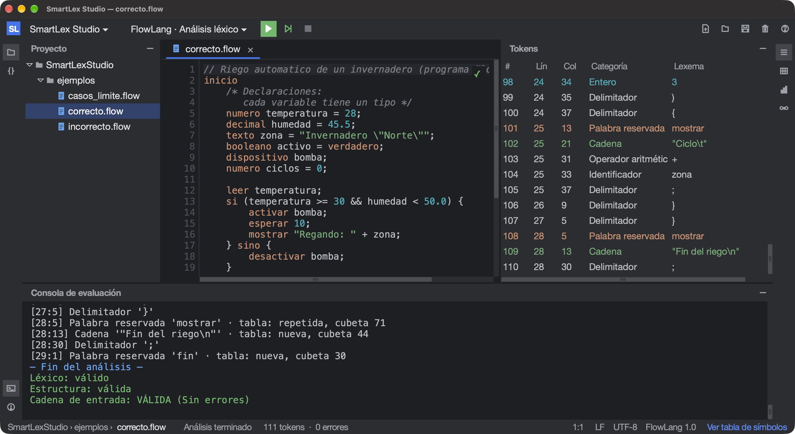
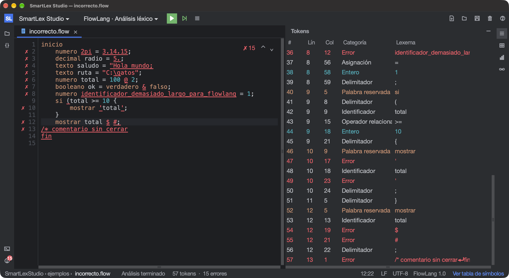
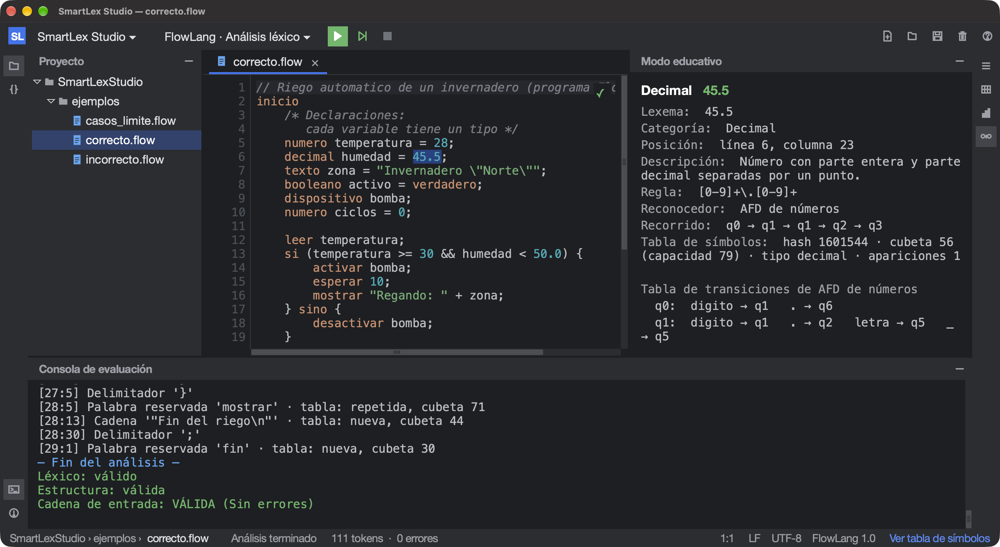

# 04 · Manual de usuario — SmartLex Studio

SmartLex Studio analiza programas escritos en **FlowLang 1.0**, un lenguaje pequeño para describir automatizaciones (riego, luces, alarmas). Te muestra, token por token, cómo el analizador léxico reconoce el texto, qué errores encuentra y cómo se llena la tabla de símbolos.



## 1. Requisitos

- **Python 3.10 o superior** (solo biblioteca estándar; no hay que instalar paquetes con `pip`).
- **tkinter** (Tk) para la interfaz gráfica. El modo consola (`--consola`) no lo necesita.

Comprueba que tienes Tk:

```
python3 -c "import tkinter; print(tkinter.TkVersion)"
```

Si imprime un número (por ejemplo `8.6` o `9.0`), todo está listo. Si dice `No module named '_tkinter'`, instala Tk:

| Sistema | Cómo instalar Tk |
|---|---|
| macOS (Homebrew) | `brew install python-tk` (o `python-tk@3.14`, según tu versión de Python) |
| Windows | Reinstala Python desde python.org y deja marcada la opción *tcl/tk and IDLE* |
| Debian / Ubuntu | `sudo apt install python3-tk` |
| Fedora | `sudo dnf install python3-tkinter` |

En macOS, el `python3` del sistema puede no traer Tk; usa el de Homebrew, por ejemplo `/opt/homebrew/bin/python3.14`.

## 2. Cómo ejecutar

Desde la carpeta `SmartLexStudio/`:

```
python3 main.py                                  # interfaz gráfica
python3 main.py --consola ejemplos/correcto.flow  # modo texto, sin ventana
python3 main.py --consola                         # pide la ruta del archivo
```

Si Tk no está instalado, `python3 main.py` te lo dice y te sugiere el modo consola.

## 3. Recorrido de la interfaz

La ventana sigue el estilo de PyCharm (tema oscuro). Todas las zonas se redimensionan arrastrando los bordes.

1. **Barra superior**: el logo *SL*, dos menús desplegables y los botones de acción. **«SmartLex Studio ▾»** abre el menú de archivo (Nuevo archivo, Abrir, Guardar, Limpiar, Ayuda, Salir); **«FlowLang · Análisis léxico ▾»** abre el de ejecución (Analizar, Paso a paso, Detener). A continuación van **▶ Analizar** (verde), **Paso a paso** y **■ Detener** (rojo), y a la derecha, en gris, los iconos **Nuevo archivo** (documento con «+»), Abrir, Guardar, Limpiar y Ayuda. Los que no se pueden usar en el estado actual aparecen apagados, y al detener el ratón sobre un icono aparece su nombre y atajo.
2. **Franjas de iconos** (izquierda y derecha): cada icono es una *tool window*. Izquierda arriba: **Proyecto** y **Lenguaje FlowLang**; izquierda abajo: **Consola de evaluación** y **Problemas** (con el número de errores). Derecha: **Tokens**, **Tabla de símbolos** (apagada hasta terminar el análisis), **Estadísticas** y **Modo educativo**. Un clic en el icono de la vista que ya se ve **oculta** esa zona; otro clic la vuelve a mostrar. El botón `—` de cada cabecera también la oculta. El icono de la vista visible queda resaltado.
3. **Proyecto** (izquierda): árbol `SmartLexStudio › ejemplos › *.flow` con el archivo abierto seleccionado; doble clic en un ejemplo lo carga. **Lenguaje FlowLang** muestra el árbol de palabras reservadas, operadores, delimitadores, escapes y límites; al elegir un elemento, su descripción aparece debajo.
4. **Editor** (centro): una pestaña con el nombre del archivo (`sin título` si no hay) y una `×` que equivale a *Limpiar*; números de línea grises, colores por categoría de token (comentarios en cursiva) y línea del cursor resaltada. Las líneas con error léxico llevan una `✗` roja en el margen y el texto erróneo va subrayado en rojo. Arriba a la derecha del editor, el **widget de inspección** muestra `✗ N` con las flechas `⌃` `⌄` (o `✓` si no hubo errores): las flechas, o `Shift+F2` y `F2`, saltan al error anterior o siguiente.
5. **Herramientas de la derecha**: Tokens, Tabla de símbolos, Estadísticas y Modo educativo, una a la vez (sección 5).
6. **Herramientas de abajo**: **Consola de evaluación** (una línea por token; en rojo las que traen errores; al final los veredictos) y **Problemas** (tabla de errores a todo el ancho con su detalle).
7. **Barra de estado** (gris): migas de pan `SmartLexStudio › ejemplos › correcto.flow`, estado y contadores de tokens y errores, y a la derecha `Lín:Col`, `LF`, `UTF-8`, `FlowLang 1.0` y el enlace **Ver tabla de símbolos** (activo solo al terminar el análisis).


Con las zonas izquierda e inferior ocultas el editor gana espacio:



## 4. Flujo típico

1. **Abrir** un archivo `.flow` o `.txt` (`Ctrl+O`). Al iniciar, la aplicación abre sola el selector «Seleccione el archivo con las cadenas de entrada»; si lo cancelas puedes escribir directamente en el editor o usar los ejemplos.
2. **Analizar** (`F5`): la evaluación es **progresiva**; verás cómo se llenan las herramientas Tokens y Problemas mientras avanza (la consola se abre sola si estaba oculta). Mientras analiza (incluso en pausa), el editor está en solo lectura. *Detener* (`Esc`) la pausa y *Analizar* la continúa.
   - Alternativa **Paso a paso** (`F10`): cada pulsación procesa exactamente un token y abre el Modo educativo con su explicación.
3. **Revisar los errores**: el primer error abre la herramienta *Problemas* (y suma al contador de su icono). Haz clic en una fila para ver el detalle completo y doble clic para saltar a esa posición del editor.
4. **Ver la tabla de símbolos**: al terminar, un diálogo pregunta «¿Desea ver la tabla de símbolos?». Responde *Sí* (se abre la *Tabla de símbolos*) o usa luego el enlace de la barra de estado o el icono de la franja derecha.
5. Si editas el texto después de analizar, el resultado queda marcado como desactualizado; vuelve a analizar.

**Nuevo archivo** (`Ctrl+N`, `Cmd+N` en macOS; también en el menú «SmartLex Studio ▾»): si hay cambios sin guardar pregunta si guardarlos (*Sí* guarda, *No* descarta, *Cancelar* aborta); después pide el nombre del archivo (`.flow` por defecto; carpeta del archivo actual o `ejemplos/`) y lo crea con una plantilla mínima válida (`inicio` … `fin`), con el cursor en la línea 2. Si cancelas el diálogo no pasa nada; un error de archivo (extensión no permitida, sin permiso) aparece en *Problemas*.

*Limpiar* deja la aplicación sin archivo y sin resultados. *Guardar* (`Ctrl+S`) escribe el contenido del editor en UTF-8.

### Atajos de teclado

| Atajo | Acción |
|---|---|
| `Ctrl+N` (`Cmd+N` en macOS) | Nuevo archivo |
| `Ctrl+O` (`Cmd+O` en macOS) | Abrir archivo |
| `Ctrl+S` (`Cmd+S` en macOS) | Guardar |
| `F5` | Analizar / continuar |
| `F10` | Paso a paso |
| `Esc` | Detener |
| `F1` | Ayuda |
| `F2` / `Shift+F2` | Siguiente / anterior error en el editor |

## 5. Las herramientas de la derecha y de abajo

### Tokens
Una fila por token reconocido, coloreada según su categoría. Columnas: `#` (orden), `Lín`, `Col` (posición desde 1), `Categoría` y `Lexema`. Al hacer clic en una fila, el token se resalta en el editor y el Modo educativo lo explica. Los comentarios y los fragmentos erróneos también aparecen (categorías *Comentario* y *Error*).

### Tabla de símbolos
Se habilita **al terminar** el análisis. Es una tabla hash con encadenamiento: las filas se ordenan por cubeta y las entradas que comparten cubeta (colisión) tienen un fondo distinto. Encima, un resumen:

- **Capacidad**: número de cubetas (empieza en 17 y crece cuando el factor de carga supera 0,75).
- **Entradas** y **Factor de carga** (`entradas / capacidad`).
- **Colisiones al insertar**: veces que un lexema nuevo cayó en una cubeta ya ocupada (contador histórico).
- **En la tabla actual**: colisiones que se ven ahora (`entradas − cubetas ocupadas`); suelen ser menos porque al redimensionar muchas se separan.
- **Cadena más larga** y **Redimensionados**.

Columnas: `Cubeta`, `Hash`, `Lexema`, `Categoría`, `Tipo` (tipo de dato: el de la declaración, o el del literal), `Valor` (para literales y booleanos), `Decl.` (línea de la declaración) y `Apariciones` (lista de `(línea, columna)`). Cada lexema aparece una sola vez; si se repite, solo se suman apariciones.

### Problemas (zona inferior)
Tabla de errores a todo el ancho (la herramienta se abre sola con el primer error). Columnas: `Código`, `Tipo`, `Lín:Col`, `Mensaje` y `Sugerencia`. Bajo la tabla se muestra el detalle completo del error seleccionado. Los errores de archivo (`ARC-…`) no tienen posición. Como máximo se muestra un error de archivo a la vez.

### Estadísticas
Aparece al terminar: veredicto léxico, estructural y global; tokens por categoría con barras proporcionales; número de líneas, caracteres y tokens; errores por tipo.

### Modo educativo
Explica un token: lexema, categoría y posición; descripción; la **expresión regular** de su categoría; el **reconocedor** (qué autómata lo leyó) y el **recorrido de estados** (por ejemplo `q0 → q1 → q1 → q2 → q3` para `45.5`); para errores, el código y la sugerencia; si el lexema está en la tabla, su hash, cubeta, tipo y número de apariciones. Al final muestra la tabla de transiciones del autómata usado.



## 6. Códigos de error

Un programa es **válido** cuando no tiene errores léxicos (`LEX`) ni estructurales (`SIN`).

| Código | Título | Significado y qué hacer |
|---|---|---|
| `LEX-001` | Carácter no reconocido | Un símbolo que no pertenece a FlowLang (`@`, `#`, `&` suelto…). Elimínalo o cámbialo; el mensaje a veces sugiere el símbolo correcto. |
| `LEX-002` | Cadena sin cerrar | Falta la comilla de cierre en la misma línea. |
| `LEX-003` | Número mal formado | Por ejemplo `3.`, `.5` o `3.4.5`. Un decimal lleva dígitos a ambos lados de un único punto. |
| `LEX-004` | Identificador inválido | Empieza con un dígito (`2pi`, `12abc`). Comienza con una letra o `_`. |
| `LEX-005` | Identificador demasiado largo | Más de 32 caracteres. |
| `LEX-006` | Secuencia de escape inválida | Dentro de una cadena solo valen `\n`, `\t`, `\"` y `\\`. |
| `LEX-007` | Comentario de bloque sin cerrar | Falta el `*/`. |
| `SIN-001` | Programa vacío | No hay ningún token significativo. |
| `SIN-002` | Falta `inicio` | El programa debe comenzar con `inicio`. |
| `SIN-003` | Falta `fin` | El programa debe terminar con `fin`. |
| `SIN-004` | Cierre sin apertura | Un `)` o `}` sin su `(` o `{`. |
| `SIN-005` | Apertura sin cierre | Un `(` o `{` que nunca se cierra. |
| `SIN-006` | Cierre no correspondiente | Paréntesis y llaves mal anidados, por ejemplo `( }`. |
| `ARC-001` | Archivo inexistente | Revisa la ruta y el nombre. |
| `ARC-002` | Extensión no soportada | Usa `.flow` o `.txt`. |
| `ARC-003` | Archivo vacío | El archivo no tiene texto (o solo espacios). |
| `ARC-004` | Codificación inválida | Guárdalo como UTF-8. |
| `ARC-005` | Error de lectura o escritura | Permisos, o la ruta es una carpeta. |
| `ARC-006` | Archivo demasiado grande | Supera 1 MB. |

El analizador **no se detiene en el primer error**: descarta el fragmento inválido y sigue, para que veas todos los errores en una sola pasada. Las comprobaciones `SIN` son mínimas (inicio/fin y balance de paréntesis y llaves); no verifican la gramática completa ni tipos.

## 7. Un programa FlowLang mínimo

```flow
// Riego automatico
inicio
    numero temperatura = 28;
    decimal humedad = 45.5;
    dispositivo bomba;
    si (temperatura >= 30 && humedad < 50.0) {
        activar bomba;
        mostrar "Regando\n";
    } sino {
        desactivar bomba;
    }
fin
```

Reglas básicas:

- El programa empieza con `inicio` y termina con `fin`.
- Distingue mayúsculas de minúsculas: `inicio` es reservada, `Inicio` es un identificador.
- Tipos de dato: `numero`, `decimal`, `texto`, `booleano`, `dispositivo`; valores `verdadero` y `falso`.
- Cadenas con comillas dobles en una sola línea. Comentarios: `// hasta el final de la línea` y `/* en bloque */`.
- Los espacios y saltos de línea solo separan lexemas.
- Los nombres usan letras ASCII, dígitos y `_` (no pueden empezar con dígito).

En `ejemplos/` tienes tres programas: `correcto.flow` (válido), `incorrecto.flow` (con errores léxicos y estructurales) y `casos_limite.flow` (válido, con casos extremos).

## 8. Solución de problemas

| Problema | Qué hacer |
|---|---|
| `No module named '_tkinter'` o la ventana no abre | Instala Tk (sección 1) o usa `python3 main.py --consola archivo.flow`. |
| Un mensaje de error de archivo al abrir | Mira su código en la sección 6; el contenido del editor no se modifica. |
| El botón *Analizar* sin archivo vuelve a pedir uno | Es lo esperado: abre un archivo o escribe en el editor. |
| El icono *Tabla de símbolos* aparece apagado | Se activa al terminar el análisis; pulsa *Analizar* y espera. |
| No puedo escribir en el editor | Está en solo lectura mientras dura el análisis, también cuando está detenido con *Detener* (`Esc`). Continúa con *Analizar* (`F5`) hasta el final, o pulsa *Limpiar*. |
| Los colores se desplazan tras un emoji (Tcl/Tk 8.6) | Limitación visual conocida; los tokens y posiciones del análisis son correctos. |
| Un archivo grande se anima lentamente | El análisis es correcto; la animación depende del dibujo de Tk. Usa el modo consola si solo necesitas el resultado. |
