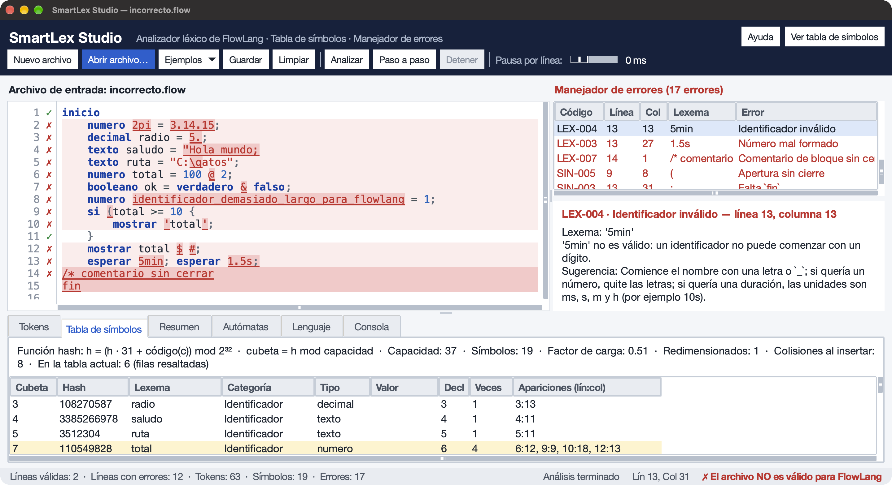
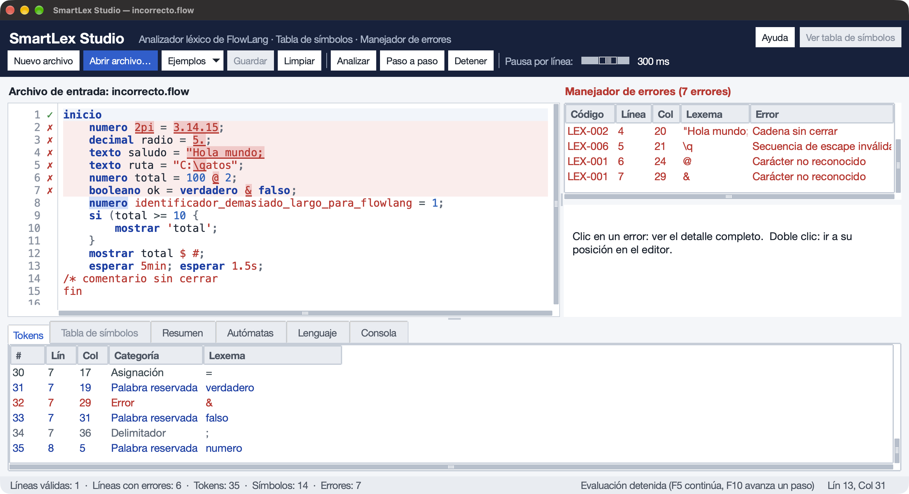
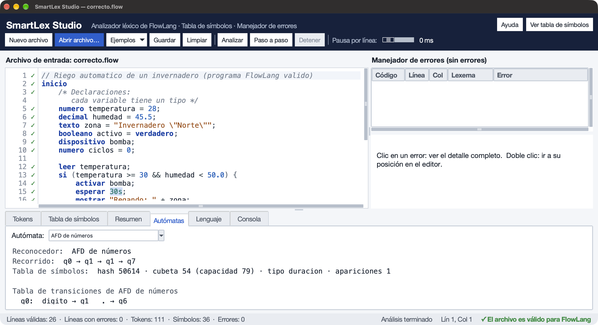
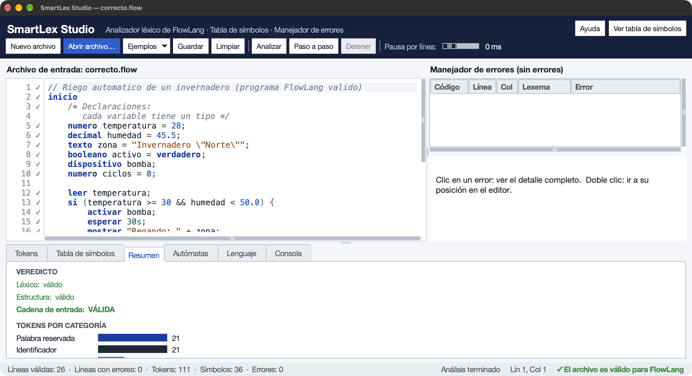

# 04 · Manual de usuario — SmartLex Studio

SmartLex Studio analiza programas escritos en **FlowLang 1.0**, un lenguaje pequeño para describir automatizaciones (riego, luces, alarmas). Te muestra, token por token, cómo el analizador léxico reconoce el texto, qué errores encuentra y cómo se llena la tabla de símbolos.


## 1. Requisitos

- **Python 3.10 o superior** (solo biblioteca estándar; no hay que instalar paquetes con `pip`).
- **tkinter** (Tk) para la interfaz gráfica. El modo consola (`--consola`) no lo necesita.

Comprueba que tienes Tk:

```
python3 -c "import tkinter; print(tkinter.TkVersion)"
```

Si imprime un número (por ejemplo `8.6` o `9.0`), todo está listo. Si dice `No module named '_tkinter'`, instala Tk:

| Sistema | Cómo instalar Tk |
|---|---|
| macOS (Homebrew) | `brew install python-tk` (o `python-tk@3.14`, según tu versión de Python) |
| Windows | Reinstala Python desde python.org y deja marcada la opción *tcl/tk and IDLE* |
| Debian / Ubuntu | `sudo apt install python3-tk` |
| Fedora | `sudo dnf install python3-tkinter` |

En macOS, el `python3` del sistema puede no traer Tk; usa el de Homebrew, por ejemplo `/opt/homebrew/bin/python3.14`.

## 2. Cómo ejecutar

Desde la carpeta `SmartLexStudio/`:

```
python3 main.py                                  # interfaz gráfica
python3 main.py --consola ejemplos/correcto.flow  # modo texto, sin ventana
python3 main.py --consola                         # pide la ruta del archivo
```

Si Tk no está instalado, `python3 main.py` te lo dice y te sugiere el modo consola.

## 3. Recorrido de la interfaz

La ventana es clara, de estilo académico: cabecera azul marino, editor a la izquierda, **Manejador de errores** a la derecha y pestañas de resultados abajo. Los divisores entre zonas se arrastran; ninguna zona se oculta.

1. **Cabecera, fila 1**: «SmartLex Studio», el subtítulo «Analizador léxico de FlowLang · Tabla de símbolos · Manejador de errores» y, a la derecha, **Ayuda** (`F1`) y **Ver tabla de símbolos** (apagado hasta terminar el análisis).
2. **Cabecera, fila 2**: **Nuevo archivo** (`Ctrl+N`, `Cmd+N` en macOS), **Abrir archivo…** (`Ctrl+O`; es el botón azul), el menú **Ejemplos** (lista los archivos de `ejemplos/` cada vez que se abre; elegir uno lo carga), **Guardar** (`Ctrl+S`), **Limpiar**, y después **Analizar** (`F5`), **Paso a paso** (`F10`) y **Detener** (`Esc`). Los que no se pueden usar en el estado actual aparecen apagados. Al final, el deslizador **Pausa por línea** (0 a 500 ms, 120 por defecto): se puede mover durante el análisis.
3. **Editor** (izquierda): título «Archivo de entrada: *nombre*» (`(sin archivo)` si no hay). El margen muestra el número de línea y una marca: `✓` verde si la línea ya se evaluó y no tiene errores, `✗` rojo si tiene algún error (léxico o estructural); las líneas en blanco o aún no evaluadas no llevan marca. La línea con error se pinta en rosado y el texto erróneo va subrayado en rojo sobre fondo rojizo. Las palabras reservadas van en azul y negrita, los comentarios en gris cursiva. `F2` y `Shift+F2` saltan al siguiente y al anterior error.
4. **Manejador de errores** (derecha, siempre visible): el título dice «(17 errores)», «(1 error)» o «(sin errores)». La tabla tiene las columnas `Código`, `Línea`, `Col`, `Lexema` y `Error`; debajo, el cuadro de detalle con el código, la posición, el lexema, el mensaje y la sugerencia del error elegido. Los errores de archivo (`ARC-…`) muestran «—» en Línea y Col.
5. **Pestañas de resultados** (abajo, a todo el ancho): **Tokens**, **Tabla de símbolos**, **Resumen**, **Autómatas**, **Lenguaje** (referencia de FlowLang: palabras reservadas, operadores, delimitadores, escapes y límites) y **Consola** (una línea por token; al final los veredictos) (sección 5).
6. **Barra de estado**: a la izquierda los contadores `Líneas válidas · Líneas con errores · Tokens · Símbolos · Errores`; a la derecha el estado, `Lín N, Col M` y el **veredicto** («✓ El archivo es válido para FlowLang» en verde o «✗ El archivo NO es válido para FlowLang» en rojo; se borra al editar el texto).



Con el análisis detenido a mitad se ve el avance por línea: las líneas de arriba con `✓`/`✗`, las de abajo sin marca y los errores ya listados.



## 4. Flujo típico

1. **Abrir** un archivo `.flow` o `.txt` (`Ctrl+O`). Al iniciar, la aplicación abre sola el selector «Seleccione el archivo con las cadenas de entrada»; si lo cancelas puedes escribir directamente en el editor o usar los ejemplos.
2. **Analizar** (`F5`): la evaluación es **progresiva** y avanza **línea por línea**: en cada latido se completa una línea, que recibe su `✓` o `✗`, y se espera la *Pausa por línea*. Con 0 ms no hay pausa. En archivos largos la pausa se acorta para que la animación completa no pase de unos 10 s (más de 83 líneas con 120 ms). Mientras analiza (incluso en pausa), el editor está en solo lectura. *Detener* (`Esc`) la pausa y *Analizar* la continúa.
   - Alternativa **Paso a paso** (`F10`): cada pulsación procesa exactamente un token y abre la pestaña Autómatas con su explicación.
3. **Revisar los errores**: cada error aparece en el Manejador de errores en el mismo paso en que se detecta. Haz clic en una fila para ver el detalle y doble clic para saltar a esa posición del editor.
4. **Ver la tabla de símbolos**: al terminar, un diálogo pregunta «¿Desea ver la tabla de símbolos?». Responde *Sí* (se abre la pestaña *Tabla de símbolos*) o usa luego el botón **Ver tabla de símbolos** de la cabecera.
5. Si editas el texto después de analizar, el resultado queda marcado como desactualizado; vuelve a analizar.

**Nuevo archivo** (`Ctrl+N`, `Cmd+N` en macOS): si hay cambios sin guardar pregunta si guardarlos (*Sí* guarda, *No* descarta, *Cancelar* aborta); después pide el nombre del archivo (`.flow` por defecto; carpeta del archivo actual o `ejemplos/`) y lo crea con una plantilla mínima válida (`inicio` … `fin`), con el cursor en la línea 2. Si cancelas el diálogo no pasa nada; un error de archivo (extensión no permitida, sin permiso) aparece en el Manejador de errores.

*Limpiar* deja la aplicación sin archivo y sin resultados. **Cambios sin guardar**: *Nuevo archivo*, *Abrir archivo*, el menú *Ejemplos*, *Limpiar* y el cierre de la ventana preguntan «Hay cambios sin guardar. ¿Guardarlos antes de continuar?» (*Sí* guarda, *No* descarta, *Cancelar* aborta). `Ctrl+O` también funciona con el cursor dentro del editor. *Guardar* (`Ctrl+S`) escribe el contenido del editor en UTF-8.

### Atajos de teclado

| Atajo | Acción |
|---|---|
| `Ctrl+N` (`Cmd+N` en macOS) | Nuevo archivo |
| `Ctrl+O` (`Cmd+O` en macOS) | Abrir archivo |
| `Ctrl+S` (`Cmd+S` en macOS) | Guardar |
| `F5` | Analizar / continuar |
| `F10` | Paso a paso |
| `Esc` | Detener |
| `F1` | Ayuda |
| `F2` / `Shift+F2` | Siguiente / anterior error en el editor |

## 5. Las pestañas de resultados y el Manejador de errores

### Tokens
Una fila por token reconocido, coloreada según su categoría. Columnas: `#` (orden), `Lín`, `Col` (posición desde 1), `Categoría` y `Lexema`. Al hacer clic en una fila, el token se resalta en el editor y la pestaña Autómatas lo explica. Los comentarios y los fragmentos erróneos también aparecen (categorías *Comentario* y *Error*).

Las categorías de número son tres: *Entero* (`28`), *Decimal* (`45.5`) y *Duración* (`30s`), un entero pegado a su unidad de tiempo (`ms`, `s`, `m` o `h`) que FlowLang usa en instrucciones como `esperar 10s;`. Cada categoría tiene su color; la Duración se ve en verde azulado. En la tabla de símbolos, una duración guarda su valor en milisegundos (`10s` vale 10000, `5m` vale 300000), de modo que `60s` y `1m` son dos entradas con el mismo valor. Con un espacio de por medio (`10 s`) ya no es una duración: son un entero y un identificador.

### Tabla de símbolos
Se habilita **al terminar** el análisis. Es una tabla hash con encadenamiento: las filas se ordenan por cubeta y las entradas que comparten cubeta (colisión) tienen un fondo distinto. Encima, una línea con la **función hash real** (`h = (h · 31 + código(c)) mod 2³²`, `cubeta = h mod capacidad`) y el resumen:

- **Capacidad**: número de cubetas (empieza en 17 y crece cuando el factor de carga supera 0,75).
- **Símbolos** y **Factor de carga** (`entradas / capacidad`).
- **Colisiones al insertar**: veces que un lexema nuevo cayó en una cubeta ya ocupada (contador histórico).
- **En la tabla actual**: colisiones que se ven ahora (`entradas − cubetas ocupadas`); suelen ser menos porque al redimensionar muchas se separan.
- **Cadena más larga** y **Redimensionados**.

Columnas: `Cubeta`, `Hash`, `Lexema`, `Categoría`, `Tipo` (tipo de dato: el de la declaración, o el del literal), `Valor` (para literales y booleanos), `Decl.` (línea de la declaración) y `Apariciones` (lista de `(línea, columna)`). Cada lexema aparece una sola vez; si se repite, solo se suman apariciones.

### Resumen
Aparece al terminar: veredicto léxico, estructural y global; tokens por categoría con barras proporcionales; número de líneas, caracteres y tokens; errores por tipo.

### Autómatas
Arriba, el selector **Autómata** con los cuatro AFD de FlowLang: al elegir uno se ve su tabla de transiciones y sus estados finales. Al hacer clic en un token (o con *Paso a paso*) explica ese token: lexema, categoría y posición; descripción; la **expresión regular** de su categoría; el **reconocedor** (qué autómata lo leyó, que queda elegido en el selector) y el **recorrido de estados** (por ejemplo `q0 → q1 → q1 → q2 → q3` para `45.5` o `q0 → q1 → q1 → q7` para `30s`); para errores, el código y la sugerencia; si el lexema está en la tabla, su hash, cubeta, tipo y número de apariciones. Al final muestra la tabla de transiciones del autómata usado.





### Lenguaje y Consola
**Lenguaje** es el árbol de referencia de FlowLang (elige un elemento para ver su descripción). **Consola** registra la evaluación: una línea por token (en rojo las que traen errores), la instalación de cada símbolo en la tabla hash y los veredictos finales.

## 6. Códigos de error

Un programa es **válido** cuando no tiene errores léxicos (`LEX`) ni estructurales (`SIN`).

| Código | Título | Significado y qué hacer |
|---|---|---|
| `LEX-001` | Carácter no reconocido | Un símbolo que no pertenece a FlowLang (`@`, `#`, `&` suelto…). Elimínalo o cámbialo; el mensaje a veces sugiere el símbolo correcto. |
| `LEX-002` | Cadena sin cerrar | Falta la comilla de cierre en la misma línea. |
| `LEX-003` | Número mal formado | Por ejemplo `3.`, `.5`, `3.4.5` o `1.5s`. Un decimal lleva dígitos a ambos lados de un único punto, y las duraciones son enteras: se escribe `1500ms`, no `1.5s`. |
| `LEX-004` | Identificador inválido | Empieza con un dígito (`2pi`, `12abc`) o es una duración con unidad desconocida (`5min`, `10seg`, `10S`). Comienza con una letra o `_`; si querías una duración, las unidades son `ms`, `s`, `m` y `h`, en minúscula y pegadas al número. |
| `LEX-005` | Identificador demasiado largo | Más de 32 caracteres. |
| `LEX-006` | Secuencia de escape inválida | Dentro de una cadena solo valen `\n`, `\t`, `\"` y `\\`. |
| `LEX-007` | Comentario de bloque sin cerrar | Falta el `*/`. |
| `SIN-001` | Programa vacío | No hay ningún token significativo. |
| `SIN-002` | Falta `inicio` | El programa debe comenzar con `inicio`. |
| `SIN-003` | Falta `fin` | El programa debe terminar con `fin`. |
| `SIN-004` | Cierre sin apertura | Un `)` o `}` sin su `(` o `{`. |
| `SIN-005` | Apertura sin cierre | Un `(` o `{` que nunca se cierra. |
| `SIN-006` | Cierre no correspondiente | Paréntesis y llaves mal anidados, por ejemplo `( }`. |
| `ARC-001` | Archivo inexistente | Revisa la ruta y el nombre. |
| `ARC-002` | Extensión no soportada | Usa `.flow` o `.txt`. |
| `ARC-003` | Archivo vacío | El archivo no tiene texto (o solo espacios). |
| `ARC-004` | Codificación inválida | Guárdalo como UTF-8. |
| `ARC-005` | Error de lectura o escritura | Permisos, o la ruta es una carpeta. |
| `ARC-006` | Archivo demasiado grande | Supera 1 MB. |

El analizador **no se detiene en el primer error**: descarta el fragmento inválido y sigue, para que veas todos los errores en una sola pasada. Las comprobaciones `SIN` son mínimas (inicio/fin y balance de paréntesis y llaves); no verifican la gramática completa ni tipos.

## 7. Un programa FlowLang mínimo

```flow
// Riego automatico
inicio
    numero temperatura = 28;
    decimal humedad = 45.5;
    dispositivo bomba;
    si (temperatura >= 30 && humedad < 50.0) {
        activar bomba;
        mostrar "Regando\n";
    } sino {
        desactivar bomba;
    }
fin
```

Reglas básicas:

- El programa empieza con `inicio` y termina con `fin`.
- Distingue mayúsculas de minúsculas: `inicio` es reservada, `Inicio` es un identificador.
- Tipos de dato: `numero`, `decimal`, `texto`, `booleano`, `dispositivo`; valores `verdadero` y `falso`.
- Cadenas con comillas dobles en una sola línea. Comentarios: `// hasta el final de la línea` y `/* en bloque */`.
- Los espacios y saltos de línea solo separan lexemas.
- Los nombres usan letras ASCII, dígitos y `_` (no pueden empezar con dígito).

En `ejemplos/` tienes tres programas: `correcto.flow` (válido), `incorrecto.flow` (con errores léxicos y estructurales) y `casos_limite.flow` (válido, con casos extremos).

## 8. Solución de problemas

| Problema | Qué hacer |
|---|---|
| `No module named '_tkinter'` o la ventana no abre | Instala Tk (sección 1) o usa `python3 main.py --consola archivo.flow`. |
| Un mensaje de error de archivo al abrir | Mira su código en la sección 6; el contenido del editor no se modifica. |
| El botón *Analizar* sin archivo vuelve a pedir uno | Es lo esperado: abre un archivo o escribe en el editor. |
| El icono *Tabla de símbolos* aparece apagado | Se activa al terminar el análisis; pulsa *Analizar* y espera. |
| No puedo escribir en el editor | Está en solo lectura mientras dura el análisis, también cuando está detenido con *Detener* (`Esc`). Continúa con *Analizar* (`F5`) hasta el final, o pulsa *Limpiar*. |
| Los colores se desplazan tras un emoji (Tcl/Tk 8.6) | Limitación visual conocida; los tokens y posiciones del análisis son correctos. |
| Un archivo grande se anima lentamente | El análisis es correcto; la animación depende del dibujo de Tk. Usa el modo consola si solo necesitas el resultado. |
